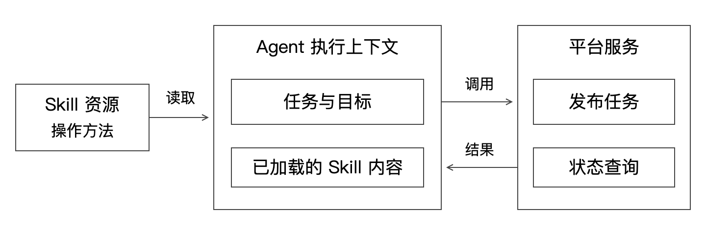

# Agent 工程：Skill、工具执行与状态恢复

本文从一次“发布测试版本并验证结果”的任务出发，解释 Agent 怎样使用操作知识、调用工具、保存状态，以及在响应丢失后继续执行。示例为通用教学设计，不对应任何公司的内部系统。

2026-10-22 补充了接入方式、发布验证的状态推演和失败诊断。建议先读第 1–8 节建立执行模型，再用第 14–16 节把机制串回一项完整任务。

读完应能解释三个问题：Skill 为什么不是一个接口；工具返回成功为什么不等于任务完成；重启后为什么不能直接把所有步骤再跑一次。

将这些机制应用到业务写操作，可继续读[商家活动创建与预算一致性](Agent工程_03_商家活动创建与预算一致性.md)。

## 1. 先把一次任务拆开

用户提出：“把商品检索服务的候选版本 r2 发布到测试环境，验证缺货商品过滤问题。”

这句话至少包含：服务是商品检索、目标版本是 r2、环境是测试、目的在于验证一个业务问题。Agent 还需要知道怎样发布、去哪取结果、运行哪批用例。模型可以分析这些信息，但真实部署由外部程序执行。



图中“上下文”表示 Agent 本次执行可读取的信息。持久化操作事实由外部服务或状态库保存，不依靠这块上下文本身提供事务保证。

### 四个对象分别是什么

| 对象 | 本例内容 | 它能保证什么 |
|---|---|---|
| 当次任务 | 发布 r2，验证缺货过滤 | 表达目标、范围与输入 |
| Skill | 平台发布与验证的操作方法 | 提供可复用指导；遵循程度仍需验证 |
| 工具 | 提交发布、查询状态、发起评测 | 执行具体程序逻辑 |
| 平台状态 | 发布任务、实例、评测结果 | 提供可查询的执行事实，保证程度由实现决定 |

比如 Skill 写“发布完成以后再评测”，这是指导；底层返回 `SUBMITTED` 时，Agent 仍应继续查询。若工具只返回一句“成功”，它到底表示请求接收、进程启动还是服务可用，就会出现歧义。

## 2. Codex 的 Skill 怎样被使用

Skill 是一个可复用工作流包，包含 `SKILL.md`，可附带脚本、参考资料和资源。Codex 可以根据用户明确指定，或根据描述与任务匹配选择 Skill；先读取名称与描述，选择后再加载正文，必要时使用其他资源。这是按需加载知识的方式。[OpenAI 官方：Build skills](https://learn.chatgpt.com/docs/build-skills)

因此，Skill 设计包含两个不同问题：描述能否让它在合适任务中被选中；正文能否指导任务正确完成。正文很好，但触发描述模糊，可能根本没有被使用。描述很醒目，但步骤缺失，也会选对 Skill 却执行错误。

下面是教学用的内容结构；它没有注册真实工具，也没有配置任何平台连接：

```text
release-check/
  SKILL.md
  scripts/        可选：确定性操作或结果解析
  references/     可选：状态、错误和接口说明
```

最小指导可以包含：适用范围、输入、执行顺序、完成条件、失败处理和输出要求。具体工具名称、参数与状态语义由应用定义。

“先阅读某个文件”与“服务端强制检查某项约束”是两个层次。权限、资源归属、关键状态迁移和幂等，应该由对应执行能力落实，不能只写在自然语言里。

## 3. 为什么工具需要明确契约

一次工具契约应让调用方回答：我在操作什么；操作已发生到哪一步；结果未知时怎样继续。

发布请求的教学字段：

```json
{
  "application": "catalog-search",
  "artifact": "r2@sha256:example",
  "environment": "test",
  "operation_id": "op-release-204"
}
```

`artifact` 中的 digest 是占位示意。应用可以使用其他不可变制品标识，关键是一次任务始终绑定同一份发布内容。`operation_id` 用来标识同一次业务操作，不等于每次 HTTP 请求都变化的 request_id。

返回示例：

```json
{
  "operation_id": "op-release-204",
  "deployment_id": "dep-72",
  "status": "RUNNING",
  "stage": "READINESS",
  "artifact": "r2@sha256:example",
  "error": null
}
```

这个结果表示当前正在就绪检查，还不能据此宣布部署成功。`deployment_id` 用来查询发布任务；`operation_id` 用来识别调用方原先想做的那次操作。两者可以在某些系统中合并，但职责要清楚。

### 为什么还要结构化错误

“失败了，再试试”没有足够信息支撑后续决策。可以区分输入错误、权限不足、制品不存在、资源暂缺、业务执行失败与网络响应未知，并给出阶段和证据引用。

是否可重试要结合动作：读取暂时失败往往可以再查；部署请求超时则应先确认任务是否已经创建。错误码有助于分类，但不能让模型或客户端不加判断地重试所有错误。

## 4. 异步发布为什么是一个状态机

发布涉及准备制品、启动实例和就绪检查，通常长于一次普通 API 请求。提交后返回任务标识，再查状态，可以把客户端连接和后台执行解耦。

本例定义：`SUBMITTED → RUNNING → SUCCEEDED / FAILED / CANCELLED`。RUNNING 内用 stage 表示当前阶段。其他系统可以采用不同状态名。

| 当前观察 | 应做什么 | 为什么 |
|---|---|---|
| SUBMITTED / RUNNING | 按任务标识查询，遵守总等待期限 | 后台工作尚未完成 |
| SUCCEEDED | 核验目标版本与必要运行条件，再发起评测 | 发布完成只说明执行条件具备 |
| FAILED | 获取当前阶段的错误与证据 | 后续应排查失败，而非评测不存在的版本 |
| 客户端超时 | 查询已有操作，保持结果待确认 | 可能只是响应没到达 |

查询可以轮询，也可以消费事件；事件可能延迟或重复，最终仍应有可恢复的状态来源。轮询应限制间隔与总时长，不能高频无限查询。

Ready 是系统约定的服务条件，不只是进程存在。若必须加载业务包、建立下游连接或预热才能接受验证，检查标准应反映这些前置条件。

## 5. “完成”为什么要由证据判断

设 Agent 做完以下操作后回答“验证通过”：提交发布 → 收到任务 ID → 结束。

这里缺少两类证据：发布最终状态，以及业务验证结果。一个完整验收需要至少确认目标制品已就绪、评测实际访问了目标版本、用例结果满足约定规则。

这说明自然语言结论只是报告。真正的完成依据来自平台状态、版本观测和评测产物。工具描述和 Skill 都应让这些依据可取得。

两类任务结果要区分：Agent 正确部署并发现候选版本业务评测不通过，说明它有效完成了“验证”任务；若用户目标是“修复并通过验证”，则还未达到整个目标。成功标准应在任务开始时定义。

## 6. 至少有三类状态

| 状态 | 例子 | 保存目的 |
|---|---|---|
| 对话上下文 | 用户要求、必要观察、简短计划 | 支持当前理解与后续动作选择 |
| 编排进度 | 当前步骤、操作 ID、评测 ID、已确认输入 | 支持任务继续与结果关联 |
| 外部业务事实 | 部署已创建、实例已就绪、评测报告已生成 | 判断副作用是否发生、任务是否达到条件 |

完整聊天记录可以辅助恢复，但不能代替平台事实。如果聊天记录说“还没发布”，平台却已经有这个操作的成功结果，恢复时应以已核验的业务事实衔接进度。

保存编排状态也不需要保存模型内部隐藏推理。目标、约束、动作、结果引用和已作出的决定足以支撑很多恢复与追踪需求。

## 7. 最容易忽略的窗口：动作成功、响应丢失

逐步看时间线：

```text
t0  调用方保存操作意图与 op-release-204
t1  平台接收请求并创建部署 dep-72
t2  平台提交成功结果
t3  返回响应时连接中断
t4  调用方超时，尚未拿到 dep-72
```

若 t4 重新生成另一个操作标识并发布，可能创建第二份部署。问题不是模型记忆不好，而是本地状态与远端提交之间没有一个共同的原子事务。

可用的业务协议是：同一操作使用稳定 ID；平台按 ID 保存请求摘要和结果；重复请求返回同一结果；同一 ID 携带不同内容则拒绝。恢复时先按原 ID 查询，查到后补记本地进度。

如果平台不提供幂等或可靠查询，结果未知就需要继续核对或人工处理，不能凭客户端超时推导“远端一定没做”。

## 8. 幂等的底层约束是什么

假设操作记录与部署记录位于同一个事务域：

```text
BEGIN
  写入唯一操作键、请求摘要
  创建部署记录
  写入操作结果与部署 ID
COMMIT
```

并发请求通过唯一约束竞争同一操作。后来的调用应在合适的事务边界读取已提交结果，检查请求摘要，再返回；已有操作仍在执行时，则返回处理中状态。

只有在同一事务内写这两类记录，才可从这个例子推导相应原子性。若“创建部署”是外部云接口，事务提交不能涵盖它，需要外部接口自身支持幂等、预先分配稳定资源名或其他核对恢复方案。

幂等不等于所有代码只执行一次。允许重复请求，但同一操作的业务效果与结果保持一致。不同的业务操作应使用不同键；同一键永远被复用来表达不同发布内容，会把合法操作错误吞掉。

配套实验使用 SQLite 事务演示提交后丢响应的窗口。它不模拟分布式事务或真实多机故障。

## 9. checkpoint、租约和幂等解决不同问题

Checkpoint 保存“编排进行到哪里”；租约帮助多个执行节点协调“谁暂时负责”；幂等处理“同一外部动作被多次请求”。

即使使用租约，也可能出现旧节点暂停很久、租约过期后新节点接手、旧节点恢复继续写入。需要用版本条件或 fencing 等机制阻止过期执行影响共享状态，并依靠工具幂等应对重复副作用。

只在单进程内加锁无法处理另外一台节点和进程重启。只保存 checkpoint，也不能消除第 7 节的远端提交窗口。不要用一个组件名称回答所有恢复问题。

## 10. 上下文怎样管理才不丢关键事实

将应用、环境、制品、操作 ID、评测 ID 等关键字段保留为结构化事实。日志返回限制时间范围和大小，优先保留与当前阶段相关的错误，并附原始证据位置。

长历史可以摘要，但摘要中“已经差不多发布好了”不能替代明确状态。若摘要丢失了目标版本或把两次评测混在一起，Agent 可能做出看似合理却无法验证的判断。

并行执行适合互不依赖的只读查询；发布完成前就发起依赖它的业务评测，会制造无意义失败。工具返回大不等于信息充分，应让每一步输出恰好支持下一项判断。

## 11. Skill 与 RAG、Harness 的关系

Skill 适合沉淀常用任务的操作方法；RAG 适合在大量可变化资料中检索当前需要的证据。两者可以结合：Skill 指导“按错误码查匹配版本的说明”，检索工具返回相应资料。

查一次部署状态属于工具读取业务事实，不自动等于 RAG。知识检索找到相关条款，也不能替代平台实时状态；“文档说正常情况下会启动”不能证明这次已经启动。

Harness 在不同项目中定义范围不同，可以理解为围绕模型组织执行的工具、状态、上下文、反馈和限制。要检查具体实现承担了什么职责，而不是把它当成额外一层必须自研的服务。

关于证据引用和检索链路，继续读[Agent 与 RAG](Agent与RAG_执行恢复知识检索和评估.md)。

## 12. 用本地实验检查理解

运行：

```bash
python3 examples/agent_delivery_eval_demo.py
```

实验先创建部署并在提交后人为抛出超时，再用相同操作 ID 重试。预期部署记录仍只有一条；同 ID 改请求内容会报冲突。随后运行评测实验，见[badcase 评测与持续迭代](Agent工程_02_badcase评测与持续迭代.md)。

运行不需要 API key、模型或外部平台。它验证状态与判定逻辑，不证明 Agent 在真实环境下的工具选择能力。

## 13. 三个自检问题

1. Skill 写了“发布后验证”，平台就保证验证执行了吗？没有，还要检查实际工具动作与结果。
2. 已保存完整聊天，是否可以安全重跑所有工具？不可以，先查外部操作事实。
3. 平台确认已部署，但评测未运行，任务完成了吗？取决于事先约定的目标；对于“发布并验证”，尚未完成。

## 14. Skill、工具调用、CLI 与 MCP 怎样放在同一张关系图里

假设同一个发布能力有三个入口：一个命令行程序、一个 HTTP 接口、一个经 MCP 暴露的工具。它们都可以最终调用同一个平台服务，但接入方式不同。

Skill 说明什么时候发布、需要哪些输入、怎样检查结果。工具调用是 Agent 发起某个可执行动作的过程。CLI 是可执行程序的交互方式；API 是程序接口；MCP 是连接工具和上下文的一种标准化协议。这些概念位于不同层次，不是互相替代的四种产品。

例如 Skill 要求“先查目标版本，再发布”。如果通过终端执行 CLI，调用方需要构造命令、处理退出码和结构化输出；如果使用已接入的工具，按工具参数调用；两者都要根据返回结果决定下一步。

| 需要解决的问题 | 合适的着力点 |
|---|---|
| Agent 不知道平台的操作顺序 | Skill 中的工作方法与示例 |
| 调用参数不完整或格式不清楚 | 工具契约、参数校验与错误信息 |
| 返回“成功”但含义不明确 | 输出状态和完成语义 |
| 同一接口要给不同客户端使用 | 底层服务与接入适配 |
| 发布造成重复副作用 | 服务端操作键、状态与恢复协议 |

因此，已有稳定 CLI 可以成为初始接入路径；需要跨客户端复用时可以评估标准化工具接入。选择应依据现有基础设施、返回信息质量和维护成本。换一种接入方式不会自动补齐发布幂等与业务验证。

### “更适合 Agent 使用”的接口具体改变什么

页面往往可以依赖人去查看进度、结合经验解释错误。面向 Agent 的输出应直接提供后续判断需要的信息，例如稳定任务 ID、阶段、明确状态、实际版本和证据位置。

这不意味着所有接口都要重写，也不意味着“给普通接口加一句自然语言描述”就够了。先运行代表性任务，找到必须由人补足的隐含信息，再决定修改哪一层。

## 15. 一次发布与验证的完整状态推演

继续使用 catalog-search、候选版本 r2 和缺货过滤用例。这里把“提交操作”“发布任务”和“验证任务”分别记录。

| 时刻 | 观察到的事实 | 本地应记录什么 | 下一步 |
|---|---|---|---|
| t0 | 用户明确测试环境与 r2 | 目标与稳定操作 ID | 发起发布 |
| t1 | 平台接收任务，返回 dep-72 | 发布任务 ID，状态执行中 | 查询发布 |
| t2 | r2 达到就绪条件 | 发布已完成及对应制品 | 验证实际落点 |
| t3 | 请求响应确认是 r2 | 实际版本、环境和观测证据 | 发起评测 |
| t4 | 评测返回 eval-17 | 评测 ID、用例集与规则版本 | 等待并读取报告 |
| t5 | 报告发现一条正常用例回归 | 有效执行、业务未通过 | 分析差异并报告 |

为什么在 t3 单独核验？发布状态和请求路由是两件事。r2 可以已经就绪，但调用方仍请求默认入口，结果被送到 r1。仅凭 dep-72 成功，不能证明后续评测用了 r2。

为什么在 t5 不直接记“Agent 失败”？如果目标是“完成验证并报告”，准确发现回归就是有效结果；如果目标是“修复后达到门槛”，则整个任务还没完成。执行与验收语义必须对齐。

### 把 t1 改成“没有收到返回”会怎样

此时发布任务可能已经存在，只是任务 ID 没到达。使用 t0 保存的稳定操作 ID 查询，可以取得 dep-72 后继续。如果每次失败都生成新操作 ID，t0 的记录就失去了恢复意义。

若状态查询短暂返回“未找到”，还要理解其一致性语义：是权威地确认没有接收，还是副本尚未追上、索引尚未建立？不能只看一次非权威空结果就创建新任务。幂等提交与可查询结果需要作为同一个协议设计。

### 取消为什么也需要语义

取消客户端等待，不一定取消后台发布。平台可能只停止后续阶段，也可能无法撤销已创建的资源。调用方应返回真实的取消状态和未完成事项，而不是断开连接后报告“已撤销”。

## 16. 失败诊断怎样从“读日志”变成有依据的判断

教学场景：dep-72 一直未就绪，某条日志里出现导入失败。合理的诊断顺序是：先确认当前失败阶段，再定位该任务对应的 Pod 或构建任务，缩小到发布时段，读取错误上下文，然后核对制品与配置。

如果失败发生在构建阶段，另一个旧 Pod 的导入错误不应成为本次失败原因。关联错对象，即使日志内容真实，结论也可能错误。

可以用三种记录区分判断强度：

| 记录 | 例子 | 含义 |
|---|---|---|
| 事实 | dep-72 的就绪检查未通过 | 已由平台状态观察到 |
| 假设 | 启动失败可能与依赖不匹配有关 | 需要进一步验证 |
| 验证 | 同制品在相同环境复现对应导入错误 | 为假设提供更直接证据 |

进一步动作可以是查依赖清单、对照环境差异、检查配置是否挂载。每次查询应回答一个明确问题，避免无限拉取日志却没有收敛。

### 为什么需要结构化错误和证据引用

状态、阶段、错误类型、观测时间和证据位置可以由工具返回，Agent 再分析解释。这样后续可以复核“结论来自哪次执行”，也减少将无关日志混入上下文的机会。

RAG 可以帮助解释匹配版本的错误说明和历史案例；实时任务状态仍由平台查询提供。检索到一个相似案例只能形成线索，要验证它与当前配置和证据是否一致。

## 17. 这条执行链路的四个设计取舍

流程稳定、分支明确的部分，可以用确定性程序封装并让 Agent 调用；错误分析和不确定的后续查询，适合保留模型选择空间。把每一步都自由规划会增加参数、顺序和状态错误的机会；全部固定又可能无法处理新问题。

轮询实现直接，但要控制查询频率和等待期限；事件通知可减少重复查询，但需要处理丢失、重复与恢复。两者都应围绕同一个发布任务事实工作。

完整日志便于取证，却可能超出上下文和泄露无关内容；只给一句摘要又可能丢掉关键条件。可以保留结构化摘要与原始引用，在需要时按范围展开。

自动重试能缓解临时故障，也会扩大重复副作用和下游压力。按错误类型、操作幂等性和总 deadline 设计重试，持续无进展时停止并返回可复核的结果。
