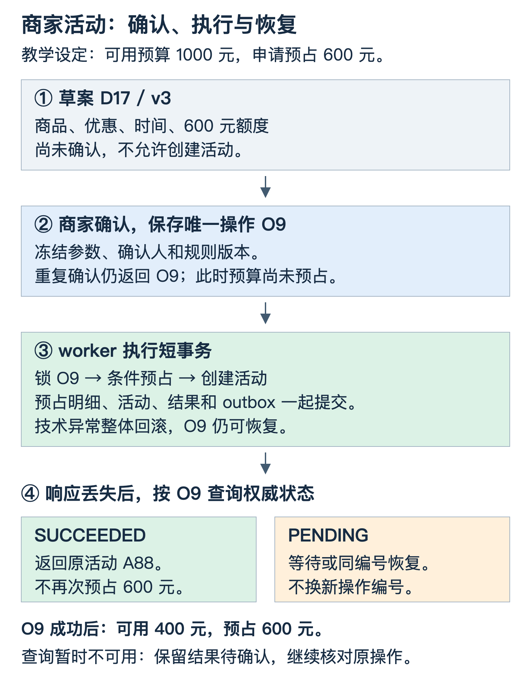

# 商家活动创建 Agent 与预算一致性

商家说“帮我创建一个周末优惠活动”，系统要把这句话变成一次经过确认、可以查询结果的业务操作。难点出现在重复点击、多个活动竞争预算、数据库已经提交但响应丢失，以及进程恢复以后重新执行等时刻。

本文用同一个例子贯穿：商家账户有 **1,000 元可用预算**，一场活动申请 **600 元预占额度**。先在一个 MySQL 事务域中建立可推演的方案，再讨论拆成多个服务后的变化。文中的编号、金额和失败场景均为教学设定。



[查看可编辑结构图](assets/agent-marketing/activity-creation.svg)。图中的 `PENDING` 表示已受理但尚无最终结果，可能正在排队，也可能正在执行事务。

## 1 固定预算含义和业务边界

这次创建申请预占600元，成功后账户可用金额从1,000元变成400元，预占金额从0变成600元。此时尚未发生消费者核销，因此不能把600元记为实际支出。后续核销由交易服务维护，实际补贴受活动额度约束。

同一份草案最多创建一个活动。商家确实想再办一场相同活动，可以新建另一份草案。系统需要识别的是“同一次创建被重复请求”，不能只因为参数相同就永久禁止合法的新活动。

第一版假设活动、预算账户、预占明细、操作记录和事件待发送记录都能在同一 MySQL 事务里修改。跨服务方案在第9节单独讨论。模型推理、规则检索和等待商家确认都放在业务写入事务之外。

## 2 把模型决策与业务执行分开

| 部分 | 负责的工作 | 关键输出 |
|---|---|---|
| Agent | 补参数、理解目标、组织草案、解释执行反馈 | 商品范围、优惠形式、时间、申请额度 |
| 规则检索与实时查询 | 查有效规则、适用范围和当前业务信息 | 带来源的规则、实时事实及数据时间 |
| 确认接口 | 校验身份和草案，保存确认与不可变执行快照 | 可查询的业务操作编号 |
| 活动与预算服务 | 检查约束，执行预占和活动创建 | 活动、预占明细、操作终态 |
| 任务编排与恢复 | 触发执行、查询结果、补发待执行任务 | 可恢复的任务进度与证据引用 |

Agent可以提出“预占600元”的草案，预算服务决定它是否能执行。自然语言里说“不要超预算”不能代替服务端条件更新。工具执行时读取已确认快照，也不能任由模型重新传入一份不同的商品或金额。

## 3 确认时保存一份唯一的业务意图

假设Agent形成草案 `D17` 的第3版。商家看到商品、优惠、时间和600元额度后确认。确认接口先校验可信会话中的商家身份与店铺权限，再把以下内容在一个短事务中保存：

| 对象 | 关键内容 | 作用 |
|---|---|---|
| 草案快照 | `draft_id`、`revision`、完整参数、规则版本 | 固定将要执行的内容 |
| 确认记录 | 确认人、时间、有效期、参数摘要 | 将授权绑定到具体内容 |
| 操作 `O9` | 商家、草案、`CREATE`、参数摘要、`PENDING` | 保存可查询、可恢复的业务意图 |

操作表对 `(merchant_id, draft_id, operation_type)` 建唯一约束。重复点击确认时，服务端查询原操作、核对内容，然后返回同一个 `O9`。单次HTTP请求的 `request_id` 可以变化，业务操作编号不能因此变化。

参数摘要由服务端对规范化内容计算：金额单位、时间表示和字段规则保持一致。它用来识别同一操作是否被换了内容，不代替权限校验。若同一操作携带不同预算，服务端返回内容冲突。

未确认时可以继续修订草案。确认后冻结执行快照；若要改变内容，应先协调取消尚未执行的操作，再创建新草案并重新确认。活动已经创建成功时，进入独立的修改或取消流程。

`O9`保存成功后，预算仍是1,000元，活动也尚未创建。此时系统只承诺“已受理”。队列通知可以触发worker，数据库中的待执行记录扫描提供补发依据，避免一次内存通知丢失后任务永久停住。

## 4 用短事务完成活动与预算的共同提交

金额采用整数分：1,000元为100000，600元为60000。执行前验证金额为正、账户归属和必要的业务条件，`operation_id`与`account_id`分别作为对应记录的主键。

以下为事务伪代码。`IF`与说明性语句由业务代码实现，不是可直接执行的完整SQL：

```text
BEGIN
  SELECT operation WHERE operation_id = O9 FOR UPDATE

  如果状态为 SUCCEEDED：读取并返回原活动，结束事务
  如果状态为 REJECTED 或 CANCELLED：返回原结果，结束事务
  如果状态为 PENDING：检查冻结快照、确认和当前可执行条件

  UPDATE budget_account
     SET available_cent = available_cent - 60000,
         reserved_cent  = reserved_cent  + 60000
   WHERE account_id = :account_id
     AND merchant_id = :merchant_id
     AND available_cent >= 60000

  如果影响0行：记录明确拒绝原因，操作改为 REJECTED，提交后结束
  如果影响1行：继续

  INSERT budget_reservation(operation_id UNIQUE, amount_cent = 60000, ...)
  INSERT activity(operation_id UNIQUE, ...)
  UPDATE operation SET status = SUCCEEDED, activity_id = A88 ...
  INSERT outbox(event_id, activity_id = A88, ...)
COMMIT
```

预算预占、预占明细、活动、成功结果和outbox一起提交。发生技术异常时，业务代码显式回滚整个事务；先前已提交的 `O9`仍为 `PENDING`，可以在数据库收敛后恢复。预算不足是明确业务拒绝，应保存 `REJECTED`，而不是无限重试。

影响0行只表示没有满足更新条件。生产接口应结合账户存在性、归属和生命周期确定错误原因，不能把不存在的账户或错误商家一律报告成预算不足。

事务内不调用模型，不等待人工，也不调用外部RPC。对多条记录保持一致的访问顺序，减少锁竞争；明确因死锁回滚时，有限重试整个事务并沿用 `O9`。提交结果未知则先查状态。[MySQL事务死锁处理](https://dev.mysql.com/doc/refman/8.4/en/innodb-deadlocks-handling.html)

## 5 分清同一操作重复与不同操作竞争

### 同一个O9被执行多次

worker W1先锁住 `O9`。W2也要执行 `O9`，需要等待这条操作记录。W1提交以后，W2读取到 `SUCCEEDED`与活动 `A88`，返回原结果，不再修改预算。

活动和预占明细对 `operation_id`的唯一约束提供额外防线。活动还可以保留 `(merchant_id, draft_id)`的业务唯一性，避免清理短期去重记录后丢失原有防重边界。记录保留期应覆盖任务寿命与重试窗口，并能关联长期业务事实。

目标是相同业务意图的效果保持一致，不是要求所有请求、线程和消息只执行一次。重复执行代码可以发生，重复产生有效业务结果需要被约束。

### 不同的O9和O10各申请600元

两个操作来自不同草案，所以不能互相当作重复请求吞掉。它们竞争的是同一个预算账户。

| 时刻 | O9 | O10 | 账户状态 |
|---|---|---|---|
| t0 | 待执行 | 待执行 | 可用1000，预占0 |
| t1 | 条件更新成功，事务未提交 | 等待预算行 | O9事务内可用400，预占600 |
| t2 | 事务提交 | 取得相应锁后检查当前条件 | 可用400，预占600 |
| t3 | 已成功 | 600元条件不满足，记录拒绝 | 可用400，预占600 |

如果O9回滚，O10才可能取得原额度。在这个模型中，两笔600元预占不能同时提交成功。条件更新把检查与扣减放进同一条写操作，避免“先读到1000元，再凭旧读数无条件扣减”的并发窗口。[InnoDB更新与记录锁](https://dev.mysql.com/doc/refman/8.4/en/innodb-locks-set.html)

这段约束针对创建时的预占。领券、核销和退款仍要维护各自的额度与账务规则，不能从一条预算SQL推导整条交易链路的正确性。

## 6 按失败窗口恢复原操作

| 故障位置 | 可能保留的事实 | 恢复动作 |
|---|---|---|
| 确认已提交，响应丢失 | 已有O9，客户端不知道编号 | 按商家与草案查询；重复确认返回O9 |
| 执行通知丢失 | O9为PENDING，尚无最终结果 | 扫描待执行记录，重新触发O9 |
| 预占后、活动插入前进程退出 | 事务尚未提交，O9仍无终态 | 等回滚和锁释放后，按O9恢复 |
| 活动已提交，HTTP响应丢失 | O9已成功，A88已存在 | 查询O9并返回A88 |
| 查询返回PENDING | 可能排队，也可能事务仍在执行 | 显示处理中，等待或同身份恢复 |
| 查询数据库暂时不可用 | 无法确认最新业务事实 | 保留结果待确认，不生成新操作 |
| 业务提交后消息未发出 | 活动和outbox都已提交 | 重投事件，消费方做业务幂等 |

状态查询使用权威写库或满足所需一致性的入口。副本延迟、网络故障和原事务尚未结束，都可能让客户端暂时拿不到结果。“查不到”不能自动变成“肯定没执行”。

`PENDING`只表示没有可返回的终态，不承诺worker尚未开始。重复触发可以在操作行上等待；恢复扫描仍需要分页、并发上限、退避和总处理时限，避免故障时放大压力。

outbox把本地业务提交与待发送事件保存在同一事务，提供可靠交接依据。发送器可以重复投递，消费者应把事件去重记录与本地业务修改放进自己的事务，再确认消息。它不提供“消息只投递一次”的保证。

## 7 让取消与创建在同一边界仲裁

本地方案中，取消方和执行方都锁同一个 `O9`。取消先提交 `CANCELLED`，后来的执行者停止；创建先提交成功，取消方看到的是已有活动，需要走活动本身的取消规则。

因此不能只在Agent聊天记录里写“用户取消”，同时让另一个worker继续使用旧授权。决定是否允许首次生效的检查，必须发生在真正执行业务变更的位置。

已有活动的撤销、预占释放和核销后的处理都是新的业务动作，也需要明确状态与幂等身份。把编排进度倒回上一步，不会自动撤销已经提交的业务事实。

## 8 规则检索与运行环境分别承担什么

RAG返回有效规则、适用类目、生效时间和例外条款，并保留来源。价格、预算等实时信息通过业务接口读取。检索到“满100减20”，但适用类目不同，不能仅凭语义相似就套用。

服务端最终检查资格、金额、活动冲突与规则版本。若规则不足、冲突或已经失效，Agent可以追问或生成新草案；旧确认不能授权一份新内容。

围绕模型组织执行的运行环境需要保存目标、冻结草案、操作编号、当前观察和结果引用，限制工具权限、调用时间与成本。checkpoint帮助恢复编排进度，`O9`及业务查询负责核对副作用；两者职责不同。恢复所需的是可核对的动作和结果，不要求保存模型内部隐藏推理。

## 9 拆成活动与预算两个服务后怎样变化

前面的事务边界不再覆盖两个服务。可以建立持久化协调流程：先保存操作意图，幂等预占预算取得 `reservation_id`，再幂等创建并关联活动，最后确认关联；明确失败时幂等释放，状态未知时先查询核对。

| 阶段 | 服务端需要的约束 | 未知结果时的动作 |
|---|---|---|
| 预占 | 同一操作只产生一份有效预占 | 查询原reservation或同键请求 |
| 创建 | 活动绑定操作与预占身份 | 查询原活动，避免再创建 |
| 确认 | 状态转换与版本条件一致 | 核对两边已提交事实 |
| 释放 | 已释放不重复增加可用额 | 查询释放记录和活动状态 |

不能仅因超时或TTL到期就释放预占。活动可能已创建，只是响应丢失；旧worker还可能迟到继续创建。协调方案必须定义取消、确认、释放的先后，必要时由接收方校验有作用域的版本或fencing代次，并保留对账恢复。

这是一类可恢复业务流程设计。分布式锁或编排状态机单独存在，都不能把两个服务变成一个原子事务。

## 10 容量设计先区分管理与交易链路

商家生成草案和创建活动是管理链路，消费者浏览、领券和核销是另一类访问模式。消费者高频链路使用已发布的确定性活动规则，不需要为每笔交易重新运行Agent。

先量出商家任务峰值、每个任务的模型与工具次数、延迟和服务配额，再决定队列、执行节点和并发上限。长模型请求与短业务事务分开；按商家和下游工具限并发，设置总时限与成本上限。

模型不可用时，保留人工创建、草案查看和操作状态查询。扩容Agent实例不会自动解决热点预算行竞争，仍需对热点账户排队、限流，或在业务允许时研究额度分配与对账代价。

## 11 从正确性到业务效果分层评估

### 先检查不能被文案分数抵消的约束

未确认不能创建，商家和参数必须匹配，同一业务操作不能重复创建或预占，可用预算不能为负。检查依据是活动、预占、操作和账务状态，不是模型自评“已完成”。

| 验收场景 | 应核对的结果 |
|---|---|
| 同一O9并发调用100次 | 最多一个活动和一份有效预占，累计600元 |
| 两个不同操作各申请600元，账户共1000元 | 最多一笔成功，成功后可用400元 |
| 预占后注入技术异常 | 未提交修改回滚，O9仍能恢复 |
| 提交后丢弃响应 | 查询得到原活动，不再次预占 |
| 未确认或商家身份不符 | 拒绝，活动和预算均无变更 |
| 取消与执行并发 | 按同一操作行决定先后，不出现虚假取消承诺 |

这些是待执行的验收用例。SQL与时序属于协议推演，尚未据此宣称完成真实MySQL并发、崩溃或多服务故障验证。

### 再分别观察任务 体验和增量

任务层记录草案合格率、已确认任务正确完成率、合理拒绝与人工接管，保留样本量和失败分类。预算不足、用户取消、技术失败不能混成同一种错误。

体验与成本层记录得到可用草案的时间、确认后完成时间、执行P95及每个正确完成任务的模型与工具成本。只降低单次请求价格，却增加大量失败重试，不一定降低每个成功任务的成本。

业务层使用适当的商家或活动实验单元，观察采用率、增量成交和营销投入产出，并记录补贴、投诉等约束。活动创建成功证明执行完成，成交增长还需要实验归因，不能直接把活动期间全部成交归给Agent。

## 自测

先预测每种情况的下一步，再核对解释：

1. 用户重复点确认，但前端每次生成新的request_id，会不会出现两笔操作？确认接口按商家、草案和操作类型的业务唯一性返回原O9，不能仅依赖网络请求ID。
2. 两个worker同时读到O9为PENDING，会不会都扣预算？普通读不能授权执行；两者必须通过锁住同一操作记录仲裁，后来的执行者读取终态并返回原结果。
3. O9执行超时，恢复节点读副本查不到，能否换键重做？不能先据此认定未执行；核对权威状态，保持原业务身份。
4. 活动创建与预算预占分属两个服务，能否继续依靠一条本地事务？本地原子域已经变化，需要协调、下游幂等、状态核对和补偿规则。
5. 已知重复调用都正确，但所有商家的成交都上涨，能否证明Agent有效？还需要对照与实验归因，排除活动强度、商家差异和季节等因素。
6. 一场新活动与旧活动参数完全相同，是否必须拒绝？如果用户明确创建新草案并确认，这是新的业务意图；参数相同不等于同一操作。

## 继续阅读

- [工具契约与幂等身份](实现详解_40_工具契约并行依赖与幂等ID.md)：区分请求、调用和业务操作。
- [Checkpoint与外部副作用恢复](实现详解_41_Checkpoint与外部副作用恢复.md)：理解提交窗口、取消和迟到执行。
- [MySQL的MVCC与版本链](实现详解_18_MVCC的ReadView与undo版本链.md)：区分快照观察与当前写入约束。
- [badcase评测与持续迭代](Agent工程_02_badcase评测与持续迭代.md)：拆开结果、轨迹、成本与业务归因。
- [稳定分桶与实验归因](实现详解_38_稳定分桶与AB实验归因.md)：为业务增量建立可解释的对照。

已有[发布与评测实验](examples/agent_delivery_eval_demo.py)可用于理解同键重试和结果判定。它是SQLite本地协议示例，不验证本篇的MySQL预算锁或跨服务协调。
