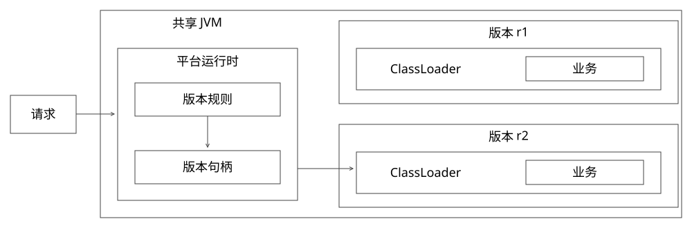
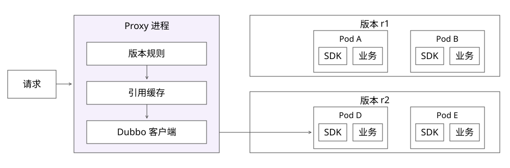
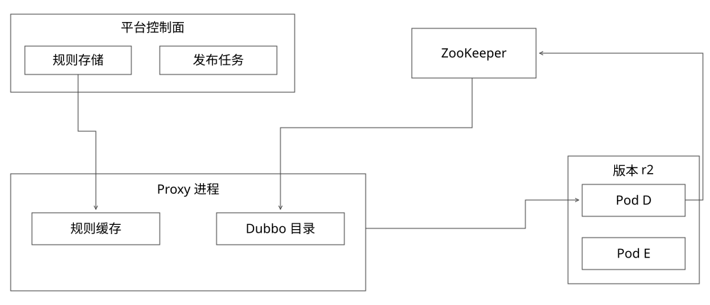
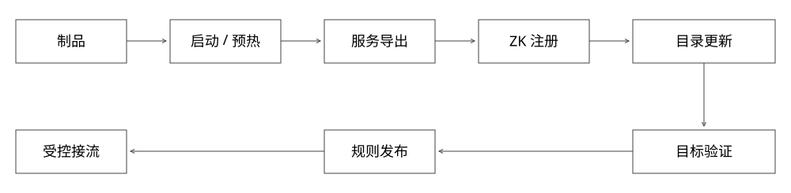
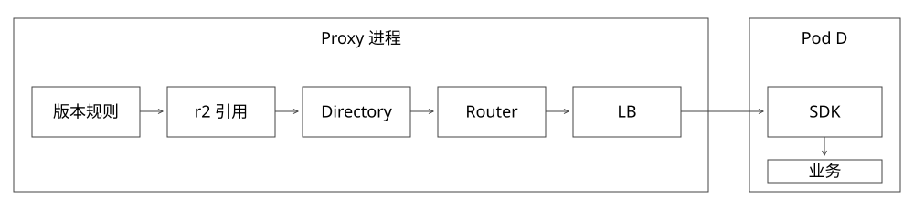
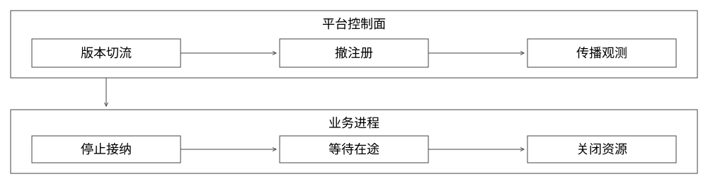

# Dubbo多版本服务：发布、发现、路由与下线全链路

本文只解决一个问题：同一应用的r1、r2长期并存，每版多个Pod，怎样将一次请求可靠地送到指定版本，并在更新与下线期间守住边界？

采用一个贯穿例子：`recommend`应用，r1有A、B、C，r2有D、E；Proxy独立部署。业务实现通过SDK提供统一入口，Pod内worker由业务运行时管理。所有编号、规则、控制器与故障时序均为教学设计，不代表某个组织的已上线系统。

阅读顺序：先走发布，再走发现与一次请求，最后反推下线。不要从几个类名开始背调用链。

图按白底、直角细框绘制；窄屏阅读可打开每图的SVG/PNG链接放大，不需要在缩略图里辨认所有嵌套标签。

## 1. 先锁定版本和分析分支

源码基线固定为Apache Dubbo **3.2.12**，commit `1dd6a4aaa8816cf3f1585769dfff4f325e4ecd15`。这是机制研读基线，不是当前生产选型、维护状态或安全性的推荐。

主线分析Java SDK的接口级服务发现：Provider配置`register-mode=interface`；Consumer按`FORCE_INTERFACE`选择接口级目录。配置需在实际应用模型中生效，不能只改一份未加载的文件。Dubbo 3还有应用级、双注册与迁移模式；本文不把它们的目录结构混画在一起。[官方注册模式说明](https://dubbo.apache.org/en/overview/mannual/java-sdk/reference-manual/upgrades-and-compatibility/migration-service-discovery/)、[迁移模式说明](https://dubbo.apache.org/en/overview/tasks/migration/service-discovery-samples/)

```properties
# 教学主线的显式选择，不声称这是所有3.x的默认配置
dubbo.application.register-mode=interface
dubbo.application.service-discovery.migration=FORCE_INTERFACE
```

注册中心选ZooKeeper；Proxy内置Dubbo Consumer。Java端源码用来解释机制，Python互通另见第11节，不因此把Java类名当成Python实现。

| 身份 | 例子 | 改变它意味着什么 |
|---|---|---|
| 应用/场景 | recommend / feed | 稳定业务入口与规则作用域 |
| 服务契约 | `study.ExecuteService` | 方法、参数与结果约定 |
| Dubbo服务分组 | `recommend` | 服务身份维度，不是鉴权结论 |
| 业务发布 | r2，绑定制品H2、配置K2 | 一份不可变发布定义 |
| Dubbo version | 本例映射为r2 | 区分服务引用；不等于唯一正确映射 |
| 路由代次 | G101 | 某规则作用域的更新顺序，不是制品版本 |
| 实例身份 | Pod D的UID、地址 | 一次承载生命周期，IP可变 |

同一个r2扩成四个Pod不产生r3；r2如果重新指向不同字节却不留记录，会破坏追溯。接口兼容版本与业务发布号仍是两个概念；本例为便于严格寻址，选择将业务发布号映射到Dubbo version。

## 2. 运行边界：旧方案与独立部署方案

共享运行时将多个版本装入同一JVM，用类加载器边界区分类与私有依赖。它能复用基础开销，但不是独立堆、GC、线程和进程故障域。



[可编辑SVG](assets/dubbo-lifecycle/01-shared-runtime.svg) · [PNG](assets/dubbo-lifecycle/01-shared-runtime.png)

独立部署后，Proxy里的版本选择与引用缓存属于Proxy进程，SDK与业务实现属于各业务Pod的运行进程。版本外框只是归属关系，不是多个Pod被包进一个进程。



[可编辑SVG](assets/dubbo-lifecycle/02-dubbo-runtime.svg) · [PNG](assets/dubbo-lifecycle/02-dubbo-runtime.png)

两图保持相同请求方向和版本位置，便于比较。旧图只展开一个承载JVM，新图一台Proxy表示一组同类实例，不主张单点部署；r1图中仅展开A/B，省略C，也不展开Pod内worker。独立进程增加启动、网络、常驻内存与实例治理成本，不能直接推出“更省资源”。

下面区分两种控制信息：平台规则回答“请求应该访问谁”，注册发现回答“哪些地址宣称提供相应服务”。前者不能被后者代替。



[可编辑SVG](assets/dubbo-lifecycle/06-control-and-discovery.svg) · [PNG](assets/dubbo-lifecycle/06-control-and-discovery.png)

这张图只解释规则、发现与请求三种关系：D示意向ZK注册，ZK视图进入Proxy的Dubbo目录，平台规则进入规则缓存，请求从Proxy去D。E同样需要注册，图中省略重复连线；发布任务的部署步骤见下一节，不把规则分发误认为服务发现。

## 3. 一次r2发布：平台交付的不是一个成功字符串

输入至少固定应用/环境、代码或制品、SDK/依赖、配置与资源意图。模型、字典等影响行为的依赖要绑定必要身份；实时数据不能冻结时，要记录验证边界。平台接受发布只表示一个操作已被记录。



[可编辑SVG](assets/dubbo-lifecycle/03-publish-discovery.svg) · [PNG](assets/dubbo-lifecycle/03-publish-discovery.png)

### 3.1 每个阶段产出什么

| 阶段 | 输入与动作 | 完成证据 | 不能由此推出 |
|---|---|---|---|
| 记录发布意图 | O17绑定r2/H2/K2，建立D17 | 稳定任务身份、请求摘要 | 业务已经启动 |
| 构建 | 固定输入生成H2 | 制品及依赖清单 | 启动必定成功 |
| 启动/预热 | 创建D、E，装载依赖与业务状态 | 实际实例身份、入口与检查结果 | 已传播到每台Proxy |
| 导出/注册 | 暴露服务并注册Provider信息 | 导出与注册观测 | 已通过业务验证 |
| 准备调用 | 创建r2引用，目录出现合格实例 | 目录、实际命中H2/K2 | 所有Proxy瞬间一致 |
| 受控接流 | 发布G101与容量约束 | 实际命中、错误与时延 | 可立即推全 |

这些阶段名是平台参考状态，不是Dubbo现成的发布状态机。O17去重、制品、Pod调度、灰度验收仍需平台或基础设施实现。

### 3.2 从业务对象到可调用服务

Java研读入口是`ServiceConfig.doExportUrlsFor1Protocol`：整理配置并形成服务URL，之后进入导出路径。业务对象会被适配成Invoker；Exporter表示导出后的生命周期句柄。Invoker不等于线程，也不等于Pod。[ServiceConfig固定源码][s-service]

进入注册协议分支时，`RegistryProtocol.export`先做本地协议导出，再按配置决定是否注册。Triple分支的导出负责将服务放入相应解析结构并绑定服务端入口。这些动作不是一次跨注册中心、进程和平台数据库的事务。[RegistryProtocol固定源码][s-registry]、[TripleProtocol固定源码][s-triple]

这给出三个重要反例：端口已监听但注册失败；注册已经出现但业务依赖尚未准备好；服务已可被直连但平台仍未允许普通流量。都不能用“export返回了”一笔带过。

### 3.3 Pod Ready不自动控制Dubbo注册

Kubernetes readiness影响相应端点流量资格，并不会自动撤销业务进程自己写入ZooKeeper的Provider URL。Dubbo客户端若直接用注册地址，不能假设它必经Kubernetes Service过滤。

参考设计应选择并验证准入衔接：必要预热完成后再导出/注册，或者即使提前暴露入口，也由服务端接纳门和受控调用范围阻止普通业务过早执行。仅在平台页面把状态改成Ready不够。具体如何延迟注册和控制导出，需按所用SDK生命周期API验证。

先让r2可被指定验证，再通过规则扩大普通流量；不是让它一注册就随机加入r1的默认池。新版本验证请求要核对实际制品/配置，不只相信返回的r2字符串。

## 4. 注册发现：地址为什么能到Proxy

### 4.1 接口级ZooKeeper里放的不是业务请求

`ZookeeperRegistry.doRegister`将服务URL编码为相应节点路径，并依据dynamic参数创建节点。教学默认根下可以理解为：

```text
/dubbo/study.ExecuteService/providers/
    URL(D, group=recommend, version=r2, protocol=tri, ...)
    URL(E, group=recommend, version=r2, protocol=tri, ...)
```

这是解码后的逻辑展示，不是说真实节点名带这些未转义空格，也不是说每个version天然有独立父目录。接口级路径下，group/version等信息可处在编码的URL中。根路径也可配置。[ZookeeperRegistry固定源码][s-zk]

动态节点一般关联会话；短暂断连不等于会话立即失效。会话过期后注册信息才按相应机制消失，其他进程仍需收到变化。服务进程在注册系统看来“存在”，也不证明当前业务健康。[ZooKeeper 3.9.2会话与临时节点](https://zookeeper.apache.org/doc/r3.9.2/zookeeperProgrammers.html)

### 4.2 一次订阅包含初始视图和后续变化

接口级Consumer订阅Provider等类别路径。`doSubscribe`设置子节点监听，并取得初始子节点集合，再通知监听者；变化回调继续驱动后续更新。不能画成“只有新节点变化时，Consumer才第一次拿到地址”。[ZookeeperRegistry固定源码][s-zk]

原生普通watch不能当完整可靠事件日志。这里又有Curator和Dubbo封装；不要把“ZooKeeper watch一次性”误解为业务代码只订阅一次以后就永久收不到通知。恢复后应重新获得有效视图，而不是假定断线期间每个中间事件都被逐条重放。

### 4.3 谁实际匹配版本

接口级转换会使用订阅条件匹配Provider信息；`UrlUtils.isMatch`检查接口、类别、启用状态及group/version等条件。明确指定r2与使用`version=*`不是同一语义，group也可以有通配行为。[URL匹配固定源码][s-url]

因此主线是“平台选r2引用 → 引用以r2条件订阅/匹配 → 目录持有该服务的Invoker → 后续路由与均衡”，不是“注册中心执行用户分桶，然后直接转发请求”。

### 4.4 磁盘缓存不是新鲜度保证

订阅异常时，`FailbackRegistry.subscribe`存在使用缓存地址及登记后续重试的分支；是否启动失败还受check等条件影响。保留缓存可以帮助存量服务继续，但新版本、失效地址与撤权不能因此被视为已确认。[FailbackRegistry固定源码][s-failback]、[AbstractRegistry固定源码][s-abstract-registry]

平台控制面失联、ZooKeeper失联、业务实例失联是三种故障，应分别观测。新Proxy能否启动也取决于已有缓存、注册访问、凭证和配置，不能仅凭老Proxy还能服务就判断全系统可恢复。

## 5. Proxy怎样得到“r2引用”，不是怎样改一份全局变量

### 5.1 建立引用与每次调用分开

参考缓存键包含应用模型/注册域、环境、接口、group、version及必要的隔离条件。缓存中保留的是这份引用及其所有权，不只是一个裸地址。

```java
// 配置示意，省略ApplicationModel、注册中心初始化、并发创建与清理。
ReferenceConfig<ExecuteService> ref = new ReferenceConfig<>();
ref.setInterface(ExecuteService.class);
ref.setGroup("recommend");
ref.setVersion("r2");
ref.setProtocol("tri");
ref.setRetries(0);
ref.setParameters(Map.of("migration.step", "FORCE_INTERFACE"));
ExecuteService client = ref.get();
// 接纳调用时复用client；版本退役并排空引用使用后再销毁ref。
```

片段不是完整可运行工程，`ExecuteService`需真实定义；跨语言时还要改用双方一致的IDL/生成代码，而不是把Java String接口当作Protobuf契约。

`ReferenceConfig.get`按生命周期准备模块并初始化，`createProxy`组织地址来源、Invoker和代理；不应在每个业务请求中重新完成这些工作，也不能对共享ReferenceConfig逐请求改version。[ReferenceConfig固定源码][s-reference]

并发首次创建同一键时，要受控共用创建结果并处理失败；只在CHM里放对象不自动解决半初始化、失败缓存、过期回收和正在使用时销毁。复用引用也不意味着每版一定独占一条物理连接，底层资源共享按协议与配置核实。

### 5.2 Dubbo 3的迁移层不能被省略成错误的直线

接口级主线可按以下层次定位；这里只保留本任务相关层，省略代理/过滤器等包装：

```text
ReferenceConfig
  → InterfaceCompatibleRegistryProtocol继承的refer / doRefer
  → 该子类getMigrationInvoker创建MigrationInvoker
  → FORCE_INTERFACE / refreshInterfaceInvoker
  → 该子类getInvoker创建RegistryDirectory
  → doCreateInvoker / subscribe / cluster.join
```

源码中的`RegistryProtocol.doRefer`并不简单直接new一个RegistryDirectory；它经迁移Invoker与监听机制决定发现分支。接口兼容注册协议通过子类覆写选择MigrationInvoker；`MigrationInvoker.refreshInterfaceInvoker`再衔接接口级Invoker建立。SPI资源里的协议扩展映射是确认实际类型的入口。强制应用级、双订阅和ServiceDiscoveryRegistry路径要另行追踪，不能套用本文接口级ZK目录。[接口兼容注册协议][s-compatible]、[协议SPI映射][s-protocol-spi]、[MigrationInvoker][s-migration]、[ServiceDiscoveryRegistry][s-discovery]

这里存在不同迁移包装，不能凭名字把`ServiceDiscoveryMigrationInvoker`当成“必走接口级”的类。读调用链必须同时读运行时采用的注册URL类型、迁移规则和实际目录类。

## 6. 一次指定r2请求怎样走到D



[可编辑SVG](assets/dubbo-lifecycle/04-request-path.svg) · [PNG](assets/dubbo-lifecycle/04-request-path.png)

图中Directory、Router和LB是逻辑职责模块，不保证每一层都有一个同名独立对象。客户端实现会有包装与缓存；实际源码类型见下文。

### 6.1 先决定业务意图

Proxy验证身份与场景权限，使用一份已校验规则视图决定目标r2。教学优先级可以是显式验证、白名单、实验、默认；这不是Dubbo自动知道的业务策略。

请求携带r2不等于有权访问r2。服务分组、标签、调用附件都不是独立鉴权证据。目标版本、剩余预算、trace等上下文跨异步线程也要正确传播和清理。

### 6.2 目录与路由产生候选

`AbstractClusterInvoker.invoke`先取得目录候选并校验，再准备LoadBalance，进入具体集群调用。`AbstractDirectory.list`与`DynamicDirectory.doList`衔接候选视图和路由链；3.2.12里要看到SingleRouterChain以及主备链更新机制，不能只背旧版`RouterChain.route`一行。[集群入口][s-cluster]、[AbstractDirectory][s-directory]、[DynamicDirectory][s-dynamic]、[RouterChain][s-router]

本例目录内r2候选D、E。E在平台就绪/排空规则中已失去接纳资格，路由只留下D。平台如果要实现这种实例级资格，应接入可验证的Provider本地门和调用侧过滤；Dubbo不会自动理解任意自定义字段`draining=true`。

路由前后集合、版本命中依据及实际实例应可观测。每条成功响应至少能关联这次请求和实际运行身份；只打通一条探针不能证明所有实例、所有Proxy都已一致。

### 6.3 负载均衡只能在候选内选

多个合格r2实例可按策略均衡，只有D就选D；集合为空则明确失败或走已授权且语义可接受的策略。禁止仅为提高成功率静默转r1，特别是调试、评测和不兼容变更。

RandomLoadBalance是候选内的随机/权重选择，不是用户级实验分桶。小样本偏差、请求成本不同、长连接和流式占用都会影响观测分布。灰度30%不代表每秒每个Pod恰好30%。[RandomLoadBalance固定源码][s-random]

特别反例：该固定版本实现中，总权重为0时有均匀随机选择分支。因此“所有实例weight=0”不能充当严格拒新协议。需要真正从候选中排除并配合执行端接纳门，而非把权重当安全屏障。

### 6.4 重试不能逃出版本约束

`FailoverClusterInvoker.doInvoke`在后续尝试前可以重新取得候选。尝试数由配置/上下文计算，并非永远某个固定值。目录变化时仍必须保留r2身份与权限，不能在第二次尝试退到应用的全版本池。[FailoverClusterInvoker固定源码][s-failover]

关闭这一层重试不等于端到端只执行一次：上游、用户或恢复程序仍可能重发；超时也不证明Provider未执行。写操作需稳定业务意图、查询与幂等，流式部分输出不能无条件从头重试。

还要区分调用当场抛异常与异步Result后来失败。读到doInvoke里的catch，不等于证明所有异步完成异常都会重新进入同一个重试循环；需沿所用协议和结果适配核验。

## 7. 地址与规则乱序：必须讲清本地保证

### 7.1 普通空列表与empty协议通知不是一回事

直接读`RegistryDirectory.refreshInvoker`可见两个不同分支：普通空列表可能复用cachedInvokerUrls；明确`empty://`通知会设置禁止访问并销毁旧Invoker。上游`CacheableFailbackRegistry.toUrlsWithEmpty`是否形成empty通知又受类别和空保护配置影响。[RegistryDirectory][s-registry-directory]、[CacheableFailbackRegistry][s-cacheable]

因此排障不能只看“收到了空”。至少记录原始Provider集合、转换后的通知协议、空保护配置、目录缓存和有效候选。ZK目录无子节点，不足以单独证明每台Proxy已清空地址。

另一个边界：非空URL列表如果因协议不匹配等原因全部转换失败，目录代码也可能保留旧状态并返回。必须区分明确撤销与无效更新；不能把保留旧视图当成新版已就绪。

### 7.2 四个不同时间点

```text
t0  D已启动，E尚未就绪，默认流量仍到r1
t1  Proxy P1有r2的D地址，P2尚无r2可用目录
t2  发布G101：指定人群可访问r2
t3  P1命中r2；P2若未具备条件，明确失败/HOLD或尚未启用该规则
```

选择哪种失败/保持策略必须先约定，不能为了图上顺畅就让P2偷偷去r1。允许有限传播窗口与要求全局即时切换，是不同服务承诺。

### 7.3 业务路由代次不等于注册revision

参考控制面用G101、G102仲裁同一场景路由，回滚到r1要发G103引用H1/K1，而不是让generation倒退。独立地址系统的revision未必能与G103数值比较，应核对发布身份与引用相容。

单台Proxy安装完整视图，可以减少半套配置；多Proxy仍需成员观测、退役条件与失联处理。失联时使用最后有效规则可提高可用性，却不能同时保证即时撤权。注册地址的连接可用也不替代平台最新授权。

## 8. 下线：撤注册、拒新、排空和销毁不是同一个动作



[可编辑SVG](assets/dubbo-lifecycle/05-drain.svg) · [PNG](assets/dubbo-lifecycle/05-drain.png)

图中关联表示协调，不是全局事务屏障。下面分别讨论整个r1退役与r2单个Pod缩容。

### 8.1 整个版本退役

平台先让正常流量不再选择r1，并禁止新建/新获取该版本引用；发布新的规则代次并观察传播。是否继续允许指定调试，要按权限和保留策略决定，不能一边称退役一边无限续用。

随后安排Provider撤注册与本地排空。可以留准备摘流窗口给旧视图传播，但必须有期限。进入严格排空时，业务接纳门关闭；已有租约继续持有，结束后才允许释放资源。最后按引用所有权销毁Consumer引用，并关闭Provider相应服务/进程。

若r1是回滚保留版本，可停止正常接流而保留运行能力，不必立即撤注册和回收；“流量为0”“不可被调用”“资源已释放”是三种状态。

### 8.2 只缩掉E，不能销毁整个r2引用

r2仍有D可用时，只撤掉E的资格和地址，让目录更新并清理E对应Invoker。Proxy中的r2引用仍服务D，不应因为一个Pod退役就将整个ReferenceConfig销毁。

框架清理Invoker与物理连接的关闭也不总是一一对应：共享传输资源由具体实现管理。平台不能随手关闭一条可能被其他服务使用的底层连接。

### 8.3 为什么撤注册后旧请求还会来

P2仍缓存E，或者在旧HTTP/2连接上创建新stream。E需按接纳协议拒绝新工作；若能可靠证明尚未执行，调用方才可在预算内重选同版本其他实例。请求已经接纳、响应丢失或部分输出时，要按结果未知和幂等协议处理。

本地原子域必须覆盖“检查accepting＋取得租约”；beginDrain也操作同一状态。读完Map再加inFlight，会出现关闭者看到0先释放资源、调用者随后加1的窗口。异步任务、流式响应要把租约持有到实际终止，而非仅持有到业务方法返回。

### 8.4 源码里的优雅下线到底保证什么

固定版本`ServiceConfig.unexport`先请求各Exporter撤注册，再调用`waitForIdle`，之后unexport。`waitForIdle`基于lastInvokeTime及配置时间计算等待，不是本文自定义的业务租约门，也不是所有流和外部副作用都结束的证明。[ServiceConfig][s-service]

注册Exporter包装把撤注册和协议unexport分开；应用整体销毁还有服务实例、模块和协议等生命周期。不要把单个服务的unexport等同于整个应用退出，更不能把`TripleProtocol.destroy`这种协议级关闭用于随意退役一个版本。[RegistryProtocol][s-registry]、[DefaultApplicationDeployer][s-deployer]、[TripleProtocol][s-triple]

还要看失败分支：注册包装的unregister存在捕获异常并记录后继续的处理。本地状态已更新或unexport返回，不足以证明远端注册和每台Consumer目录均已撤销；执行端拒新与恢复核对因此仍有必要。

终止预算必须覆盖应用排空与运行环境退出。Kubernetes的preStop也消费终止宽限期，端点传播与本地终止并非严格串行。若30秒预算先花10秒执行hook，不能再承诺后面有完整30秒排空。[Pod终止流程](https://kubernetes.io/docs/concepts/workloads/pods/pod-lifecycle/#pod-termination)

### 8.5 超时不等于可以声称无损

到期仍有死循环、长流或卡住任务时，策略可能是继续隔离等待、明确失败或终止独立进程。终止释放运行资源，不撤销已经写库、发消息或调用外部工具的结果。

如果没有合格替代实例，严格拒新会牺牲部分可用性；没有有界传播或执行端仲裁，无法同时宣称“所有旧Proxy立刻不调用”“完全无失败”。应说明接受的保证和演练证据。

## 9. 一组失败窗口，检查整条链有没有讲通

| 故障 | 首先保住什么 | 下一项证据 | 不该直接做什么 |
|---|---|---|---|
| 构建成功，启动失败 | 不放业务流量 | 制品、启动阶段与错误 | 报业务效果下降 |
| Provider已注册，但模型未就绪 | 禁止普通业务执行 | 业务准入与预热 | 认为ZK存在就健康 |
| 发布返回丢失 | 原业务意图可查询 | O17对应D17 | 换新操作ID盲重发 |
| r2规则先于地址到达 | 不跨版本 | 对应引用目录与实际命中 | 自动拿r1凑成功 |
| 注册断连 | 明确缓存与新鲜度边界 | 会话、重连、目录变化 | 认定进程已经退出 |
| 全部URL转换失败 | 不把旧状态当新状态 | 协议与转换异常 | 宣布新目录安装成功 |
| 摘流后旧连接发新请求 | 接纳与租约原子协调 | 拒新证据及在途 | 只靠固定sleep证明无损 |
| 回滚后G101迟到 | 当前G103不被倒写 | 同作用域代次 | 把制品r1当旧事件丢掉 |

## 10. 容量与规模：版本多不是只有一个Map的代价

假设100应用各20版本，Proxy共50台。若每台都引用所有版本，最多是10万份引用关系，未计订阅、路由、元数据和连接；不是10万个永久独立TCP连接的断言。按实际活跃范围惰性/预先建引用，结合配额与回收，才知道资源是否可控。

吞吐容量按版本成本测。1000QPS中r2占30%，r1/r2 CPU服务需求分别10/20ms，则理想CPU需求为7核和6核；单Pod1核、目标60%约需12和10个Pod，另加突发、预热与故障余量。这是CPU受限的教学估算，不是实际部署建议。

Proxy异步化可以减少被动占线程，但连接、请求状态、缓冲与下游配额不会消失。稳定条件下50QPS、平均10秒意味着平均约500在途，需并发接纳、有界队列、背压和端到端预算，不能只比较线程数。

## 11. Python扩展：协议互通与发现互通分开验证

Java主线里有`ServiceConfig`、`ReferenceConfig`等类，并不表示Python SDK内部也按这些类运行。Apache Dubbo Python提供Triple实现并列出ZooKeeper能力，但仓库仍标为早期项目；生产可用性和跨版本能力不能仅凭README判断。[官方Python实现](https://github.com/apache/dubbo-python)

目标组合可设为Java Proxy → Triple/Protobuf → Python SDK/运行入口；至少验证：

1. 固定双方SDK版本、同一份IDL及服务/方法名，正常请求与错误能被双方一致解释。
2. 直连通过后，再验证选定的接口级/应用级发现模式；Python是否注册Java端预期的元数据，不按包名推断。
3. group/version如何传输与匹配；r2请求故意发到错误服务或缺少版本元数据时，必须有负向测试。
4. 明确超时、取消、流式终止和部分失败；协议宣称支持某模式，不证明接纳与排空已经正确衔接。
5. 审计服务端兜底解析。固定Java TripleProtocol存在默认服务解析相关开关；严格多版本不能只验证Consumer筛选，也要验证服务端没有把错误版本解析为默认实现。[TripleProtocol][s-triple]、[开关键名固定源码][s-rpc-constants]

不能从这个开关的存在直接断言“设置一个值就完成跨语言严格隔离”。应核验实际读取的配置与错误版本测试结果。若目标Python SDK在所需发现/版本能力上不能满足，可保留原HTTP/gRPC入口或增加经过评估的适配层，代价与责任另算，不虚构已经跑通的代码。

## 12. 源码怎样读：入口、分支和要验证的条件

| 层次 | 固定版本入口 | 读完要能回答 |
|---|---|---|
| 服务导出 | [ServiceConfig][s-service] | URL、业务Invoker、Exporter各是什么；导出与注册是否同一动作 |
| 注册协议 | [RegistryProtocol][s-registry] | 本地协议导出和注册的顺序；refer是否直接创建目录 |
| ZK发现 | [ZookeeperRegistry][s-zk] | 初始列表、监听与重连；节点路径到底包含什么 |
| 匹配 | [UrlUtils][s-url] | interface/group/version与通配条件在哪里匹配 |
| 空保护 | [CacheableFailbackRegistry][s-cacheable] | 普通空和empty通知如何形成 |
| 目录更新 | [RegistryDirectory][s-registry-directory] | 缓存复用、URL转Invoker、旧Invoker清理与失败保留 |
| 引用 | [ReferenceConfig][s-reference] | 初始化与调用为何分离，销毁粒度是什么 |
| 迁移 | [MigrationInvoker][s-migration] | 当前运行的是哪种发现分支 |
| 调用目录 | [AbstractDirectory][s-directory]、[DynamicDirectory][s-dynamic] | 候选快照和路由视图怎样协调 |
| 路由链 | [RouterChain][s-router] | 主备链更新不等于所有Proxy同时切换 |
| 集群调用 | [AbstractClusterInvoker][s-cluster] | list、选择策略与具体集群执行的关系 |
| 故障转移 | [FailoverClusterInvoker][s-failover] | 每次尝试是否重取候选，结果未知怎么办 |
| 均衡 | [RandomLoadBalance][s-random] | 权重如何参与；全零是否等于拒绝 |
| Triple | [TripleProtocol][s-triple] | 导出、调用连接与协议级销毁；默认解析边界 |
| 应用退出 | [DefaultApplicationDeployer][s-deployer] | 应用、服务实例与单服务生命周期怎样区分 |

精确文件摘要和入口行号见[本专题源码锁](sources/dubbo-lifecycle-lock.json)。行号是定位，不代替阅读上下文。锁文件补充本专题范围，不改写原14仓库98文件的历史索引。

首次取得这些公开源码，可在本工程运行`python3 scripts/fetch_dubbo_lifecycle.py`。脚本按固定commit下载到忽略目录并核对摘要，不执行上游Java代码，也不改写旧索引。

## 13. 可检查实验：验证边界，不假装运行了Dubbo

在本工程根目录执行：

```bash
python3 examples/dubbo_lifecycle_model.py
```

该程序只模拟：注册与业务就绪分离、严格版本候选、普通空/明确空通知、更新失败保留、旧代次拒绝、局部更新不等于全局切换，以及接纳/排空与引用关闭。它不创建真实Dubbo代理，不连接ZooKeeper，不验证Java/Python互通、Curator时序或Kubernetes终止。

真实集成至少要另外做：D/E两Provider注册；两个Proxy分别订阅；r2定向请求；撤掉E后D继续可用；r2全空不去r1；注册短断与会话过期；规则/地址延迟；长流与强杀；错误版本服务端解析。必须保留具体配置和观测，不用本地模型测试数量代替这些结果。

## 自测

1. D已在ZK注册但模型还没加载，能直接接流吗？——不能，注册身份不等于业务就绪；准入要与实际调用路径衔接。
2. 接口级r2引用为什么不会正常看见r1？——订阅/匹配有明确服务身份，之后路由和重试也要保留边界；`version=*`会改变前提。
3. 发现普通空列表就能断言地址已全部清空吗？——不能，要检查空保护和是否形成empty协议通知。
4. 全部weight=0是否绝对不调用？——该固定Random实现存在全零均匀选择分支，不能作严格拒新。
5. r2的E缩容，要销毁整个r2 Reference吗？——不应；D仍承载r2，实例、服务引用与协议关闭不是同一粒度。
6. ServiceConfig先撤注册再等待，是否证明所有长流已结束？——不是；该等待逻辑与业务生命周期、传播及外部副作用保证要分别核验。
7. G103回滚到r1，迟到G102怎么办？——按同作用域代次拒旧，不按制品标签新旧判断。
8. Java直连Python通过，是否发现和严格版本也通过？——不是，协议、注册模式、元数据与错误版本负向测试分别验证。

完整知识链是：不可变发布身份 → 导出与注册 → 订阅及目录 → 业务版本约束 → 实例调用 → 更新与重试 → 接纳/排空 → 按所有权回收。每个箭头都要说明完成证据、失败窗口与实现边界。

[s-service]: https://github.com/apache/dubbo/blob/1dd6a4aaa8816cf3f1585769dfff4f325e4ecd15/dubbo-config/dubbo-config-api/src/main/java/org/apache/dubbo/config/ServiceConfig.java
[s-reference]: https://github.com/apache/dubbo/blob/1dd6a4aaa8816cf3f1585769dfff4f325e4ecd15/dubbo-config/dubbo-config-api/src/main/java/org/apache/dubbo/config/ReferenceConfig.java
[s-registry]: https://github.com/apache/dubbo/blob/1dd6a4aaa8816cf3f1585769dfff4f325e4ecd15/dubbo-registry/dubbo-registry-api/src/main/java/org/apache/dubbo/registry/integration/RegistryProtocol.java
[s-zk]: https://github.com/apache/dubbo/blob/1dd6a4aaa8816cf3f1585769dfff4f325e4ecd15/dubbo-registry/dubbo-registry-zookeeper/src/main/java/org/apache/dubbo/registry/zookeeper/ZookeeperRegistry.java
[s-url]: https://github.com/apache/dubbo/blob/1dd6a4aaa8816cf3f1585769dfff4f325e4ecd15/dubbo-common/src/main/java/org/apache/dubbo/common/utils/UrlUtils.java
[s-failback]: https://github.com/apache/dubbo/blob/1dd6a4aaa8816cf3f1585769dfff4f325e4ecd15/dubbo-registry/dubbo-registry-api/src/main/java/org/apache/dubbo/registry/support/FailbackRegistry.java
[s-abstract-registry]: https://github.com/apache/dubbo/blob/1dd6a4aaa8816cf3f1585769dfff4f325e4ecd15/dubbo-registry/dubbo-registry-api/src/main/java/org/apache/dubbo/registry/support/AbstractRegistry.java
[s-cacheable]: https://github.com/apache/dubbo/blob/1dd6a4aaa8816cf3f1585769dfff4f325e4ecd15/dubbo-registry/dubbo-registry-api/src/main/java/org/apache/dubbo/registry/support/CacheableFailbackRegistry.java
[s-registry-directory]: https://github.com/apache/dubbo/blob/1dd6a4aaa8816cf3f1585769dfff4f325e4ecd15/dubbo-registry/dubbo-registry-api/src/main/java/org/apache/dubbo/registry/integration/RegistryDirectory.java
[s-directory]: https://github.com/apache/dubbo/blob/1dd6a4aaa8816cf3f1585769dfff4f325e4ecd15/dubbo-cluster/src/main/java/org/apache/dubbo/rpc/cluster/directory/AbstractDirectory.java
[s-dynamic]: https://github.com/apache/dubbo/blob/1dd6a4aaa8816cf3f1585769dfff4f325e4ecd15/dubbo-registry/dubbo-registry-api/src/main/java/org/apache/dubbo/registry/integration/DynamicDirectory.java
[s-router]: https://github.com/apache/dubbo/blob/1dd6a4aaa8816cf3f1585769dfff4f325e4ecd15/dubbo-cluster/src/main/java/org/apache/dubbo/rpc/cluster/RouterChain.java
[s-cluster]: https://github.com/apache/dubbo/blob/1dd6a4aaa8816cf3f1585769dfff4f325e4ecd15/dubbo-cluster/src/main/java/org/apache/dubbo/rpc/cluster/support/AbstractClusterInvoker.java
[s-failover]: https://github.com/apache/dubbo/blob/1dd6a4aaa8816cf3f1585769dfff4f325e4ecd15/dubbo-cluster/src/main/java/org/apache/dubbo/rpc/cluster/support/FailoverClusterInvoker.java
[s-random]: https://github.com/apache/dubbo/blob/1dd6a4aaa8816cf3f1585769dfff4f325e4ecd15/dubbo-cluster/src/main/java/org/apache/dubbo/rpc/cluster/loadbalance/RandomLoadBalance.java
[s-migration]: https://github.com/apache/dubbo/blob/1dd6a4aaa8816cf3f1585769dfff4f325e4ecd15/dubbo-registry/dubbo-registry-api/src/main/java/org/apache/dubbo/registry/client/migration/MigrationInvoker.java
[s-discovery]: https://github.com/apache/dubbo/blob/1dd6a4aaa8816cf3f1585769dfff4f325e4ecd15/dubbo-registry/dubbo-registry-api/src/main/java/org/apache/dubbo/registry/client/ServiceDiscoveryRegistry.java
[s-triple]: https://github.com/apache/dubbo/blob/1dd6a4aaa8816cf3f1585769dfff4f325e4ecd15/dubbo-rpc/dubbo-rpc-triple/src/main/java/org/apache/dubbo/rpc/protocol/tri/TripleProtocol.java
[s-rpc-constants]: https://github.com/apache/dubbo/blob/1dd6a4aaa8816cf3f1585769dfff4f325e4ecd15/dubbo-rpc/dubbo-rpc-api/src/main/java/org/apache/dubbo/rpc/Constants.java
[s-deployer]: https://github.com/apache/dubbo/blob/1dd6a4aaa8816cf3f1585769dfff4f325e4ecd15/dubbo-config/dubbo-config-api/src/main/java/org/apache/dubbo/config/deploy/DefaultApplicationDeployer.java
[s-compatible]: https://github.com/apache/dubbo/blob/1dd6a4aaa8816cf3f1585769dfff4f325e4ecd15/dubbo-registry/dubbo-registry-api/src/main/java/org/apache/dubbo/registry/integration/InterfaceCompatibleRegistryProtocol.java
[s-protocol-spi]: https://github.com/apache/dubbo/blob/1dd6a4aaa8816cf3f1585769dfff4f325e4ecd15/dubbo-registry/dubbo-registry-api/src/main/resources/META-INF/dubbo/internal/org.apache.dubbo.rpc.Protocol
