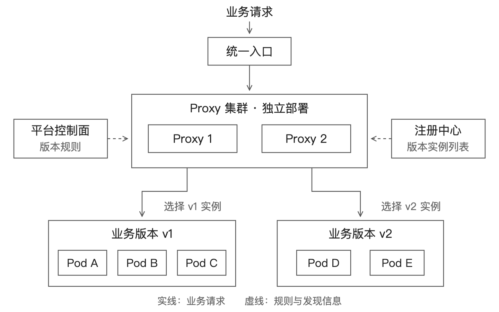
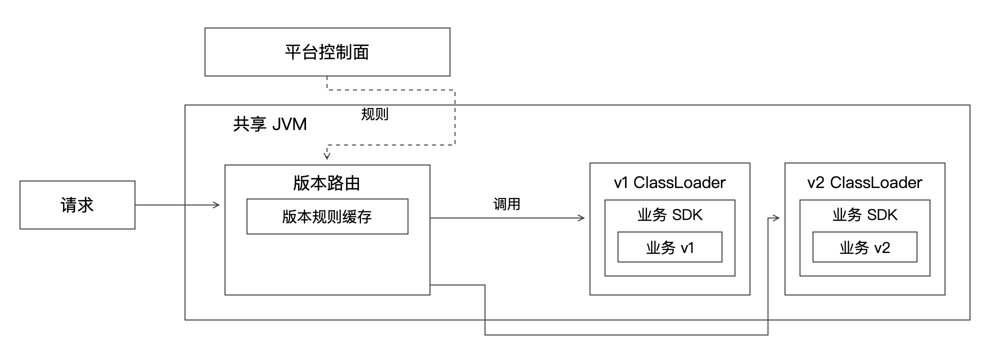
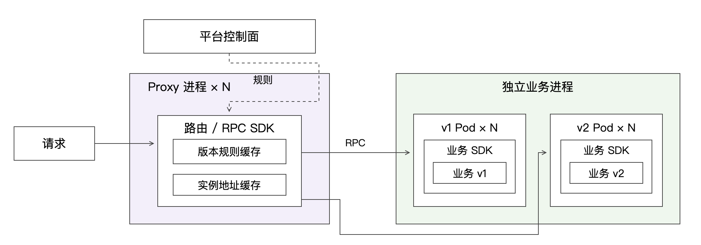
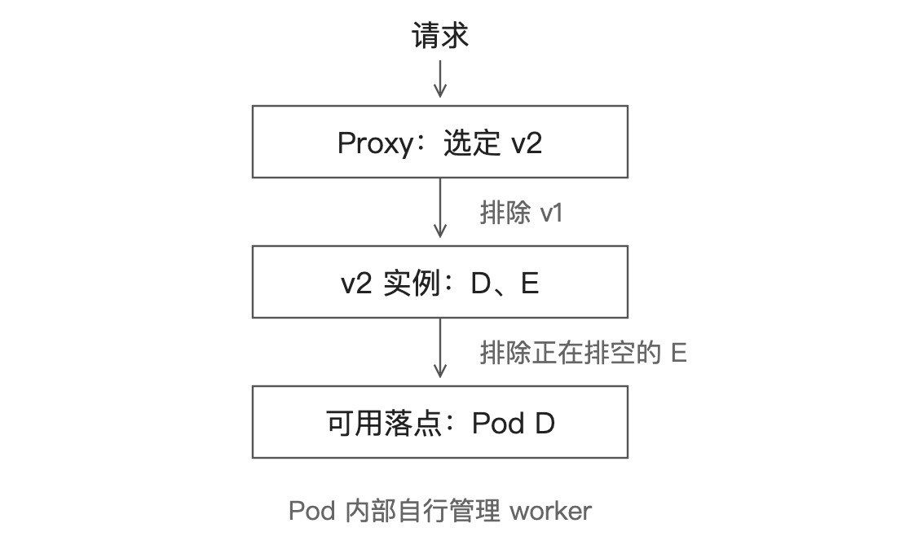

# 多版本研发平台：部署、路由与 Dubbo 服务发现

本文回答一个具体问题：同一个应用同时运行多个业务版本，每个版本有多个 Pod，怎样让请求到达正确版本中的一个可用实例？

沿一套具体实现继续读：[Dubbo多版本服务全链路](Dubbo多版本服务_发布发现路由与下线全链路.md)。固定3.2.12接口级分支，串起发布、导出注册、初始发现、目录更新、实例选择和下线，补充普通空/empty、权重全零与不同销毁粒度的反例，并提供六张简约SVG/PNG和本地实验。

先建立对象和请求路径，再看 Kubernetes、注册中心和 Dubbo 怎样分工。所有配置与代码都是教学示例，不是某套生产系统的实现声明；Java 片段未组成可直接运行的完整工程。



图中 Proxy 先确定目标版本，再选择该版本的可用实例。采用 Dubbo 时，客户端位于 Proxy 内，注册中心提供发现信息、不转发业务请求；Pod 内部 worker 不展开。

## 1. 先用五个 Pod 建立直觉

### 现有链路：共享进程热加载



### 改造方案：独立 Proxy 与业务进程



两图使用相同位置对照路由与业务模块。浅紫标出独立 Proxy，浅绿标出业务进程隔离。SDK、规则缓存和实例地址缓存的嵌套是用于说明归属的设计示意，具体缓存实现需结合实际系统核实。每个版本有多个 Pod，Pod 内 worker 由业务运行时管理；图中缓存指路由信息缓存。横向箭头分别表示版本调用路径，每次请求只选择目标版本中的一个实例。

应用叫 recommend，同时运行两个版本：

| 版本 | Pod | 状态 |
|---|---|---|
| v1 | A、B、C | 全部可用 |
| v2 | D | 可用 |
| v2 | E | 正在排空，不再接新请求 |

Proxy 是另一组独立部署的实例，负责接收并转发请求。入口流量先到某个 Proxy；Proxy 再决定本次业务请求的去向。



用户明确调试 v2，那么 A、B、C 再健康也不属于本次请求的候选集合；E 在排空，应排除；最后只能选 D。

如果 D 也不可用，结果是“v2 当前没有可用实例”，不是“随便去 v1”。能否回退必须由显式策略决定，否则用户以为验证了新代码，实际运行的是旧代码。

## 2. 四种对象不要混在一起

| 对象 | 例子 | 负责描述什么 |
|---|---|---|
| 应用 | recommend | 业务服务的稳定身份 |
| 版本 | v2 | 一份可追溯的业务发布内容 |
| 部署 | recommend-v2 在 test 环境的部署 | 制品、配置、资源与副本目标 |
| 实例 | Pod D | 实际运行并监听请求的单元 |

版本不等于 Pod。扩容 v2 是从两个实例变成四个实例，不是产生 v3。实例重启后 IP 可以变化，业务版本仍然不变。

发布单元不仅有代码，还可能有 SDK 版本、运行时镜像和配置。为复现问题，要能还原这些内容；不能让同一个 v2 标识无记录地指向不断变化的制品。

### Pod 内的 worker 由谁管

业务运行时可以在 Pod 内运行一个或多个 worker。平台只面向统一服务入口管理实例，并不必感知每个 worker。

但双方需要明确契约：什么时候 Ready、能承担多少并发、过载如何拒绝、收到退出信号如何排空、长任务如何取消。否则平台只能看到 Pod 活着，却不知道它是否还能服务。

## 3. 请求路由其实是三步

### 第一步：确定目标版本

规则可以包含指定版本、白名单、实验分桶和默认版本。它们发生冲突时要有确定的优先级。

例如一个教学策略：先验证调用方是否有权访问指定版本；有合法指定就使用它，否则判断灰度分桶，最后使用默认版本。指定版本非法时直接拒绝，不把用户输入原样变成任意服务引用。

做稳定灰度时，可以基于用户 ID 等稳定标识分桶。每次随机选版本可能让同一用户的连续请求看到不同逻辑，不适合所有业务。

### 第二步：限定候选实例

候选条件可能是：应用、环境、租户、目标版本均匹配，并且实例就绪、未排空。具体在哪一层完成取决于框架；有些条件已经由订阅身份或网络环境保证。

```text
已发现实例：[A(v1), B(v1), C(v1), D(v2), E(v2)]
匹配目标 v2：[D, E]
排除排空 E：[D]
```

这里的“平台负责限定集合”，不要求平台亲自维护所有地址和连接。平台可以生成配置，由 RPC 路由器执行；也可以选择版本专属的服务引用或 Service，让下层自然只看到这一版本的端点。

### 第三步：在候选集合中选择实例

负载均衡可以使用随机、轮询、权重、最少活跃请求等策略。健康检查和熔断还可能进一步影响可选实例。算法只能在正确集合中运行，不能替代版本筛选。

下面是职责伪代码，不是某个框架的实际 API：

```text
target = resolveAuthorizedVersion(request, rules)
instances = discover(application, environment)
candidates = filter(instances, target, ready=true, draining=false)
if candidates is empty:
    return explicitUnavailableOrApprovedFallback()
endpoint = loadBalance(candidates)
return invoke(endpoint, request, deadline)
```

反例：先在五个 Pod 中随机选到 B，发现版本不对再重试。这会把本应确定的版本约束变成概率问题，并可能真的执行错误版本。

## 4. 一应用多版本，Kubernetes 怎样部署

若 v1、v2 需要长期并存并能分别寻址，一个直接的做法是分别创建 Deployment，使用不重叠的版本选择器。

```yaml
apiVersion: apps/v1
kind: Deployment
metadata:
  name: recommend-v2
spec:
  replicas: 2
  selector:
    matchLabels:
      app: recommend
      release: v2
  template:
    metadata:
      labels:
        app: recommend
        release: v2
    spec:
      containers:
        - name: business
          image: example.invalid/recommend:v2
          ports:
            - containerPort: 8080
          readinessProbe:
            httpGet:
              path: /ready
              port: 8080
---
apiVersion: v1
kind: Service
metadata:
  name: recommend-v2
spec:
  selector:
    app: recommend
    release: v2
  ports:
    - port: 80
      targetPort: 8080
```

镜像地址是占位符，业务需要真实实现 `/ready`。生产配置还要补资源、退出机制等；制品宜使用不可变 tag 或 digest。v1 使用对应的 v1 名称、标签和镜像，形成另一组实例。

特别注意 Service 的 selector：如果只有 `app: recommend`，它会匹配两个版本；加上 `release: v2` 才限定到 v2。标签是选择条件，不是安全权限边界。[Kubernetes Service 文档](https://kubernetes.io/docs/concepts/services-networking/service/)

更新同一个 Deployment 的镜像，会触发其滚动更新流程；新旧 ReplicaSet 暂时共存，不等于建立长期独立管理的多个业务版本。[Deployment 文档](https://kubernetes.io/docs/concepts/workloads/controllers/deployment/)

### 到底谁决定具体 Pod

可以选两种路径，不需要同时使用：

- Proxy 访问版本专属 Service：平台选择版本入口，Kubernetes 网络数据面将连接送往后端端点。
- Proxy / RPC 客户端直接取得版本实例地址：平台或框架限定候选地址，再由客户端选择并调用实例。

前者更易复用已有网络能力；后者能更直接地掌握实例级策略，但需要管理地址更新、连接和故障处理。Service 本身不理解业务请求中的版本意图，版本通常已编码在目标 Service 的选择中。

Service 的转发不能简单等同于“每个 HTTP 请求都重新选 Pod”。长连接、HTTP/2 多路复用会影响实际分布；需要请求级负载均衡时，应检查 L7 代理或 RPC 客户端行为。

## 5. 注册中心如何区分版本

注册中心维护的是服务与实例信息；它通常不位于每次业务调用的数据路径中，也不自动理解业务灰度规则。

### 方式一：版本进入服务标识

```text
recommend-v1 → [A, B, C]
recommend-v2 → [D, E]
```

消费者订阅 `recommend-v2`，拿到的天然就是 v2 地址。这种方式直观，但版本多时会增加订阅、引用和治理对象数量。

### 方式二：同一服务，通过元数据区分

```text
recommend →
  A: {release: v1}
  D: {release: v2}
  E: {release: v2}
```

消费者拿到实例后，按 release 筛选。写入 metadata 不代表请求自动按它路由；还需要明确的路由器或筛选逻辑。以 Nacos 为例，实例可以携带 metadata，但业务版本筛选应结合客户端调用方式实现，不能只调用“选健康实例”就假定版本正确。[Nacos Java SDK](https://nacos.io/docs/latest/manual/user/java-sdk/usage/)

SOFARegistry 也有自己的数据标识与分组概念。DataId、GroupId、InstanceId 应按该注册中心的定义理解，不能把其中 InstanceId 直接当成 Pod ID，或与 SOFARPC 的 uniqueId 混用。[SOFARegistry 术语](https://www.sofastack.tech/projects/sofa-registry/terminology/)

## 6. Dubbo：用服务版本限制候选集合

Dubbo 是 RPC 框架，可以结合注册中心完成服务发现。服务接口、group、version 共同参与服务区分；这里用 group 表示一个服务分组，用 version 区分本例的两个发布版本。[Dubbo 分组与多版本](https://dubbo.apache.org/zh-cn/overview/tasks/develop/version_group/)

这是逻辑服务身份，不代表所有注册模型都在注册中心中创建完全相同形式的目录。接口级发现与应用级发现的存储、元数据与地址解析方式不同，不影响这里讨论的“最终必须匹配正确服务版本”。

### Provider：同版本 Pod 使用相同标识

下面片段省略 import、启动类、注册中心和协议配置。`platform.release` 由部署配置注入，例如 v1 或 v2；应在实际使用的 Dubbo/Spring 版本中核验配置解析。

```java
public interface ExecuteService {
    String execute(String requestJson);
}

@DubboService(group = "recommend", version = "${platform.release}")
public class ExecuteServiceImpl implements ExecuteService {
    @Override
    public String execute(String requestJson) {
        return runBusiness(requestJson); // 业务方法，此处省略实现
    }
}
```

A、B、C 三个 Provider 配置 v1；D、E 配置 v2。它们实现同一个 Java 接口，但对应不同的服务版本。

### Consumer：先选择引用，再选择实例

当只有固定的两个版本时，静态声明最容易说明原理：

```java
@DubboReference(group = "recommend", version = "v1", retries = 0)
private ExecuteService v1Service;

@DubboReference(group = "recommend", version = "v2", retries = 0)
private ExecuteService v2Service;

public String forward(String authorizedVersion, String requestJson) {
    return switch (authorizedVersion) {
        case "v1" -> v1Service.execute(requestJson);
        case "v2" -> v2Service.execute(requestJson);
        default -> throw new IllegalArgumentException("Unknown version");
    };
}
```

`authorizedVersion` 表示已经经过平台权限与路由规则校验的结果，不是任意外部请求头。示例 switch 表达式需要相应 Java 语言版本。

调用 `v2Service` 的含义不是绑定 D，而是限定到 v2 服务。Dubbo 再通过地址目录、路由、集群与负载均衡能力，选择可用 Provider。严格版本隔离时，不应以 `version="*"` 订阅全部版本后期待自动选对。

示例关闭框架调用重试，是为了便于解释一次调用；这不保证端到端“只执行一次”，上游重试或超时后重放仍可能重复。同步 String 接口也仅用于说明版本绑定，不代表已解决异步转发、流式响应或任务取消。

### 版本不断变化，是否每次增加一个字段

不必。可以动态创建引用，但创建动作应放在版本接入或首次受控访问流程中，并复用它，而不是每个请求都创建一次。

```java
// 示意：运行环境已完成 Dubbo ApplicationModel、注册中心等初始化。
ReferenceConfig<ExecuteService> ref = new ReferenceConfig<>();
ref.setInterface(ExecuteService.class);
ref.setGroup("recommend");
ref.setVersion(targetVersion);
ref.setRetries(0);
ExecuteService service = ref.get();
// 复用 service；版本退役并排空后，再由引用所有者回收 ref。
```

ReferenceConfig 涉及连接、目录和订阅等资源，是应复用的重对象。官方提供引用缓存机制；默认服务级缓存键不能替代平台自身所有环境、注册域或租户隔离需求。[Dubbo 引用缓存](https://dubbo.apache.org/en/docs3-v2/java-sdk/advanced-features-and-usage/performance/reference-config-cache/)

引用管理至少需要考虑：

1. 按应用模型/注册域、环境、必要的租户边界、接口、group、version 管理，避免作用域冲突。
2. 同一键并发创建时只保留一个有效引用；初始化失败可恢复，不永久缓存坏结果。
3. 只允许引用平台已授权的活跃版本，防止任意版本字符串导致资源无限增长。
4. 下线先阻止新的引用使用，再等在途调用结束，最后按框架与引用所有权规则释放资源。
5. 不在共享 ReferenceConfig 上为每个请求切换 version；并发请求会相互影响，且已有代理不会因此安全地完成逐请求换绑。

### 接口版本和发布版本是不是同一个东西

不是。接口版本表达调用契约的兼容关系；发布版本表达具体部署内容。两次发布完全可能共用一个接口版本。

为了说明多版本选择，上述示例把发布号映射到 Dubbo version。大量短生命周期版本时，应评估引用和订阅数量；另一种设计是保持接口版本稳定，以部署标签或元数据结合路由规则选发布版本。采用后一种方式，要验证规则优先级、强制匹配和无匹配回退行为，不能只“贴标签”。

## 7. 控制面与数据面为什么要分开

控制面负责创建版本、发布规则、实例生命周期；数据面负责承接实际请求并执行这些规则。Proxy 应尽量使用本地可用的配置与地址视图，而不是每次请求都去查询管理数据库。

问题在于：路由规则和实例列表不一定同时到达。

```text
t0：v2 尚未就绪，所有请求走 v1
t1：Proxy 收到“10% 流量走 v2”
t2：Proxy 才收到 v2 地址
```

在 t1 到 t2 之间，v2 请求会无实例可选。因此一个可研究的发布顺序是：部署 → 就绪检查 → 地址传播与预热验证 → 开启灰度规则 → 观察 → 扩大流量。

本地原子替换完整快照，可以减少单个 Proxy 看到半套配置的风险；它不等于跨整个 Proxy 集群实现原子切换。若规则、发现分别由不同系统提供，还需要兼容窗口、就绪门槛或显式发布协调。

控制面不可用时，已有实例是否能继续使用缓存服务，要看缓存、连接和地址变更策略。缓存能缓解短暂故障，但过旧的地址也可能失效；必须定义过期、监控和降级边界。

## 8. 发布、流量与容量是三个独立维度

一个合理的概念状态链是：

```text
制品完成 → 部署启动 → 就绪验证 → 小流量验证
       → 正常承接 → 停止新流量 → 排空在途请求 → 回收
```

不同系统可以使用不同状态名。关键是不把“进程启动”直接等同于“已经承接流量”。

假设应用总流量 1,000 QPS，v2 接 10%，则预期是 100 QPS。若 v2 单实例经压测能在目标延迟下稳定处理 80 QPS，那么两个实例正常运行可能足够，但损失一个实例后只剩 80 QPS；是否可接受，要根据可用性目标和其他限流、扩容策略决定。

实例数不是流量百分比的替代品。版本执行耗时变化、Agent 长请求和连接复用，都可能改变所需容量。

### 下线不是立刻杀进程

先撤掉新流量资格，再等待正在执行的请求，最后退出；为发现传播与连接行为预留窗口，并设置最长等待时间。Ready 变化和端点状态的传播不是瞬时完成的，应用本身仍需参与退出处理。[Pod 生命周期](https://kubernetes.io/docs/concepts/workloads/pods/pod-lifecycle/)、[EndpointSlice 状态](https://kubernetes.io/docs/concepts/services-networking/endpoint-slices/)

长任务可能超过普通退出宽限期，需要取消、外部任务状态或可恢复执行机制。具体能做到哪一步，不能只靠 Deployment 配置来回答。

## 9. 多个 Proxy 为什么还不等于高可用

多个实例主要减少单进程故障影响，但错误配置、公共下游故障、共享连接池耗尽可能同时拖垮所有实例。

至少检查四个维度：

- 路由正确性：版本不串、配置可追溯、空集合有明确处理。
- 资源隔离：不同版本是否共享并发配额、连接、队列；慢版本是否挤占其他版本。
- 生命周期：超时是否传递、调用方断连是否取消、实例下线是否排空。
- 故障恢复：配置回滚、部分实例失效、注册中心暂时不可用时怎样继续服务。

异步 I/O 可以减少等待网络时占用线程，但 CPU 密集计算和阻塞调用仍会耗尽执行资源。对长请求还要关注在途数量、连接数量、内存和尾延迟，不能只看 QPS。

## 10. Java Proxy 调 Python 服务，Dubbo 能直接替代协议吗

不能因为存在 Dubbo Python SDK，就认为 Java 的注解示例可以原样用于 Python。跨语言互通还需要确认：协议、接口描述、序列化、注册发现、服务标识以及 SDK 功能支持。

[Apache Dubbo Python](https://github.com/apache/dubbo-python) 提供 Python 实现，可以围绕 Triple 等能力研究互通；具体 group/version 语义、发现模式、流式调用和治理能力，要按选定版本验证，不能假设与 Java 完全等价。

如果业务已有成熟 HTTP/gRPC 服务，也可以先保留现有协议，用版本专属 Service 或代理路由解决版本选择，不必为了多版本而整体更换 RPC 技术栈。

## 11. 用五个问题检验是否真的理解

1. v2 的两个 Pod 都不可用，但 v1 健康，能直接转 v1 吗？——只有明确允许的降级策略才可以，否则应报告目标版本不可用。
2. 给实例加了 `release=v2`，就自动按版本路由了吗？——没有；必须让服务选择器、订阅或路由器实际使用它。
3. 一个 Deployment 滚动更新时同时有新旧 Pod，是否就是稳定多版本平台？——不是；长期寻址、生命周期和流量策略仍需独立设计。
4. 每个请求创建一个 ReferenceConfig 是否简单可靠？——会重复消耗引用相关资源；应受控创建、缓存复用并按生命周期回收。
5. 平台不管理 worker，是否可以不关心并发能力？——不可以；内部实现可自治，对外容量、背压、健康和退出契约仍要明确。

继续阅读：[容器与服务治理](容器与服务治理_隔离发布和故障定位.md)、[JVM 类加载隔离与内存回收](JVM_类加载隔离与内存回收.md)。
