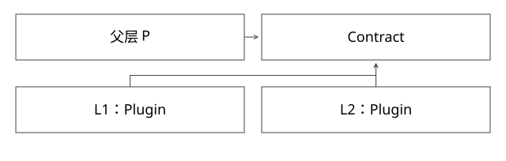

# 类加载委派与类身份

为什么同名类可能不能互转，又为什么两个版本仍能实现同一个接口？

源码基线：openjdk/jdk17u · jdk-17.0.14+7。[固定源文件](https://github.com/openjdk/jdk17u/blob/c5c90ffa45d0c14bcb013164f0992938eb4740ab/src/java.base/share/classes/java/lang/ClassLoader.java)；方法名是导航，下面逐步解释条件与状态。



## 先分清四个对象

class 文件是一份字节，Class 是 Java 可见的类镜像，定义加载器决定该类属于哪个类型命名空间，发起加载器则是某次请求中被 JVM 记录为发起者的加载器。不能把“从哪个目录读到文件”直接当成类身份；核心是二进制名与定义加载器。

父加载器 P 定义 Contract；子加载器 L1、L2 分别定义 Plugin。两个 Plugin 的 Class 不相等，但都可以转换为 P 的 Contract。若 L1、L2 各自定义了 Contract，它们就只是名字相同的两种接口。这也解释参数跨版本调用为何可能出现 ClassCastException 或加载约束错误。

## 关键代码的语义化简

对应 loadClass(name,resolve)，以下是解释控制流的伪代码，不是可直接替换 JDK 的实现：

```text
拿 getClassLoadingLock(name)
  c = findLoadedClass(name)
  若尚无结果:
    尝试 parent.loadClass，或 bootstrap 查找
    只在父层报告没找到时，进入自己的 findClass
  若 resolve 为真: resolveClass(c)
  返回 c
```

第一步查“已经加载”，不是先到自己的 jar 找字节。否则重复调用 loadClass 就可能反复 defineClass，触发重复定义。委派不是广播所有加载器，也不是保证所有加载器的父指针构成依赖管理框架。

getClassLoadingLock 对普通加载器与已注册 parallel-capable 的加载器可以返回不同粒度的锁。一个按加载器串行，一个可按类名协调；它们都还需要保证同一类型的定义不会被同名并发请求重复完成。

## 完整推导：L1 首次请求 Plugin

1. L1 没有记录，先问 P。
2. P 找不到 Plugin，L1.findClass 从版本产物取得字节并 defineClass。
3. Plugin 解析 Contract 时又先问 P，得到共享 Contract。
4. L2 重复这个过程，定义自己的 Plugin，却复用 P 的 Contract。
5. 主程序接收 Contract 参数时，两者都满足共同类型关系；把 L2 对象强转为 L1.Plugin 则不成立。

注意父层若已经能找到 Plugin，两个子层可能都得到父层同一份 Plugin。仅 new 两个 URLClassLoader，不足以证明隔离已经发生。

## 为什么 child-first 需要白名单边界

child-first 改的是查找策略，不是取消 JVM 类型约束。公共接口、序列化类型和跨层参数应有明确归属；第三方依赖是否允许隔离也应单独决定。不要把 java.* 类、宿主 API 与业务实现不加区分地全部抢先定义。

一种可解释的策略是：公共契约走父层，明确隔离的业务包走子层，其余依赖按规则处理。还需处理资源查找、服务发现与线程 context class loader，否则“类来自新版本，配置来自旧版本”仍可能发生。

## 验证与排查

现有 ExpertMechanics.java 的类身份实验使用 platform parent，避免父层直接找到测试实现，断言两个 Class 不相等、交叉 isInstance 失败、共同 Runnable 成功。排查现场还应打印类名、getClassLoader 和来源位置，而不是只看异常中的同名字符串。

## 自测

问：两个文件内容相同、类名相同，能否必然互转？答：不能；先核对定义加载器。问：resolve=true 是否必然执行静态块？答：不能这样推导，链接与初始化是不同协议。

[查看可编辑 SVG](assets/deep-points/01.svg) · [查看 PNG](assets/deep-points/01.png) · [返回知识点目录](实现详解_00_知识点目录.md)

