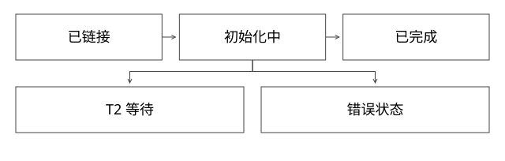

# 类初始化状态机

为什么静态初始化只执行一次，失败后再访问又会得到不同异常？

源码基线：openjdk/jdk17u · jdk-17.0.14+7。[固定源文件](https://github.com/openjdk/jdk17u/blob/c5c90ffa45d0c14bcb013164f0992938eb4740ab/src/hotspot/share/oops/instanceKlass.cpp)；方法名是导航，下面逐步解释条件与状态。



## 加载锁和初始化锁不是一把概念上的锁

loadClass 协调类型加载；initialize_impl 协调这个已定义类型是否已经初始化。拿到 Class、验证链接完成、执行 `<clinit>` 是不同进度。静态字段初始化表达式和静态块会进入类初始化逻辑，实例构造器则是另一条执行路径。

本版 initialize_impl 先 link_class，再取得 init_lock。状态包括 being_initialized、fully_initialized、initialization_error，并保存正在初始化的线程。真正执行初始化器时，前面的局部锁作用域已结束；其他线程主要根据状态等待，不应描述为一直持有该 monitor 运行所有静态块。

## 关键分支逐个读

```text
在初始化协调区：
  正在初始化，且不是当前线程负责 -> 等待并重检
  正在初始化，且正是当前线程负责 -> 递归请求直接返回
  已完成 -> 返回
  已错误 -> 抛 NoClassDefFoundError
  否则标记“初始化中”，记录当前线程
协调区外：
  初始化必要父类型，调用本类初始化器
  重新协调发布“完成”或“错误”，通知等待者
```

递归返回不是说明静态字段全都有最终值。初始化过程中若通过方法回读尚未执行赋值的静态字段，可能看到准备阶段的默认值。它避免自等待，却没有创造一个已完成的对象世界。

## 完整推导：两线程首次使用同一类

| 时刻 | T1 | T2 | 类状态 |
|---|---|---|---|
| t0 | 开始主动使用 | 尚未使用 | 已链接 |
| t1 | 记下自己并执行初始化器 | 进入并发现 T1 在初始化 | 初始化中 |
| t2 | 等待一个外部依赖 | 在初始化协议上等待 | 初始化中 |
| t3 | 完成静态赋值 | 被通知后重检，再继续使用 | 已完成 |

T2 不会为同一类再执行第二次初始化器。反过来，若 T1 的初始化器等待 T2 必须执行的任务，而 T2 又主动使用这个类，就可能构成等待环。初始化线程自己等待外部任务，正是排查“启动卡住”的关键。

## 错误分支为什么不同

本类初始化器抛出非 Error 的异常，本版将类记为错误，并向首次触发方抛 ExceptionInInitializerError；若本来就是 Error，则按相应分支传播。后续主动使用遇到已错误状态，抛 NoClassDefFoundError，并可能携带保存的初始化失败原因。

这不是每次都重新尝试静态块，也不意味着后来的异常必然是 jar 丢失。父类型初始化失败还有其传播分支，不能把所有错误都描述成同一个包装异常。

## 怎样做可重复实验

新增 DeepStateTransitions.java 用 Class.forName(name,false,loader) 先取类镜像，确认未执行初始化；再让 T1、T2 主动触发，借助锁存器控制先后，检查执行计数为 1。失败类则主动使用两次，分别断言首次包装错误与后续错误状态。实验不依赖 sleep 猜调度。

恢复方式也要匹配错误根因：如果同一类身份已进入错误状态，简单重试同一方法不会把它变回初始状态。更换可用版本或重新建立类身份，是不同于“捕获后继续”的方案。

## 自测

问：初始化中递归请求返回，能否读取尚未赋值字段的最终值？答：不能。问：两个加载器中的同名类共享这一个初始化状态吗？答：不共享类身份，但外部文件、环境与服务仍可共享。

[查看可编辑 SVG](assets/deep-points/02.svg) · [查看 PNG](assets/deep-points/02.png) · [返回知识点目录](实现详解_00_知识点目录.md)

