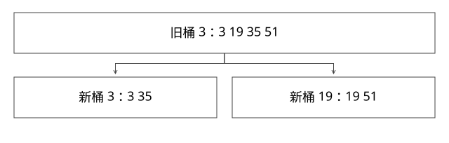

# HashMap扩容与树化

扩容到底改了哪些指针，为什么树化也不能无条件承诺对数查找？

源码基线：openjdk/jdk17u · jdk-17.0.14+7。[固定源文件](https://github.com/openjdk/jdk17u/blob/c5c90ffa45d0c14bcb013164f0992938eb4740ab/src/java.base/share/classes/java/util/HashMap.java)；方法名是导航，下面逐步解释条件与状态。



## 数组、桶和节点分别保存什么

Node 保存 hash、key、value、next；数组槽位保存桶首引用。hash 是扰动后的值，resize 不需要为每个 key 再调用 hashCode。容量是二的幂，因此索引使用低位掩码。

从容量 16 扩到 32，旧桶 j 的节点只有 j 与 j+16 两个目的地。原因不是碰巧，而是新掩码只多检查值为 16 的那一位。

## 完整推导：把四个节点拆成两条链

旧桶 3 为 hash=3→19→35→51：

```text
3  & 16 = 0   -> low：3
19 & 16 = 16  -> high：19
35 & 16 = 0   -> low：3 -> 35
51 & 16 = 16  -> high：19 -> 51
新桶[3]  = low
新桶[19] = high
```

源码分别维护 loHead/loTail、hiHead/hiTail，以尾插保留各分组内相对顺序，最后把尾节点 next 置空。若忘了断尾，低位桶可能继续串到高位桶旧节点。不要把这个实现套成 JDK 7 的头插行为，也不要把 CHM 迁移的复制策略套过来。

链的拆分只需要遍历一次。数组变大占用额外内存，重新分配与搬桶会造成一次操作的延迟尖峰；平均复杂度不表示每次 put 都固定常数时间。

## putVal 的计数为何容易背错

TREEIFY_THRESHOLD=8，但在这条普通追加路径，已有 8 个节点时追加第 9 个，循环计数达到相应条件，才调用 treeifyBin。数组长度不足 64 时，该方法又可能先扩容。compute 等其他路径要看自己的计数，不能把“阈值 8”变成“所有 API 第 8 个立即树化”。

树化维护 TreeNode，也会维护桶内链接等关系；退化回链与 resize 拆树又有自己的条件。不能仅因元素数下降一次，就断言任意删除路径都按同一个固定 N 立即退化。

## 红黑树为什么仍有特殊查找代价

TreeNode.find 先比较 hash；hash 相同先判等，再尝试可用的 Comparable 顺序；无法建立有用顺序时，可能需要搜索两侧子树。插入时的 tie-break 顺序，不等于查询任意新 key 都能可靠复现唯一方向。

因此红黑树保持平衡，不代表所有不可比较、同哈希 key 都有严格 log n 的 equals 次数。现有实验构造 32 个同哈希非 Comparable key，确认桶是 TreeNode，再查询不存在 key，观察到 33 次 equals。这个数是本次实现与数据的观察值，反例意义是不能无条件许诺对数查找。

## 可变 key 为什么会“明明在 Map 中却找不到”

插入时保存 hash=h1，后来 key 的参与 equals/hashCode 字段改变，get 算得 h2，可能走不同桶或不匹配保存 hash。扩容使用旧 hash，不会自动修复。即使 key 对象引用相同，也必须先走到相应检查路径。

正确做法是让 key 的等价关系与哈希在作为键期间稳定；若要修改，按旧身份删除，再按新身份插入。并发环境还多了安全发布与数据竞争问题。

## 验证与自测

运行 ExpertMechanics.java 可观察拆桶与树桶查找。进一步构造容量 64 的同哈希节点序列，分别记录第 8/9 次插入前后桶类型；不要依赖默认容量导致的额外 resize 混淆结论。


## 自测

resize 是否为每个 key 重调 hashCode？否。低位链和高位链相对顺序是否保持？本版 HashMap 这条路径保持。普通 HashMap 的双表搬迁能否供并发读写安全使用？不能。

[查看可编辑 SVG](assets/deep-points/04.svg) · [查看 PNG](assets/deep-points/04.png) · [返回知识点目录](实现详解_00_知识点目录.md)

