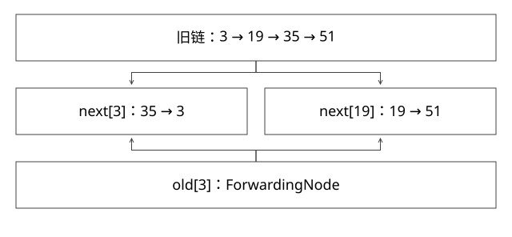

# ConcurrentHashMap并发迁移

旧表、新表和并发读写如何在扩容期间衔接？

源码基线：openjdk/jdk17u · jdk-17.0.14+7。[固定源文件](https://github.com/openjdk/jdk17u/blob/c5c90ffa45d0c14bcb013164f0992938eb4740ab/src/java.base/share/classes/java/util/concurrent/ConcurrentHashMap.java)；方法名是导航，下面逐步解释条件与状态。



## 先给对象命名

table 是当前表，nextTable 是本轮迁移目的表；普通 Node 包含 volatile val/next 等字段。ForwardingNode 保存 nextTable，hash 标记为 MOVED。transferIndex 用于认领迁移区间，sizeCtl 在不同阶段具有阈值、初始化或扩容协调等不同语义。

不要把“用了 CAS”当成完整答案：必须指出哪一个字段、什么前置条件，以及 CAS 失败后怎样恢复观察。

## 插入的两种竞争

空桶使用 casTabAt(null,newNode)。T1/T2 都见到空，仅一个 CAS 成功，失败者重读循环。非空桶锁首节点 f；取得锁后还要核对 tabAt(tab,i)==f，否则可能锁住已经脱离当前表的旧首节点。

这个复核解决的是“等待期间表结构已经变化”。没有复核，拿到一把合法对象锁，也可能修改一个不再代表当前桶的对象。

## 完整推导：lastRun 为什么不是 HashMap 的尾插拆链

取旧链 hash=3→19→35→51，oldCap=16，分组位为 0、1、0、1。最后一个同分组后缀从 51 开始，因此 lastRun=51。迁移复用这个后缀；前面的节点构造副本并分别头插：

```text
初始 high=51，low=空
处理 3： low=3
处理19： high=19 -> 51
处理35： low=35 -> 3
发布 next[3]=low，next[19]=high
最后发布 old[3]=ForwardingNode(next)
```

这里低位链顺序变为 35→3，并不违反 Map 契约。重点是迁移不随意改断旧读者正在遍历的链，而不是保证和 HashMap 相同顺序。

## 三个时间点的读写

| 时间点 | 读线程 | 写线程 |
|---|---|---|
| 尚未发布转发节点 | 可以持有并遍历旧链 | 与搬桶竞争桶锁，进入后复核 |
| 新桶已准备、旧桶刚变路标 | 经 ForwardingNode.find 到新表 | 遇 MOVED 后尝试 helpTransfer |
| 迁移全部完成 | 后续从新 table 查找 | 后续从新 table 更新 |

新桶先准备、路标后发布很重要；不能反过来让读者已跳转却尚未建立目标桶。读侧的 tabAt、节点字段与发布方式共同提供可见性；get 不需要为了读取而获取写线程那把桶锁。

get 遇转发节点主要沿 find 导航，不是所有读者都帮助搬桶。helpTransfer 的参与还要满足本轮表身份、sizeCtl 和剩余区间等条件。

## sizeCtl 与收尾不能只看符号正负

扩容线程分段工作，参与者通过相应 CAS 加入/退出。最后参与者还需确认搬迁完成，才切换 table 并清理 nextTable。一个线程迁完自己的区间，不代表可以独自把整个扩容宣布完成。

size、遍历和多 key 组合并不因此获得全局快照语义。“A 的值与 B 的值来自同一业务事务”需要上层协议，不能从两个 get 都线程安全推导。

## computeIfAbsent 的业务边界

空桶可用 ReservationNode 协调初始化；已有桶有其同步路径。慢 mappingFunction 可能阻塞相关更新，递归更新也有约束。把远程调用放进去还需定义超时、取消和失败后的占位清理；缓存一个 Future 只把问题显式化，不会自动解决任务生命周期。


## sizeCtl不是一个简单的“正在扩容”布尔量

本版将本轮扩容戳放到高位，再叠加参与者计数偏置。记R=resizeStamp(n)<<RESIZE_STAMP_SHIFT，发起线程把sizeCtl从正阈值CAS为R+2；另一个协作者成功加入后变成R+3。线程退出时CAS减一，观察旧值是否满足sc−2=R，只有最后退出的执行者转入finishing复查，而不是谁先迁完区间谁切表。

因此“负数表示扩容”只说对了一部分。新协作者还要核对table、nextTable、本轮戳和剩余transferIndex，避免把旧表的转发节点错接到新一轮扩容。计数使用位编码和偏置，不直接等于十进制线程数；也不应用源码中某个瞬间值推断系统实时活跃线程。

对比一个错误方案：T1搬完桶15–8便切换table，但T2的7–0尚未准备，后续get可能直接从缺桶的新表查出不存在。区间认领解决工作分配，最后复查和发布解决全局完成，这是两个协议。压力测试应在多次扩容期间持续校验已完成插入的key，不能只在所有线程结束后查最终size。

## 自测

若只锁 f 而不复核当前桶，哪里会错？若先写路标再准备新桶，读者会看到什么？请从对象身份与发布顺序回答。

[查看可编辑 SVG](assets/deep-points/05.svg) · [查看 PNG](assets/deep-points/05.png) · [返回知识点目录](实现详解_00_知识点目录.md)

