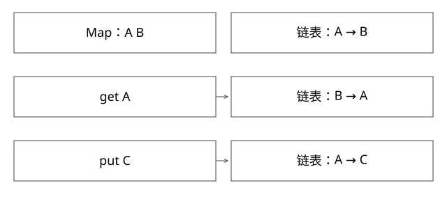

# 严格LRU与复合状态一致性

为什么使用线程安全 Map，仍可能写出不正确的 LRU？

源码基线：openjdk/jdk17u · jdk-17.0.14+7。[固定源文件](https://github.com/openjdk/jdk17u/blob/c5c90ffa45d0c14bcb013164f0992938eb4740ab/src/java.base/share/classes/java/util/LinkedHashMap.java)；方法名是导航，下面逐步解释条件与状态。



## LRU 同时维护两个索引

Map 从 key 找节点，双向链表表示最近访问顺序。它们必须引用同一批逻辑条目。严格全局 LRU 的不变量是：每个有效 key 在 Map 和链表各一次；头尾和双向指针一致；对外完成一次操作后容量不超限；淘汰的是最久未访问节点。

LinkedHashMap 的 before/after 扩展 HashMap 节点，通过 afterNodeAccess、afterNodeInsertion、afterNodeRemoval 等维护这套关系。accessOrder=true 时，一次成功 get 可能移动节点并修改结构，不能一律使用读锁。

## 完整推导：容量为 2 的序列

| 操作 | 从最旧到最新 | 需要改变什么 |
|---|---|---|
| put A | A | Map 新增，链尾挂入 |
| put B | A,B | Map 新增，链尾挂入 |
| get A | B,A | 摘 A，再挂尾 |
| put C | A,C | 插 C 后删掉最旧 B |
| put A 新值 | C,A | 更新值并提升顺序 |

只改 value 不更新访问顺序，会改变约定语义；只删链表不删 Map，会留下无法正确淘汰的幽灵条目。

## 为什么 CHM 加一个链表锁不够

设 put C 已在 CHM 放入 C，但尚未取得链表锁；另一个线程看 size=3 开始淘汰 B；第三个 get B 已从 CHM 拿到 B 的旧节点，随后准备提升。若摘除与提升没有同一个原子操作范围，可能将已淘汰节点重新挂回链表。

根因不是 CHM 不线程安全，而是“Map 更新、摘挂、容量判定”之间缺少共同提交点。多个原子小动作的组合不必原子。

## 最小正确实现

```java
lock.lock();
try {
    V value = accessOrderMap.get(key);
    // get 内部可能改变访问顺序，必须位于保护区
    return value;
} finally {
    lock.unlock();
}
```

put 也在同一把锁中完成插入和必要淘汰；size 与快照观察按契约受保护。现有 ExpertMechanics.java 提供容量检查实验。若允许 null，需要分清“未命中”与“值是 null”；若支持 loader，不能默认在锁里做长时间 I/O。

## 高并发为什么常采用近似策略

分段使每段容量和访问顺序独立，降低竞争，却不再是全局精确 LRU。异步缓冲访问记录可能丢弃或延后提升；它改善吞吐，换来近似淘汰语义。需要说清“允许淘汰一个稍新条目”是否影响业务，而不是把库名当正确性证明。

缓存中值对象的可变性也是另一个边界：Map/链表同步正确，不意味着返回对象可以被多个线程任意修改。

## 怎样验证而不是只跑大并发

先用容量 0、重复更新、命中提升、未命中不改序、删除头尾等确定性序列；再做并发压力，记录操作历史。压力测试没报错，不等于证明线性化；仍需找到每个操作对外生效的临界区。


## 自测

如果对 get 用共享读锁，两个线程分别摘挂节点，会不会同时改变 before/after？会。若愿意改成近似淘汰，需要先修改语义契约，而不是只移除锁。

[查看可编辑 SVG](assets/deep-points/06.svg) · [查看 PNG](assets/deep-points/06.png) · [返回知识点目录](实现详解_00_知识点目录.md)

