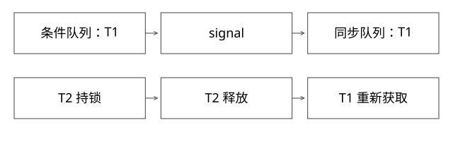

# AQS锁与Condition等待

等待队列、锁状态和条件队列怎样协作，为什么唤醒不等于得到锁？

源码基线：openjdk/jdk17u · jdk-17.0.14+7。[固定源文件](https://github.com/openjdk/jdk17u/blob/c5c90ffa45d0c14bcb013164f0992938eb4740ab/src/java.base/share/classes/java/util/concurrent/locks/AbstractQueuedSynchronizer.java)；方法名是导航，下面逐步解释条件与状态。



## 三种状态不能混成一个“阻塞”

ReentrantLock 的 state 表示重入计数，owner 表示持有线程，AQS 同步队列表示等待竞争资格。ConditionObject 还有条件等待链，表示等待某个业务谓词。处在条件链并不意味着已经进入同步队列争锁。

本版 AQS 是 OpenJDK 17u 的固定实现，节点状态与旧版本教程不一定一致；请沿 acquire、release、ConditionObject.await/doSignal 阅读，不机械套用 JDK 8 节点字段。

## 获取与释放的提交位置

state=0 时 CAS 抢占成功是一个获取关键点；重入由当前 owner 增加计数。tryRelease 先验证当前持有者，再递减；计数归零才完整释放，release 才推进后继信号。unpark 给予线程继续竞争的机会，不直接改 owner 为被唤醒者。

公平策略影响尝试条件，不等于操作系统调度绝对 FIFO。ReentrantLock 的无参 tryLock 有单独的即时非公平尝试边界，不能把 fair=true 推广到所有 API。

## 完整推导：一次 await 与 signal

```text
T1 已重入两次，state=2
T1 await：进入条件链，保存2，完整释放锁
T2 lock：取得锁，修改“队列非空”业务状态
T2 signal：条件节点转入同步队列
T2 仍持锁：T1 此时不能从 await 正常返回
T2 unlock：T1 竞争成功，恢复持有计数2，再继续执行
```

本版 await 在等待和中断/转移竞争中有不同处理：节点仍在条件链时取消，与已被 signal 转移后发生中断，不是完全一样的返回路径。正常继续之前仍需重新获得锁；不能在释放锁后立即向调用者抛出并破坏其 finally/unlock 约定。

## 为什么业务条件必须用 while

生产者放入一个元素并 signal 后，另一个消费者可能先拿锁取走它。被唤醒的消费者再次持锁时，条件又变假；即使没有这种竞争，也应容纳允许的非业务条件满足的唤醒。

```java
lock.lock();
try {
    while (queue.isEmpty()) notEmpty.await();
    return queue.remove();
} finally {
    lock.unlock();
}
```

signal 是通知，不是“分配给 T1 一件商品”的业务承诺。若要这种承诺，必须把元素分配建模成持锁状态，而不是依赖唤醒次数。

## 入队、WAITING 与 park 的竞态

acquire 循环会核查前驱、尝试获取、CAS 入队、设置等待状态并再次检查，再决定 park。释放可能恰好发生在这些阶段之间；如果仅“检查失败后无条件睡眠”，会存在遗漏唤醒的窗口。LockSupport permit 可让先 unpark 后 park 不永久睡眠，但不能代替重检，也不是任意累加的信号量。

取消、超时还会留下需要清理的节点，所以队列维护不只是 tail.next=node。取消节点被跳过，不应把后继永久堵住。

## 验证与自测

DeepStateTransitions.java 用锁存器证明 signal 后持锁者尚未 unlock 时等待者不能继续，并检查 await 重新取得了锁。实验不强制验证某个未承诺的线程调度顺序。


## 中断发生在signal前后，返回为什么不同

按本版ConditionObject.await读：先检查调用前中断，enableWait保存锁状态并释放；等待时用COND标志竞争“仍属于条件等待”这一事实。若中断先清掉COND，cancelled为真；若signal已清标志并推动转移，则属于另一条分支。两条路径最终都先调用acquire，以savedState重新取得锁。

重新持锁后，前一种取消路径清理条件链并抛InterruptedException；后一种保留signal转移结果，重新设置当前线程中断标志。不能把JDK旧版的常量名直接背到这份实现上，也不能承诺所有时间点的中断都表现为同一种异常。

用状态推演验证finally为何安全：T1重入计数2→await释放至0→T2执行signal→T1在排队时中断→T2解锁→T1重新取得2层持有→再按竞争结果返回或抛异常。调用方finally仍可按原层数解锁。如果等待期间不重新持锁就向上抛，原来的unlock反而会出错。

## 自测

T2 signal 后做 3 秒慢 I/O，T1 能先执行业务吗？不能，T2 仍持锁。优化应缩短临界区，而不是重复 signal。

[查看可编辑 SVG](assets/deep-points/07.svg) · [查看 PNG](assets/deep-points/07.png) · [返回知识点目录](实现详解_00_知识点目录.md)

