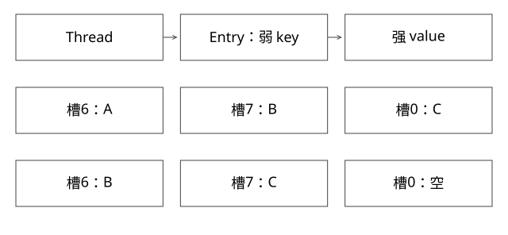

# ThreadLocal探测清理与串号

弱 key 为什么仍能留住 value，又为什么删除槽位后要重排探测簇？

源码基线：openjdk/jdk17u · jdk-17.0.14+7。[固定源文件](https://github.com/openjdk/jdk17u/blob/c5c90ffa45d0c14bcb013164f0992938eb4740ab/src/java.base/share/classes/java/lang/ThreadLocal.java)；方法名是导航，下面逐步解释条件与状态。



## 引用归属先画对

Thread 对象持有 ThreadLocalMap。Entry 的 key 是对 ThreadLocal 的弱引用，value 是普通强引用。不是“全局 ThreadLocal 对象存了一张线程 Map”。只要线程与表存活，key 清空不代表 value 自动从表删除。

失效条目清理由 get/set/remove 相关路径机会式触发，没有一个通用后台线程通过 ReferenceQueue 立刻扫掉全部 value。线程池中的长寿命 worker 会放大生命周期错误。

## get 的快路径和碰撞路径

用 threadLocalHashCode & (len-1) 找初始槽；直接命中 key 则返回。发生碰撞就向后线性探测，经过数组尾部会环绕；发现失效 key 时可进入 expungeStaleEntry 等路径。

这说明它和链式 HashMap 不是同一种碰撞结构，也不能将 key 清空简单当作该槽从未被使用过。

## 完整推导：为什么不能只清空一个槽

构造教学表长 8：A 的 home=6、B 的 home=6、C 的 home=7。插入后 A 在 6、B 在 7、C 环绕到 0：

```text
初始：槽6=A，槽7=B，槽0=C
A 的弱 key 清空
若只设槽6=null：
  查 B 从 home6 开始看到空，会提前认为不存在
正确清理：
  移除失效A，重新安排后续探测簇
  B 可回槽6，C 可回槽7，槽0变空
```

expungeStaleEntry 会从失效位置清理，继续扫描到原有空槽，重新计算仍有效条目的位置并搬放。这个例子是开放寻址模型，不是声称三次真实 ThreadLocal 创建恰好产生这三个 hash。

## 两类问题需要不同证据

第一类是弱 key 已清空但 value 暂存，涉及 GC 与机会清理。第二类是 ThreadLocal 自身仍存活，却忘了 remove，下一任务读到旧值；它不需要 GC 就会发生，且常常更容易稳定复现。

```java
try {
    tenant.set(currentTenant);
    runBusiness();
} finally {
    tenant.remove();
}
```

若框架已经设置了外层值，内层代码应按嵌套作用域恢复旧值，而非随意删除外层上下文。这里的清理契约必须与调用方约定。

## 异步传播不是自动继承

普通 ThreadLocal 不跨 executor 任务传播；InheritableThreadLocal 的创建线程继承语义也不能当作线程池每次提交的上下文传播。应在提交时捕获需要的最小上下文，在执行时安装，结束时恢复/清理，避免把整个业务对象图长期捕获。

传播敏感身份还需要权限判断，不能因为上下文里有租户字段，就把它当成可信授权。

## 验证与自测

ExpertMechanics.java 在单线程池顺序执行两任务，稳定重现未清理后的串号，再验证 remove。新增模型验证开放寻址清理，不强制 GC 时间。


## 自测

value 为旧加载器定义对象时，为什么影响类卸载？因为长期线程保留 value，可能间接保留该类身份及加载器生命周期；详见类卸载篇。

[查看可编辑 SVG](assets/deep-points/08.svg) · [查看 PNG](assets/deep-points/08.png) · [返回知识点目录](实现详解_00_知识点目录.md)

