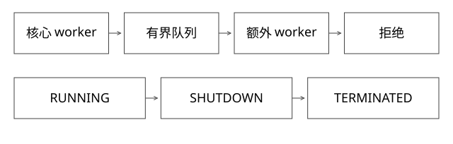

# 线程池接纳关闭与任务异常

线程池为何先排队后扩到 maximum，shutdown 又怎样与提交竞争？

源码基线：openjdk/jdk17u · jdk-17.0.14+7。[固定源文件](https://github.com/openjdk/jdk17u/blob/c5c90ffa45d0c14bcb013164f0992938eb4740ab/src/java.base/share/classes/java/util/concurrent/ThreadPoolExecutor.java)；方法名是导航，下面逐步解释条件与状态。



## ctl 把两个维度放在一个原子状态中

ThreadPoolExecutor 用 ctl 编码运行状态与 worker 数；不能只读 workers.size 判断能否接任务。运行状态区分 RUNNING、SHUTDOWN、STOP、TIDYING、TERMINATED，worker 数是另一个维度。通过同一原子值判断，减少状态转换与计数各自变化造成的不一致观察。

Worker、Thread 与 Runnable 也不是同一对象：Worker 包含线程和首任务，线程启动后在 runWorker 中继续从队列取任务。

## execute 的完整决策

```text
若 worker 数小于 core：尝试 addWorker(command, core约束)
否则/失败后：
  若仍 RUNNING 且 queue.offer 成功：
    重新读取 ctl
    若已不接收且能从队列移除该任务 -> reject
    否则若 worker为0 -> 尝试补 worker
  否则尝试 addWorker(command, maximum约束)
  仍失败 -> reject
```

先 offer 再重检不是多余：shutdown 可在两次观察之间发生。若任务已被 worker 取走，remove 可能失败，不能当作这个任务从未进入执行；具体状态与队列事实需共同判断。

## 完整推导：core=1、max=2、queue=1

T1 的任务持锁存器阻塞，第 2 个任务排队，第 3 个任务因队列满创建第二 worker，第 4 个任务才拒绝。若队列改为无界，第 3 个通常也能入队，maximum=2 就不在这条正常饱和路径上扩容。

这不是“线程数先涨到 maximum，再排队”。等待时间由队列长度和服务时间共同决定，允许百万任务入队不等于有百万任务处理能力。

## execute 与 submit 为什么观察到不同异常

execute 提交的 Runnable 直接抛出未捕获运行时异常，可使该 worker 的任务执行异常结束并触发相应退出/补充路径。submit 往往先把任务包为 FutureTask，任务异常被保存进 Future；不调用 get 或不做其他结果检查，调用方可能完全看不到失败。

afterExecute 收到的参数也应结合任务封装解释；不能只判断 Throwable 参数是否为空，就认定所有 submit 任务成功。

## 关闭和取消的边界

shutdown 不再接收新任务，但按协议处理已有排队任务；shutdownNow 尝试中断并返回未启动任务，不保证正在运行且忽略中断的代码立即停下。Future.cancel(true) 也是取消/中断请求，不是远端 RPC 或数据库事务撤销证明。

长任务应定义中断点、超时、外部请求取消和补偿。若用 CallerRunsPolicy，拒绝压力会进入调用线程；调用线程是 EventLoop 时，这可能把业务过载传播到公共 I/O 线程。

## 怎样定容量

先估算可承受在途任务、任务内存、服务时间和下游并发上限，再决定并发与有界排队。CPU 密集、阻塞等待和混合任务不能只用同一条“CPU核数乘二”公式。还应测排队时间而不仅是执行时间。

现有实验用锁存器固定接纳顺序。

## 从服务能力反推队列，而不是反过来

用一个可手算但非生产配置的例子：单任务平均占用worker 40ms，入口500任务/秒。在稳定且能承受该负载的前提下，平均工作中任务量约为500×0.04=20；若只有10个完全串行处理worker，其平均理论能力约250任务/秒，队列长期净增长约250任务/秒，改成百万队列只是在延后失败。

若每个等待任务保留20KiB上下文，5万排队任务仅这些对象就约977MiB，还未计对象头、网络缓冲和执行中工作。队列大小既受等待时限约束，也受内存约束，不能只看吞吐。

上面用平均值做量纲估算，不是用平均时延保证p99。真实容量要测服务时间分布、阻塞比例、下游限制和饱和拐点；还应观测从提交到开始的排队时间。拒绝后无上限立即重试会把拒绝变为新流量，必须在入口预算与退避协议中一起处理。

补充算例验证：[depth_review_models.py](examples/source-level/depth_review_models.py) 中的 test_queue_catchup_memory_and_peak 复算平均在途数、处理能力与排队内存，不运行真实线程池压测。

## 自测

把 queue 容量扩大十倍，是否会提升下游可处理 QPS？不会自动提升，可能只增加等待和内存。shutdownNow 返回后是否保证全部业务副作用终止？不保证。

[查看可编辑 SVG](assets/deep-points/09.svg) · [查看 PNG](assets/deep-points/09.png) · [返回知识点目录](实现详解_00_知识点目录.md)

