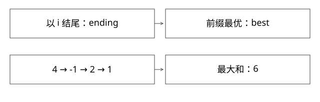

# 最大连续子数组的状态不变量

为什么只保留两个数就能求最优结果，又怎样处理全负和溢出？

实现基线：本库 [ExpertMechanics.java](examples/source-level/ExpertMechanics.java)，这是教学实现，不冒充某个开源内核。



## 先明确问题契约

输入非空整数数组，只允许选择一段连续且非空的子数组，求最大和。非空限制很重要：若允许空段，全负数组可返回 0；本篇契约则必须返回其中最大元素。算法快之前，先确认题目究竟允许哪一种答案。

暴力枚举起点和终点并逐段重复求和，可出现三重循环；保留累加和可降到平方。线性算法进一步利用“必须以当前元素结束”的局部状态。

## 两个状态分别约束什么

ending(i) 只讨论以 i 为最后元素的段；best(i) 讨论前缀 0..i 中所有合法段。以 i 结尾的最优段只有两种来源：从 i 自己开始，或接在以 i−1 结尾的最优段之后。连续性排除了跳过中间位置的其他来源。

```text
ending(i) = max(a[i], ending(i-1)+a[i])
best(i)   = max(best(i-1), ending(i))
初始 ending(0)=best(0)=a[0]
```

这就是充分状态：未来需要知道的是当前结尾最优值，不需要保存每个历史候选的完整元素。若还要返回边界，可在选择“重新开始”时记录起点，并在刷新 best 时记录最终区间。

## 完整推导：[-2,1,-3,4,-1,2,1,-5,4]

| i | 元素 | ending | best |
|---|---|---|---|
| 0 | -2 | -2 | -2 |
| 1 | 1 | 1 | 1 |
| 2 | -3 | -2 | 1 |
| 3 | 4 | 4 | 4 |
| 4 | -1 | 3 | 4 |
| 5 | 2 | 5 | 5 |
| 6 | 1 | 6 | 6 |
| 7 | -5 | 1 | 6 |
| 8 | 4 | 5 | 6 |

第 7 步 ending 降到 1，并不改变已经获得的 best=6。把这两个状态混为一个“当前最大”，就可能在后续负值时丢掉全局答案。

## 可运行实现的关键细节

```java
long ending = a[0], best = a[0];
for (int i = 1; i < a.length; i++) {
    ending = Math.max((long) a[i], ending + a[i]);
    best = Math.max(best, ending);
}
return best;
```

输入是 int 不表示结果也能放进 int。两个 Integer.MAX_VALUE 的连续和为 4294967294，需要更宽类型。若输入本来是 long，还需再定义是否检测 long 溢出；不能把换 long 描述成任何长度任何值都安全。

## 正确性与复杂度证明

归纳假设 ending(i−1) 已最优。任何以 i 结束的段，要么只有 i，要么其前部是以 i−1 结束的合法段；若前部不是最优，替换为最优只会更好，所以两个候选足够。best 再保存到当前位置的最大结束值，因此最终覆盖所有合法答案。

每个元素常数次运算，时间 O(n)，仅求值空间 O(1)；要保存全套状态或输出所有并列最优区间，会改变空间与输出成本。

## 另外两种解法：前缀最小值和分治四元组

记S[j]为前j个元素之和，区间[i,j)的和为S[j]−S[i]。固定右端j时，要最大化它，就减去j之前最小的前缀。先用当前sum更新best，再把当前sum纳入min；顺序反过来会允许选空段，导致全负返回0。

```java
long sum = 0, min = 0, best = Long.MIN_VALUE;
for (int x : a) {
    sum += x;
    best = Math.max(best, sum - min);
    min = Math.min(min, sum);
}
```

它与Kadane都是O(n)时间、仅求值O(1)额外空间，但推导角度不同：一个保留结尾最优，一个保留历史最小前缀。

分治若每层重新扫描跨中点最优，常见时间O(n log n)。若每段保存四元组(total,prefix,suffix,best)，则两段A、B可常数时间合并：

```text
total  = A.total + B.total
prefix = max(A.prefix, A.total + B.prefix)
suffix = max(B.suffix, B.total + A.suffix)
best   = max(A.best, B.best, A.suffix + B.prefix)
```

prefix/suffix/best都要求非空。单元素x的四个值均为x；不能以0初始化，否则又引入空段。跨界最优恰由A的非空后缀与B的非空前缀拼成，所以无需保留全部区间。

例如A=[4,-1]得到(3,4,3,4)，B=[2,1]得到(3,3,3,3)，合并为(6,6,6,6)。顺序不可交换，但合并可按不同括号组织，适合有序分段聚合/线段树。平衡递归总work O(n)，调用栈O(log n)；理想并行span O(log n)，不等于实际Java自动并行或O(1)栈。

[CoverageMechanics.java](examples/source-level/CoverageMechanics.java)把前缀法、四元组合并与平方暴力在97,655个输入上对照。空输入应由API单独拒绝，不在叶子递归里猜默认值。

## 验证与自测

ExpertMechanics.java 将长度 1–7、取值 −2..2 的 97,655 个数组与平方暴力对照，并验证全负、单元素和 int 加和溢出边界。穷举是有界测试，正确性范围来自状态归纳而非“跑过很多样本”。


## 自测

只要当前元素为负就重置，为什么不对？因为负数可能位于最优段中间，例如 4,-1,2,1。应该比较的是接前缀是否划算，而不是当前元素符号。

[查看可编辑 SVG](assets/deep-points/10.svg) · [查看 PNG](assets/deep-points/10.png) · [返回知识点目录](实现详解_00_知识点目录.md)

