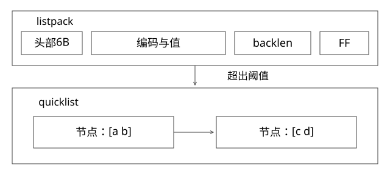

# RedisList紧凑编码与转换

连续内存中的元素怎样双向遍历，何时需要转成分块链？

源码基线：redis/redis · 7.2.4。[固定源文件](https://github.com/redis/redis/blob/d2c8a4b91e8c0e6aefd1f5bc0bf582cddbe046b7/src/listpack.c)。伪代码用于解释控制流，不冒充上游原文。



## 先看真实编码而不是逻辑类型名

逻辑类型是 List，物理编码不必固定。本组锁定的 7.2.4 在 t_list.c 支持小 List 直接使用 listpack，超过条件转 quicklist。quicklist 外层组织节点，打包节点内部仍可以是 listpack；不要画成每个元素都对应一个普通双向链表节点。

## listpack 的字节布局

```text
[总字节数4B][元素计数2B]
[元素编码与内容][本元素前部长度的反向编码]
[下一个元素 ...]
[结束标记 FF]
```

长度字段、编码类型与内容不是每个值都固定宽度；整数可能采用紧凑整数编码，字符串按长度选择编码。计数有无法直接用头部精确表示时的处理，不能把 2 字节头解释为所有长度的完整计数。

backlen 记录的是当前元素编码与内容的长度，自己占用多少字节由长度编码规则决定。从下个元素前方可以反向恢复前一条目的起点，因此支持倒向遍历。

## 完整推导：一个短字符串占多少

以字符串 abc 为例，短字符串编码头 1B、内容 3B，本元素前部共 4B，backlen 1B。整个只有此元素的 listpack 为头部 6B + 元素 5B + EOF 1B = 12B。这里未计外部对象头、分配器实际分配大小与对齐。

数值 127 可用该实现的一字节整数表示，再加 1B backlen；不能据此说所有三字符数据都和 abc 同样大小。字符串能否按整数编码要看转换规则及其是否保留约定语义。

## lpInsert 为什么仍可能昂贵

lpInsert 计算新编码长度与 backlen，计算新总长度，必要时扩内存，再 memmove 尾部，写入元素并维护头信息。插在靠前位置，可能移动后面大量字节；连续内存减少指针与分配，却没有让中间插入免费。

listpack 不把“前一个元素的长度”作为下一个元素需要随之增长的 prevlen 字段链式维护，这有助于避免旧 ziplist 那种连锁扩张。但一次插入仍可能重分配或搬动一大片，不能从“没有级联更新”推导为固定常数延迟。

## 转换条件和滞后

t_list.c 的 listTypeTryConvertListpack 用预估新增字节/元素和 quicklistNodeExceedsLimit 决定是否转换，参数 list_max_listpack_size 的正负值分别涉及数量或大小约束，需按节点限制函数解释。

转回小表示要求 quicklist 只有一个合适的打包节点；缩小时采用更严格的半阈值等条件，避免插删在边界附近来回转换。转换的是表示，不是改变 List 从头尾访问的业务顺序。

## 怎样验证

在隔离实例固定配置，分别插入短数值、长字符串、多元素 List，观察 OBJECT ENCODING 与 MEMORY USAGE，再测头尾插入和中间访问。不要把输出字节数和 RSS 混用，也不要用一次小样本微秒值宣布所有大 List 都安全。

本轮只核验源文件和手算，不宣称已运行 Redis 服务实验。

## 自测

把数据分到 quicklist 的多个节点，能否保证任意下标 O(1)？不能，仍要定位节点并在节点中查找。

[查看可编辑 SVG](assets/deep-points/11.svg) · [查看 PNG](assets/deep-points/11.png) · [返回知识点目录](实现详解_00_知识点目录.md)

