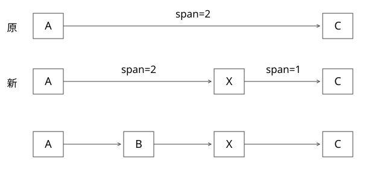

# RedisZSet跳表与span

跳表为什么既能按分数找，又能按排名找，插入时究竟改哪些跨度？

源码基线：redis/redis · 7.2.4。[固定源文件](https://github.com/redis/redis/blob/d2c8a4b91e8c0e6aefd1f5bc0bf582cddbe046b7/src/t_zset.c)。伪代码用于解释控制流，不冒充上游原文。



## 两种检索需要两种结构

较大的 ZSet 使用 dict 和 skiplist。dict 按 member 找分数，skiplist 按 score、再按 member 次序组织节点。小 ZSet 可以使用 listpack，因此不能把每一个 ZADD 都画成修改跳表。

跳表节点各层含 forward 与 span，底层还有相应后向关系。随机层高让高层较稀疏，平均减少比较次数；随机化给平均性质，不是严格最坏对数保证。

## zslInsert 的两组数组

update[i] 保存第 i 层最后一个位于插入点前的节点；rank[i] 保存沿查找路径到该位置已经跨过的底层排名数。自顶向下的搜索把高层累计结果传给下层，而不是每层从头重新数。

找到插入点后，新节点高度内需要拆开旧跨度；新节点高度以上的已有跨越边，其跨度也要增加 1。

## 完整推导：在 B 与 C 之间插入 X

原底层为 A10、B20、C30，排名 1、2、3。假设某高层是 A→C，span=2；插入 X25，令 X 也出现在这一层。

在该层 update=A，rank[i]=1，底层插入前 rank[0]=2。源码公式的语义为：

```text
旧跨度 oldSpan=2
前驱到插入点前的底层距离 d=rank[0]-rank[i]=1
X -> C 的跨度 = oldSpan-d = 1
A -> X 的跨度 = d+1 = 2
```

新排名是 A1、B2、X3、C4，A→X 跨 2，X→C 跨 1，相加比原来多 1。若 X 只有底层高度，不出现在该高层，则 A→C 仍是同一条边，但 span 从 2 增到 3。这就是“指针没有变，也必须更新跨度”的例子。

## zslGetRank 为什么不用线性计数

查询沿各层 forward 前进时把 span 加入 rank；只有不超过目标顺序的边才能走。到目标时已经累计了底层位置。因此平均复杂度仍随跳表搜索路径，而不是找到后再从 head 数到目标。

同分数需要按 member 次序比较，否则同 score 多个元素的 rank 无法稳定区分。业务若只用 score 推导唯一名次，会与实际 tie-break 约定不一致。

## 修改 score 的分支

修改分数后若仍满足左右邻居的有序关系，相关实现路径可以更新并保留位置；否则需要按新位置重新组织节点，并保持 dict 关联一致。不能只改节点 score，却让底层仍处于旧排序位置。

dict 中查分数与 skiplist 排序共享的内存归属也要看具体表示，不能把它们画成两份随意独立更新的 score。释放、重建或替换时尤其需要维护这项关系。

## 验证与自测

用小集合逐个插入，检查 ZSCORE、ZRANK、按 score 范围与按 rank 范围结果是否一致；构造同 score、修改 score、删除头尾。手算 span 的局部变化，比只验证输出已排序更强，因为跨度错误可能只影响 rank 路径。

deep_models.py 验证上述分裂公式与跨度总和；未出现层的 span 加一在本文中手工推导，当前程序未单独断言该分支。这个实验是局部数学模型，不是运行真实 Redis 随机跳表。

## 删除时把跨度还原，补齐插入的逆过程

上例插入后，高层A→X的span为2，X→C为1。删除X时，若这一层的update.forward恰好就是X，新A→C的span应为2+1−1=2：连接两段，再扣掉被删除节点自身占的一名。若某高层根本没有X，只是跨过X，则指针不变、span减1。

这对应zslDeleteNode的两类更新。只把A.forward改为C，会保留错误跨度2或3，某些例子刚好不暴露问题，另一些会导致rank偏移。还需更新底层backward、tail、length，并在最高层已经为空时收缩有效层数。

查排名与按排名找节点是一对对照：zslGetRank累加允许前进的边；按rank查找则在累计span不越过目标时前进。两种查询都依赖跨度，不是只要底层元素有序就一定正确。可把插入前、插入后、删除后三个状态的所有rank逐一核对。

## 自测

底层输出顺序正确，能否证明 ZRANK 正确？不能，span 也必须正确。

[查看可编辑 SVG](assets/deep-points/12.svg) · [查看 PNG](assets/deep-points/12.png) · [返回知识点目录](实现详解_00_知识点目录.md)

