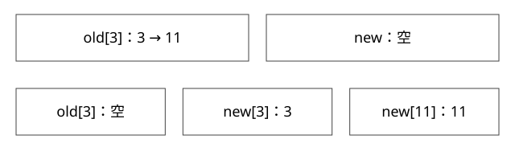

# Redis字典渐进rehash

两张表如何一起对外服务，为什么分步迁移仍可能造成延迟？

源码基线：redis/redis · 7.2.4。[固定源文件](https://github.com/redis/redis/blob/d2c8a4b91e8c0e6aefd1f5bc0bf582cddbe046b7/src/dict.c)。伪代码用于解释控制流，不冒充上游原文。



## rehashidx 是进度，不是第二份业务数据

字典维护两套哈希表状态，rehashidx 表示旧表迁移到哪里。开始扩容分配新表，已有条目最初仍在旧表；随着推进，旧桶中的条目转移，新插入按相应重哈希分支进入新表。查找在迁移期间检查两张表的适用位置。

这不是复制全部业务值后让两个节点异步同步，也不是多线程 Map 的并发迁移协议；Redis 的执行环境与暂停迁移条件是另一层前提。

## 完整推导：旧容量8到新容量16

旧桶 3 内有 hash=3、11 两个条目。旧掩码为7，两者都在3；新掩码为15，它们分别进入新桶3和11。

```text
开始：old[3]=3 -> 11，new全部空
迁桶：逐条取旧链，计算新桶号，挂入新表
完成该桶：old[3]=空，rehashidx继续前进
全部旧条目迁完：释放旧表，切换表角色，退出rehash状态
```

搬桶时还要维护两张表的已用数量。仅把 rehashidx 加一却漏掉条目，查找协议再正确也救不了丢数据。

## 一次 dictRehash(d,n) 不是固定 n 个元素

本版循环按非空桶推进，同时有扫描空桶的预算约束。一个非空桶若有很长碰撞链，仍会逐条迁走；“一次只做一个桶”不等于一次只做固定小常数工作。

因此重哈希将一次大工作分摊，但仍有尾延迟风险。碰撞分布、key 哈希成本、表稀疏程度和调用路径都会影响时间。若只看总体 CPU 平均值，可能遗漏单次主循环停顿。

## 正常操作怎样协助

_dictRehashStep 在允许迁移时由相应字典操作触发；还有主动推进等路径。安全迭代或暂停重哈希的条件会影响是否继续，所以不能说每条 Redis 命令都严格搬相同数量的桶。

查找先检查旧表，仍处于重哈希时再检查新表；删除也需考虑两张表。若新写还放旧表已经迁完的区域，就会破坏进度含义，因此插入位置必须遵守协议。

## 与另外两种哈希扩容比较

| 实现 | 单次迁移方式 | 访问衔接 |
|---|---|---|
| 普通 HashMap | resize 中处理多个桶 | 不提供并发读写协议 |
| CHM | 多线程认领区间、桶同步、路标 | 读经 ForwardingNode |
| Redis dict | 双表、渐进步骤 | 查找考虑两表，受执行环境约束 |

三者都可能有旧新数组，却不能用一个“渐进 rehash”故事解释全部实现。尤其不能把 Redis 的串行迁移假设复制到 Java 的无锁读场景。

## 观察与自测

隔离测试应同时记录构造时间、操作尾延迟、表增长阶段和 key 分布；不能仅验证最后能查到全部 key。人为构造极端碰撞要注意哈希实现与安全限制，不能对生产实例做破坏性实验。

本篇核验的是固定源码控制流。

## 自测

n=1 时是否最多迁移一个条目？不是。rehashidx 之前的旧桶已经为空，是否意味着新表同下标为空？不是，条目的目的地下标由新掩码决定。

## 补一层实现边界

扩容与缩容都改变桶映射，但容量方向、触发条件和迁移目的大小不同。运行中若有fork持久化，修改页还可能触发COW费用；减少一次迁移工作不等于消除这项代价。观察时应将rehash阶段、fork时间、脏页与延迟放到同一时间轴，避免把所有抖动归因于哈希碰撞。

[查看可编辑 SVG](assets/deep-points/13.svg) · [查看 PNG](assets/deep-points/13.png) · [返回知识点目录](实现详解_00_知识点目录.md)

