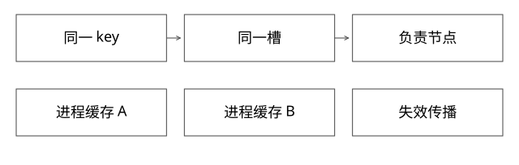

# 热key路由与放大治理

一个很小的 key 为什么能打满节点，增加分片又为何不一定有效？

源码基线：redis/redis · 7.2.4。[固定源文件](https://github.com/redis/redis/blob/d2c8a4b91e8c0e6aefd1f5bc0bf582cddbe046b7/src/cluster.c)。伪代码用于解释控制流，不冒充上游原文。



## 请求路由把同一个 key 集中到哪里

keyHashSlot 使用 CRC16 和 16384 槽。本版按第一个左花括号及其后的右花括号检查 hash tag；若这对花括号内容为空，回到整个 key 哈希，并不是继续找后面某个非空花括号片段。

同一个 key 对应一个槽，同一时刻槽的负责节点有确定路由。扩容可迁移槽、平衡多个 key，但不会把一个 key 的所有写自动拆到多个主节点。迁移热点到别处也只是换一个承压位置。

## 完整推导：请求量和单次成本相乘

设一个计数 key 每秒 20 万次访问，每次值只有几十字节。内存很小，但解析、查表、命令执行和响应都有成本，节点可能先打满 CPU。

反例是每秒仅 100 次的巨大对象读取，每次响应 20MB，理论输出已达每秒约 2GB，还未计协议和复制等成本。它不一定是访问频率最高的 key，却可能先打满网络与输出缓冲。

所以“热”与“大”是两条维度，不能只用 key 字节大小判断。

## 读扩散需要说明一致性

只读副本可以承担一部分读取，但复制延迟和故障切换会影响读到的版本。客户端本地缓存把一次集中读取扩展为多进程副本，降低 Redis QPS，却增加失效传播问题。TTL 只能控制某类保留时间，不能把所有副本即时同步。

对于允许短暂陈旧的配置、榜单快照，可以固定版本、限时缓存与合并请求；对于强一致扣减，不能把本地缓存值当作扣减事实。

## 写分片会改变业务模型

把一个总计数拆为 N 个子 key，可以将写分散，再聚合读；代价是读放大、聚合时点不一致和操作原子性改变。分桶方式、重复更新、合并与过期必须重新定义。

把一个 List 随机拆为多 key 更不能无条件保留全局队列顺序。扩散写之前，先问业务是否依赖总顺序或单 key 原子操作。

## 从请求链止血

```text
入口限流 / 隔离
  -> 合并同 key 重复在途请求
  -> 允许时使用短期缓存或过期旧值
  -> 限制响应大小与批量
  -> 避免故障时全部请求穿透数据库
```

合并请求应按 key、租户和数据版本区分，处理超时后占位释放；否则一个卡住任务可能拖住所有等待者。缓存击穿保护与授权隔离是两种约束，不能为了共享结果跨租户泄漏。

## 证据与自测

先比较节点 CPU、命令耗时、输入输出带宽、输出缓冲、连接、复制与持久化压力，再定位 key 访问。命令耗时高可能来自大范围操作，而非简单 GET 量高；fork/COW 也可能同时抬升内存和延迟。

本轮未执行生产采样或压测。

## 自测

新增 3 个主节点能否把同一个库存 key 的原子扣减自动平分？不能。若拆库存，必须另行设计额度分配和一致性，不再是纯路由调整。

## 补一层实现边界

容量治理可按流量放大链反推：一个入口请求触发多少次相同key查询，重试是否重复查询，结果是否被多处序列化。若每请求查同一配置20次，先做请求内复用可能比跨进程缓存更容易保持语义；这不改变外部更新协议，却可消除内部放大。验证时分别记录入口QPS与Redis命令QPS。

[查看可编辑 SVG](assets/deep-points/14.svg) · [查看 PNG](assets/deep-points/14.png) · [返回知识点目录](实现详解_00_知识点目录.md)

