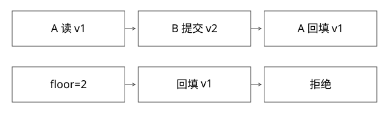

# 缓存旧值回填与版本栅栏

为什么先更新数据库再删除缓存，仍可能让旧值重新出现？

源码基线：redis/redis · 7.2.4。[固定源文件](https://github.com/redis/redis/blob/d2c8a4b91e8c0e6aefd1f5bc0bf582cddbe046b7/src/db.c)。伪代码用于解释控制流，不冒充上游原文。



## 缓存一致性跨越两个提交域

数据库提交、Redis 更新、本地缓存失效是不同动作。Redis 单条命令原子，不能把它们变成一个事务。expireIfNeeded 决定过期处理，不知道外部数据库哪次更新已经提交。

先约定业务目标：是允许短暂陈旧，还是要求读到最新已确认值？前一种可以用明确的陈旧时间控制，后一种通常需要更强的读取与提交协议。

## 完整推导：一次旧值回填

| 时刻 | 读者 A | 写者 B | 缓存 |
|---|---|---|---|
| t0 | 未命中 | | 空 |
| t1 | 从数据库取得 v1，暂停 | | 空 |
| t2 | | 数据库提交 v2 | 空 |
| t3 | | 删除缓存 | 空 |
| t4 | 恢复，把 v1 写缓存 | | v1 |

B 的删除成功并没有取消 A 已取得的旧读取结果。延迟双删依赖对窗口的估计，可以缓解某些情况，却不是无界网络延迟和任务暂停下的普遍证明。

## 单纯比较“缓存当前版本”还不够

若缓存被 B 删除，A 看不到当前版本，就可能把 v1 当作“空缓存允许写”。因此版本化值还需要一个不会随删除一起丢掉的版本栅栏，或其他能核验旧读的协议。

示意：保留 floorVersion=2；任何回填版本必须不小于 floor。检查与写入应在相应存储端原子完成。若先 GET floor，再 SET value，中间仍可发生 floor 升级。

```text
原子回填(v,content)：
  若 v < floorVersion -> 拒绝
  若当前值版本 > v -> 拒绝
  若同版本但内容冲突 -> 报错
  否则保存版本化内容
```

这是假设版本栅栏已经正确发布后的局部协议，不是完整 DB→缓存强一致方案。数据库提交与 floor 发布之间仍有窗口；floor 的持久性、过期和更新丢失也必须设计。

## 失效消息也会重复和乱序

v3 的失效先到，v2 后到，不应把 floor 从3改回2；需要单调推进。消息投递至少一次时应幂等。若失效消费中断，本地缓存必须有可控陈旧上限或停止信任策略。

每个业务实体的版本来源也要明确：事务序列、行版本或可靠事件版本，不能随便用不同机器的当前时间代替全序。删除数据应保留必要 tombstone，避免旧更新让它复活。

## 可验证的边界

新增 deep_models.py 展示：无栅栏的 v1 回填成功；floor=2 时拒绝 v1；v2/v3 失效乱序不回退 floor。它验证比较与原子模型，不证明数据库、Kafka、Redis 与客户端之间已经形成一个分布式事务。

更强读取可直接回源、使用可验证版本或特定一致性协议，但会付出延迟、吞吐或可用性代价。不要把所有缓存场景一律升级为同一个方案。

## 将“原子回填”落实到部署边界

若floor和value是两个Redis key，比较与写入必须在实际部署允许的同一原子域中完成，例如合适的脚本或WATCH/事务协议，而不是在客户端分开GET/SET。Redis Cluster多key操作有同槽等约束，不能把分散在不同节点的floor和值看成一条天然原子操作。使用相同实体的hash tag可以安排同槽，但也要评估热点集中。[Redis Cluster规范](https://redis.io/docs/latest/operate/oss_and_stack/reference/cluster-spec/)

原子脚本只能保证这一轮比较写入。DB提交v2之后、floor2尚未发布之前，旧读者仍可能把v1返回或写入；所以本设计的局部性质是“floor2生效后拒绝低版本回填”，不是“DB一提交所有读者立刻读v2”。

再看过期：若value十分钟过期，floor也同时删除，一个暂停十一分钟的旧读者可能重新写回v1。floor保留期必须覆盖允许迟到的回填窗口，或让回填带可核验的当前源版本。无限暂停不能靠一个有限TTL无条件覆盖；需要明确定义超时后旧任务不得再提交的协议。

实体删除也应单调推进删除版本，并保留必要tombstone，否则迟到更新会复活数据。这里的版本要有来源与比较语义，不能直接拿跨机器墙钟代替可靠顺序。

## 自测

只给 value 加 version，删除后还剩什么能阻止旧值？若没有额外证据，就仍存在窗口。版本栅栏是否解决数据库提交与栅栏发布之间的问题？没有，需要继续定义跨系统协议与容忍边界。

## 补一层实现边界

严格一致场景也要说明读者是否允许使用已取得的旧结果。即使阻止旧值回填，A可能已准备把v1直接返回；缓存栅栏不自动让这个返回值变新。必须说明目标是“禁止某版本之后重新污染缓存”，还是“所有后续读取均不陈旧”，两种性质需要不同证明。

[查看可编辑 SVG](assets/deep-points/15.svg) · [查看 PNG](assets/deep-points/15.png) · [返回知识点目录](实现详解_00_知识点目录.md)

