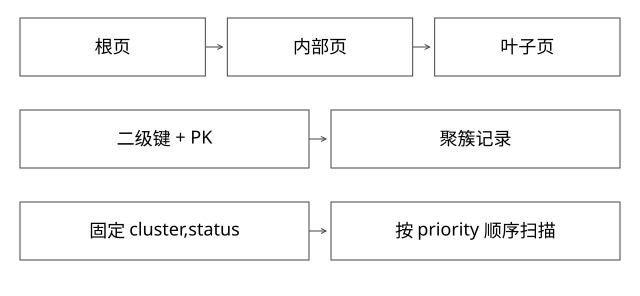

# InnoDB的B树记录与联合索引

联合索引为什么有左前缀约束，回表又具体多读了什么？

源码基线：mysql/mysql-server · mysql-8.0.36。[固定源文件](https://github.com/mysql/mysql-server/blob/49ef33f7edadef3ae04665e73d1babd40179a4f1/storage/innobase/btr/btr0cur.cc)。伪代码用于解释控制流，不冒充上游原文。



## 先在纸上排列真实键

索引 (cluster,status,priority DESC,created_at ASC,id ASC) 不是给每一列各建一棵树，而是按组合键的字典序组织。聚簇索引叶子保存行记录；二级索引携带索引字段与相应主键信息，用于定位聚簇记录。

btr_cur_search_to_nth_level 处理树中查找、目标层、搜索模式与锁存条件。到页后还有记录定位，不是只比较树高就完成整次 SQL。

## 完整推导：等值条件如何固定排序前缀

给出三行：
```text
(1,0,100,09:00,A)
(1,1,200,10:00,B)
(1,1,150,08:00,C)
```

WHERE cluster=1 AND status=1 固定前两列，剩余顺序可按 priority DESC、created_at ASC 使用。若去掉 status 条件，状态0那组可能排在状态1那组之前，A100 在 B200 前，并不形成全局 priority 递减。

这不是“索引里没有 priority”，而是其物理顺序前面还有未固定维度。后续字段仍可能帮助过滤或覆盖，不能粗暴说全部失效。

## 范围、过滤与覆盖分别改变什么

范围定位决定要扫描哪个键区间；索引条件下推在索引记录上先判断部分条件，减少聚簇访问；覆盖读取使某些字段不必再从整行获取。这三个能力不等价。

例如 SELECT id,priority 的列都在索引中，不代表 WHERE 只检查一条记录；若条件不能缩小范围，仍可能扫描大量叶子项。MVCC 与记录状态也可能要求额外的聚簇检查，不能对所有一致性读承诺绝对零回表。

## 页内和页间的两层顺序

内部页保存分隔键与子页引用，叶子通过页内记录组织和页间链接支持扫描。记录逻辑有序不意味着每次插入都把整个数据文件连续搬移成一张大数组。

页分裂、主键宽度、记录尺寸和填充率改变树的空间与写成本。主键更宽会放大二级索引中的定位信息。自增主键通常有较强局部性，但并发热点、页分配与业务写模式仍需测量。

## 怎样估算而不背“三层”

假设一个内部页可容纳 f 个子页引用，叶子可容纳 l 条记录，高度 h 的数量级约为 l*f^(h-1)。f 和 l 受页大小、键长、记录头与填充影响；这个模型解释宽索引为何降低扇出，却不是某张线上表的实测。

缓存命中时树高增加不必等价为同样次数的磁盘随机 I/O；未命中时二级→聚簇两次路径与数据分布更值得观察。

## 验证与自测

实际实验应固定 DDL、数据量和选择性，比较有无 status 条件的计划、扫描行数和排序。EXPLAIN 的估计不是实际读行数；EXPLAIN ANALYZE 会执行查询，必须在可控环境运行。

本轮未启动 MySQL。

## 页数模型落到一条查询上

用纯教学参数：每页16KiB，平均一个内部页分隔项约32B，先忽略页头和填充，则理论扇出约512；假设叶页每条200B、有效占用70%，约可放57条。三层数量级是57×512²≈1494万条，不是“所有三层B树都能放几千万”。主键或索引字段变宽，会同时影响内部扇出与叶页密度。

二级索引找到100个主键后，回表不是凭空把100行拼出来，而是用这些定位键访问聚簇索引。若数据页分散且冷，会产生较多随机页访问；若同页或已缓存，物理读次数远小于100。应把索引扫描记录数、回表行数、缓存页命中和实际IO分别统计。

最左前缀也不是“范围之后所有字段失效”。对(a,b,c)，a等值、b范围可界定连续扫描范围，c的条件可能在扫描过程中被用作索引过滤，但一般不能把所有满足c的记录神奇压缩成一个更窄连续区间。特殊优化如skip scan需要满足自己的条件，不能反过来否定组合键顺序。

设计索引时先写清筛选与输出排序，再估计选择性、回表和写放大。覆盖索引越宽，越可能减少一次取行却增加每次写入、缓存和磁盘费用；不存在“把SELECT所有字段全加进去就最优”的通用结论。

## 自测

看到 key 使用某索引，是否说明 ORDER BY 一定免排序？不能。联合索引“最左”指字段顺序约束，不是 SQL 中 WHERE 文本书写顺序。

[查看可编辑 SVG](assets/deep-points/16.svg) · [查看 PNG](assets/deep-points/16.png) · [返回知识点目录](实现详解_00_知识点目录.md)

