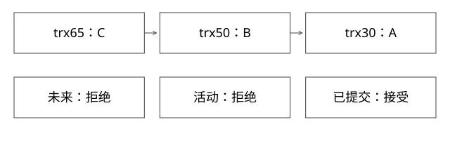

# MVCC的ReadView与undo版本链

快照具体拒绝哪些事务版本，拒绝后怎样找到能读的历史行？

源码基线：mysql/mysql-server · mysql-8.0.36。[固定源文件](https://github.com/mysql/mysql-server/blob/49ef33f7edadef3ae04665e73d1babd40179a4f1/storage/innobase/include/read0types.h)。伪代码用于解释控制流，不冒充上游原文。



## 一条记录不等于只存在一个可读版本

InnoDB 聚簇记录包含事务与回滚相关系统信息；版本重建利用 undo 等信息恢复此前内容。ReadView 是读者的可见性规则，不是完整复制一张表。

row_search_mvcc 处理读取，必要时衔接 row_vers_build_for_consistent_read；changes_visible 只是判断某个事务版本是否可见的关键函数，不能单独代表全部隔离机制。

## ReadView 四个字段的语义

m_creator_trx_id 标记创建者；m_ids 保存快照相关活动事务集合；m_up_limit_id 是较早活动边界；m_low_limit_id 是未来事务边界。名字中的 up/low 很容易背反，应该按比较分支记。

```text
visible(tx):
  tx < up 或 tx == creator -> 真
  tx >= low -> 假
  其余 -> tx 不在 active 中才为真
```

中间区间不能仅比较“比我早”；事务启动早，不代表快照建立时已经提交。

## 完整推导：沿三层版本往回找

设置 up=40、low=60、active={40,50}、creator=55。当前记录由 trx65 写为 C，前一版本由 trx50 写为 B，更前版本由 trx30 写为 A：
```text
65:C -> 50:B -> 30:A
65 >= 60，拒绝
50 在活动集合，拒绝
30 < 40，接受，读到A
```

随后 trx50 提交，并不会让已建立的 RR 快照自动改写自己的 active 集。相同快照继续判断50不可见，仍可能读到A；新 ReadView 才可能读到更新结果。

事务55对自己已写行的可见性又是独立分支，不能把 RR 理解成事务内永远看不到自己的新写。

## 两会话时间线

会话A START TRANSACTION 后第一次普通一致性 SELECT 建立快照；B 更新同一行并 COMMIT；A 再次一致性 SELECT，在常规 RR 语义下复用快照。RC 的后续语句会取得相应新视图，因此可看到不同结果。

START TRANSACTION 与明确建立快照的时点需要区分；不能把所有 RR 快照都说成连接创建或 BEGIN 那一刻。锁定读、UPDATE 与普通 SELECT 的路径也不相同。

## 删除、长事务与 purge

删除行有自己的版本与删除标记语义；快照可能仍需要删除前的版本。只因当前记录看起来已删除，并不意味着所有活跃快照都再也读不到它。

长寿命 ReadView 可能让旧版本仍被需要，影响 purge 和历史保留。不是“undo 一有更新就全部永久保存”，也不是“事务提交后所有旧版本立刻删除”。需要结合最老活跃读视图与具体回收机制观察。

## 二级索引为什么更复杂

二级记录不简单携带一条完整的同型 undo 链；某些路径需要回到聚簇记录检查可见性、重建版本或核对二级记录是否对应。SELECT 字段都在二级索引中，不是任何事务情况下绝对无需聚簇访问的证明。

新增 [deep_models.py](examples/source-level/deep_models.py) 用版本链执行上述判断；[双会话 SQL](examples/source-level/mysql_mvcc_lab.sql) 需在隔离 MySQL8 环境手工运行，本轮没有执行。

## 快照一致，为什么仍可能把预算扣错

账户初始余额1000。A、B都用普通一致性SELECT看到1000，各自判断可以消费600，然后把“自己算出的余额400”写回。最后余额可能是400，但两笔业务都认为自己成功消费600，业务约束已被破坏；读到了稳定快照没有保护“检查→更新”的整体动作。

一种最小方案是短事务内执行带条件的原子更新：available=available−600，reserved=reserved+600，WHERE account_id=? AND available>=600，并检查affected_rows。先成功者把余额降到400，后续更新不能再满足条件。金额还需非负与溢出校验，操作本身要有稳定幂等键；同一请求重复执行不能再扣一遍。

也可以在合适事务中锁定读取再更新，但要理解读取的是何种版本、锁持有到何时、使用哪个索引、锁范围和死锁重试。RR普通SELECT、SELECT FOR UPDATE和UPDATE不能混成一种“读”；这个区别可对照[MySQL锁定读取说明](https://dev.mysql.com/doc/refman/8.0/en/innodb-locking-reads.html)。

因此MVCC解决的是特定读取的可见性，不是所有业务不变量的自动保证。长时间等用户确认或模型输出不应放进持锁事务；先形成草案和授权，再用短事务核对实时事实。跨服务预算与活动创建又超出了这一数据库事务域，仍需业务恢复协议。

## 自测

trx45 位于40..60且不在active，会不会可见？会；这正是“中间集合判断”而非简单阈值的意义。

[查看可编辑 SVG](assets/deep-points/18.svg) · [查看 PNG](assets/deep-points/18.png) · [返回知识点目录](实现详解_00_知识点目录.md)

