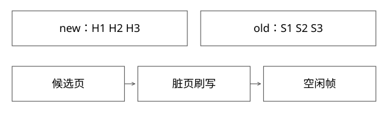

# BufferPool中点LRU与脏页淘汰

为什么一次全表扫描不会理想地把所有热页都换掉，链尾页又为何不一定能立即释放？

源码基线：mysql/mysql-server · mysql-8.0.36。[固定源文件](https://github.com/mysql/mysql-server/blob/49ef33f7edadef3ae04665e73d1babd40179a4f1/storage/innobase/buf/buf0lru.cc)。伪代码用于解释控制流，不冒充上游原文。



## 不是普通精确 LRU 的一张链表

Buffer Pool 缓存数据页等状态，LRU 具有 new/old 区域及中点插入策略；还存在 free list、flush list 等不同组织。每个列表回答不同问题：可空闲帧在哪里、哪些页较冷、哪些脏页需按相关顺序刷写。

old/new 是页在缓存管理中的冷热位置，不是数据库记录的新旧事务版本，不能与 MVCC 的版本链混画。

## 新页为什么不一律放最热端

一次大扫描可能读入大量只用一次的页；若每读一次就把它放头部，长期热工作集可能被顺序流量冲走。中点插入使新读页先进入相应 old 区域，之后根据访问和时间等条件决定晋升。

buf_page_peek_if_too_old 结合 old 状态、访问时间阈值与 freed_page_clock 等信息。具体“是否 make young”受分支与配置影响，不是一个对所有命中都执行的 move-to-head。

## 完整推导：热工作集与扫描页相遇

设日常热页为 H1/H2/H3，突发扫描读 S1..S100。普通“每次读放全局头”可能让链前部充满 S。中点策略让大量 S 停留在较冷部分，未再次按条件使用时更可能先被淘汰。

若扫描页很快被反复访问或工作集本来超过缓存，保护效果仍有限。中点不是可以保证热页永不淘汰的 pin，也不能让超过容量的全部数据都缓存住。

## old_blocks_time 解决的不是容量问题

时间阈值可减少短时间扫描式访问立即把页提升为热页。增大阈值可能更抗扫描，但新出现的真正热页也可能更晚晋升；减小则更敏感，但更易受扫描污染。

因此参数调节应同时看负载模式、命中、young/non-young 相关观察与 I/O，而不是只凭一个“推荐值”覆盖所有实例。

## 淘汰为什么不能只 pop 链尾

```text
找较冷候选
  -> 检查页是否仍被使用 / 正在I/O
  -> 若脏，需要满足刷写与恢复约束
  -> 满足释放条件后，帧才可转为空闲
```

页锁存保护页内/管理结构的一致操作，事务锁保护业务并发语义，两者不同。脏页意味着内存内容比磁盘新；直接丢掉会损失更新，因此淘汰与刷脏要协调。写前日志约束也不能被“急需空闲帧”跳过。

## 为什么命中率高仍可能慢

命中只减少某类磁盘读取。锁等待、热点页争用、刷脏、日志刷盘、CPU与排队仍可能主导延迟。一个99%以上命中率，不是排除数据库内部瓶颈的充分证据。

反过来，大扫描可降低命中率却不一定恶化关键接口：必须按请求和时间窗口关联，不能从总指标直接归因。

## 验证与自测

设计混合负载：固定热集合点查，再加入顺序扫描；比较关键请求尾延迟、I/O和缓存页状态，而不只看扫描本身完成时间。分开改变缓存容量和晋升策略，避免同时调多个参数后无法解释收益。

本轮未运行服务级实验。

## 刷脏和事务提交为什么不是同一个时刻

事务提交可以先依据日志持久化协议确认，而修改过的数据页仍留在Buffer Pool等待后续刷写；这就是恢复需要redo的一部分原因。反过来，脏页被写回也不应被理解成对应事务一定已经对外提交，事务可见性仍由事务与版本协议约束。

最小时间线：页P被修改→对应redo产生→满足WAL要求后P才允许写回→缓存需要空间时再按条件回收。WAL中的“先”是相关日志到达所需持久化位置先于数据页落盘，不是每次修改都马上刷整页，也不是先把undo删掉。

若空闲帧不足而候选多为脏页，前台请求可能等待回收/刷写，形成时延尖峰；即使命中率仍高也可能如此。诊断要同时看页读取、刷写速度、日志进度、脏页分布和等待，而不是把所有IO都叫“缓存未命中”。

这个时间线是机制化简，不等于完整崩溃恢复实现。刷脏、doublewrite、redo持久化和存储设备语义分别解决不同窗口；容量调大可能延后压力，却不能替代稳定的写入与刷盘能力。

## 自测

链尾是脏页，是否一定能立即变 free？不是；需要满足相应刷写与释放条件。old 区页是否一定是旧数据？不是，它是缓存管理位置。

[查看可编辑 SVG](assets/deep-points/19.svg) · [查看 PNG](assets/deep-points/19.png) · [返回知识点目录](实现详解_00_知识点目录.md)

