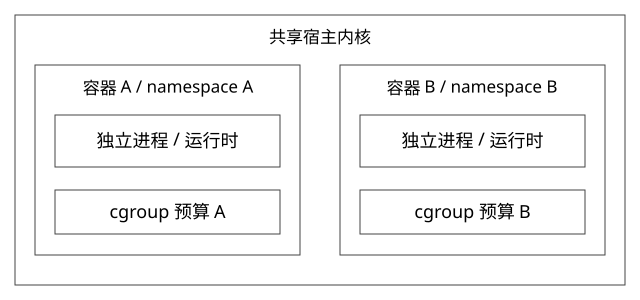

# 容器namespace与cgroup隔离

独立 Pod 为什么能隔离一部分故障，又为什么 CPU 看起来不满仍会变慢？

源码基线：torvalds/linux · v6.6。[固定源文件](https://github.com/torvalds/linux/blob/ffc253263a1375a65fa6c9f62a893e9767fbebfa/kernel/nsproxy.c)。

## 先区分视图、预算与进程命运

namespace 控制进程看到的部分系统对象，cgroup 控制任务资源归属和约束，独立进程拥有自己的语言运行时。三个机制相互配合，但不是同一个开关。容器仍共享宿主内核，不是每个容器都有一套独立内核。

copy_namespaces 按创建标记决定共享还是创建对应 namespace；没有设置某类新建标记，就不能只因“运行在容器里”而推导该类视图已独立。

## 从系统对象看隔离

PID namespace 影响进程号视图，network namespace 影响网络设备/路由等视图，mount namespace 影响挂载视图，user namespace 影响用户与权限映射。改变根目录不能替代这些机制；进程看不到某个路径，也不等于没有任何能力影响宿主。

Pod 内容器可能共享某些 namespace，具体取决于配置。平台不管理 worker 数，不影响它们仍受所属进程/cgroup预算约束。

## 容器启动还有控制与运行时两层

Kubernetes中，kubelet通过CRI与容器运行时交互，运行时处理镜像和容器生命周期；不是Deployment控制器直接调用Linux内核创建每个业务进程。参见[官方CRI说明](https://kubernetes.io/docs/concepts/containers/cri/)。

典型Linux容器还需准备根文件系统/挂载、namespace与cgroup等运行环境，设置身份和权限约束，再启动目标程序。镜像是打包与分发的文件系统/配置材料，不是另一个正在运行的内核。具体调用顺序与运行时有关，本篇锁定的nsproxy.c只解释内核视图机制，不假装覆盖containerd/runc全部源码。

所以启动慢要按镜像拉取、文件系统准备、调度、应用初始化和预热分段；class热加载和“包含冷拉镜像的Pod启动”不是天然公平的比较。

## 完整推导：0.5 核预算如何被多线程消耗

固定 cgroup v2 的 cpu.max 为50000 100000，即每100ms周期约50ms CPU预算。假设4个线程能在4个可用CPU上并行，理想化消耗50ms预算只需约12.5ms墙钟时间，随后可能等待预算补充。

这只是预算模型，实际还受调度、runtime slice、层级限制和内核配置影响；它解释的是“多线程可以更快耗尽预算”，不是精确预测某次 throttle 时刻。

宿主总CPU可能很空，而容器已被限额。仅加线程不改变预算，反而可能把响应变成短暂突进加长等待的形态。

## cgroup归属怎样影响判断

kernel/cgroup/cgroup.c 管理任务归属，具体控制器处理资源；CPU路径要继续读 kernel/sched/fair.c 中的带宽限制与 throttle。父层预算也会限制子层，因此只看容器自己的一项配置可能漏掉层级瓶颈。

CPU request 常参与调度与资源分配语义，不应简单等同 cpu.max；内存上限、节点内存压力和语言堆上限也不同。JVM 堆未满，进程仍可因 native、直接内存、线程栈或其他费用触到限制。

## 故障域仍有共享层

独立JVM避免所有版本共享同一堆和GC停顿，但共享节点、网关、注册中心、数据库等仍可能传播故障。容器耗尽节点磁盘或公共后端容量，也不是独立进程就自动隔离。

从共享运行时改到进程隔离，应同时核算基础内存、连接、启动与实例数量，而不是只比较业务代码包大小。

## 验证与自测

在隔离环境记录 cpu.stat 的 throttled相关计数、应用延迟、运行线程和节点CPU；固定请求量，分别改变线程数与quota，避免一次改两项无法归因。内存则分解堆、native、页缓存与cgroup统计口径。

本轮未创建容器。

## 自测

半核是否绑定半个物理核？不是。独立进程是否隔离数据库连接池压力？只有本地池独立，共用数据库总容量仍需治理。

[查看可编辑 SVG](assets/deep-points/20.svg) · [查看 PNG](assets/deep-points/20.png) · [返回知识点目录](实现详解_00_知识点目录.md)

