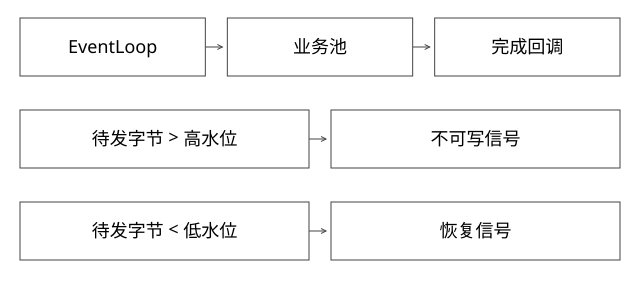

# Netty事件循环与出站背压

从 socket 就绪到业务回调，谁执行代码，慢客户端又怎样拖住内存？

源码基线：netty/netty · netty-4.1.108.Final。[固定源文件](https://github.com/netty/netty/blob/3a3f9d13b129555802de5652667ca0af662f554e/transport/src/main/java/io/netty/channel/nio/NioEventLoop.java)。



## 一条 EventLoop 服务多条连接

NioEventLoop.run 处理选择策略、就绪键和排队任务；processSelectedKeys 与 runAllTasks 都消耗这条线程的时间。ioRatio 分配相关执行预算，不会创造后端算力。

同一循环上的 Channel 共享推进机会。某个 handler 同步等待RPC，即使只阻塞一个请求，也可能延迟这条循环上其他连接。Future只是结果容器，不等于线程切换。

## 完整推导：一个请求经历哪些执行者

```text
EventLoop：读入 -> 解码 -> handler
业务 executor：阻塞查询 / 重CPU处理
完成通知：把结果交回约定 executor
EventLoop：编码 -> write/flush -> 处理可写事件
```

这是合理的分工示意，不是所有Netty项目默认会这样切线程。若handler直接做查询，第二行可能仍发生在EventLoop。DefaultPromise.notifyListeners 还会判断是否在关联executor中及通知递归深度，决定立即通知或再提交；注册listener不保证回调去业务池。

## 排队怎样取代线程阻塞成为瓶颈

跨线程 execute 把任务放入队列，最终仍需循环消费。业务池饱和若使用 CallerRunsPolicy，任务又可能回到提交它的EventLoop上执行，破坏隔离。若队列过大，则等待时间和上下文内存增长。

稳定负载下以Little定律估算平均在途量：100QPS、平均20秒，约2000个任务。异步不为每次等待独占线程，却仍需保存请求状态、连接和结果；它不把在途任务变成零成本。

## 出站缓冲水位的精确意义

ChannelOutboundBuffer 维护待发送字节。该版在总待发送量超过高水位时标记不可写，在降到低水位以下时恢复相应可写状态。高低阈值提供滞后，避免在一个边界上频繁抖动。

```text
待发送 40 -> 超高水位：触发不可写信号
应用若继续 write：数据仍可能继续积压
发送推进 -> 低于低水位：触发恢复可写信号
```

水位不是自动阻塞所有write的硬闸。应用需响应可写变化，限制生产速度、并发、缓冲和最大响应；也要考虑用户定义的其他不可写位。

## 超时与资源清理

调用方超时或断开连接，不保证下游任务停止。应定义是否取消、取消能否传播、迟到结果如何丢弃、ByteBuf何时release以及业务副作用怎样核对。

引用计数对象跨线程传递需遵守生命周期。仅把队列设为有界，不会自动修复丢失release造成的直接内存增长。

## 观察与自测

同时记录EventLoop任务延迟、业务池排队时间、在途数、pending outbound bytes、下游延迟与错误。线程栈中的等待要结合线程名识别，不能看到Future.get就认为一定在业务池。

本轮阅读固定源文件，未运行真实网络压测。

## 用一个慢客户端推导背压链，而不只看isWritable

假设业务每秒生成1MiB结果，客户端每秒只能读100KiB，若应用持续write，净积压约924KiB/秒，十秒约9MiB。水位通知会发生，却不会自动让生成器停下。关闭autoRead只影响相应入站读取，也不会自动停止另一个线程正在生成出站数据。

真正的反压链要连接四处：Channel不可写→停止/减慢结果生产→限制业务在途与缓冲→达到总预算时取消或返回明确失败。对于流式SDK，可把“还可接收多少chunk”变成有界通道或需求信号；不能无限缓冲直到整个大结果生成完。

还要考虑多连接相乘：单连接缓冲1MiB看起来不大，一万慢连接就约10GiB量级，未计其他开销。因此应同时有单连接、单租户和进程总预算，而不只修改一项Channel水位。

## ByteBuf跨线程的所有权账

假设handler收到一个引用计数缓冲，异步任务稍后才读取。若框架在handler结束时自动release，而任务没有持有自己的有效引用，就可能访问已释放内容；反过来，盲目retain但所有终止路径不release，又会泄漏。

必须写明谁拥有哪一次引用、何时转交、谁在成功/失败/取消/拒绝入队时释放。例如“入队成功由worker finally释放，入队失败由提交者释放”，同一引用只释放一次。retain不是拷贝字节，不会让并发写同一缓冲突然安全。

因此诊断直接内存增长要同时看缓冲积压和引用泄漏。前者随慢连接排空可能下降，后者可能在负载停止后仍保留；二者都不能只靠调整业务线程数解决。

## 自测

把blockingCall包在completedFuture(blockingCall())中是否异步？不是，调用早已在创建Future前执行。

[查看可编辑 SVG](assets/deep-points/21.svg) · [查看 PNG](assets/deep-points/21.png) · [返回知识点目录](实现详解_00_知识点目录.md)

