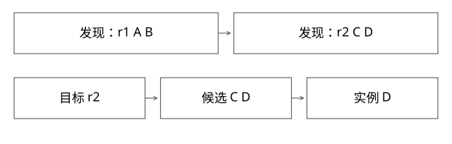

# Dubbo目录路由与版本候选

注册中心如何变成可调用实例，版本筛选与负载均衡分别在哪里？

完整阶段与更多结构图见[发布、发现、路由与下线全链路](Dubbo多版本服务_发布发现路由与下线全链路.md)。本篇保留单主题入口；源码补充锁单列，不改原基线。

源码基线：apache/dubbo · 3.2.12。[固定源文件](https://github.com/apache/dubbo/blob/1dd6a4aaa8816cf3f1585769dfff4f325e4ecd15/dubbo-cluster/src/main/java/org/apache/dubbo/rpc/cluster/support/AbstractClusterInvoker.java)。



## 四个概念先分开

逻辑服务身份由接口、group、version等维度决定；注册发现提供地址与元数据；路由限定当前调用可选集合；负载均衡在候选内选实例。一个应用的业务发布号不必等于接口兼容版本。

多个Pod组成一个业务版本，平台可先限定版本候选，再交给既有框架做版本内负载均衡，不必自己接管Pod内部worker。

## 从调用入口读路径

AbstractClusterInvoker.invoke 取得目录列表，初始化负载均衡等，再进入具体 doInvoke；list 委托 Directory。RegistryDirectory.refreshInvoker 将注册变化衔接为可调用对象，RouterChain参与路由机制。

固定3.2.12还需区分注册协议扩展：接口兼容分支的InterfaceCompatibleRegistryProtocol覆写getMigrationInvoker/getInvoker，经迁移规则选接口级RegistryDirectory；应用级使用另一分支。目录调用还涉及AbstractDirectory、DynamicDirectory和实际SingleRouterChain，不把其他版本的简化调用图当成逐行源码。

```text
发现快照：{A:r1,B:r1,C:r2,D:r2}
调用目标：r2
版本约束后：{C,D}
可用性与其他路由后：例如{C}
负载均衡：只能选C
```

负载均衡不能在筛选后偷偷选A。如果C/D都不可用，应按明确规则失败或执行获准的回退，而不是为了成功率静默调用不兼容旧版。

## 完整推导：规则与地址到达顺序不同

控制面发布r2规则，地址缓存却暂时只有r1。若调用侧只保存一个不带版本的实例池，就可能将r2请求打到r1。正确实现需要让规则/地址身份可核对，空集合处理可观察。

反过来，r2地址先到不代表可以立即承接所有流量；发布状态、就绪与业务验证仍有自己的门槛。注册成功与“该版本应对外服务”不是同一事实。

## Reference生命周期为什么不是每请求配置

共享ReferenceConfig的version若被并发请求修改，会让不同目标请求竞争同一个可变对象。每请求新建引用又可能反复创建发现、连接和元数据状态。

参考方案是按稳定服务身份缓存引用，定义容量、版本退役与销毁时点；若使用自定义路由，则请求上下文携带目标版本，并保证作用域正确、不串请求。不能把一个全局ThreadLocal忘记清理后当成路由上下文。

## 失败重试仍需保持集合约束

FailoverClusterInvoker可重新取候选并尝试其他实例；retries+1是该路径的尝试数逻辑。重试应仍属于被允许版本集合，不能只在首试时过滤。

请求超时不证明对端没执行；写操作需要幂等和状态查询。配置retries=0也不消除浏览器、上游Proxy或恢复逻辑的重发。参数只限制某一层的重试，不提供端到端只执行一次。

## 排空时的竞态

从注册发现摘除后，缓存与长连接可能仍产生在途或新请求。实例进入DRAINING拒绝新工作、等待在途完成、最后退出，与发现传播共同构成协议。单独sleep固定秒数并不是无损下线证明。

本轮未运行Dubbo集群。

补充两个源码反例：普通空列表可触发目录缓存复用，而明确empty协议通知可清理候选，需连同空保护配置检查；RandomLoadBalance在总权重为0时存在均匀选择分支，不能用全零权重实现严格拒新。完整条件与固定源码链接见上方全链路正文第6–8节。

## 自测

r2零实例时继续选r1是否正确？只有业务明确允许并验证兼容的回退才可能正确。Java与Python互通也要核对协议和SDK，不靠服务名相同推导。

[查看可编辑 SVG](assets/deep-points/22.svg) · [查看 PNG](assets/deep-points/22.png) · [返回知识点目录](实现详解_00_知识点目录.md)

