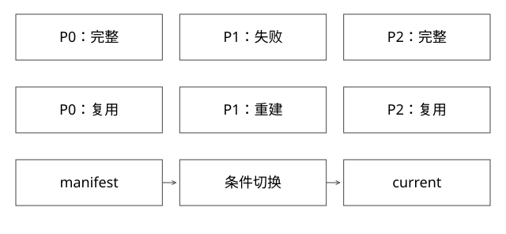

# 构建分片manifest与产物提交

失败后怎样只重做必要部分，怎样防止半份结果被当成完整版本？

实现基线：本库协议模型，非内部系统源码。



## 工作单元必须有可验证身份

DUMP输出构建输入，Build输出引擎制品，分发输出交付状态，在线加载输出服务实例的就绪证据。阶段间不应只传一个“成功=true”，而应传输入身份、配置摘要、分片规则与产物清单。

一个分片的身份可由 snapshot_id、schema_hash、builder_version、partition_rule、part_id构成。attempt_id是执行尝试，不应与分片逻辑身份混为一谈。

## 完整推导：三片中P1失败

```text
逻辑任务T：snapshot=S1，schema=H1，parts={P0,P1,P2}
attempt a：P0完整，P1半份，P2完整
重试 b：复用已核验P0/P2，只重建P1
manifest M：精确列出三片的URI、大小、校验与身份
发布指针：current从旧M切到新M
```

P1文件存在不等于完整；临时文件可写到尝试隔离路径，全部校验后才生成可发布manifest。换成S2或H2，旧片不应因“上次成功过”直接复用。

## 写文件和提交结果为什么分离

| 崩溃点 | 可见事实 | 恢复动作 |
|---|---|---|
| 文件未完成 | 只有临时产物 | 清理/续写按格式契约 |
| 文件完整、manifest未提交 | 可核验孤儿产物 | 校验身份后决定复用 |
| manifest完整、指针未切 | 新版本尚未服务 | 重试条件切换 |
| 指针切换、响应丢失 | 可能已经发布 | 按操作ID查状态，不重复猜 |

文件系统rename、对象存储对象写入、数据库条件更新的原子域不同，不能一句“原子提交”覆盖跨存储动作。发布指针应由具有明确一致性与条件写语义的存储管理。

## 调度并发与资源成本

记录数均分可能仍有大字段或计算倾斜。总时长受最慢尾片、调度排队、源读取、计算、存储和分发共同约束。应记录各阶段字节、CPU、等待与重试，而不是只报告总时间下降。

例如固定集群1000核全天预留与瞬时500核跑2小时，预留容量、峰值核数、实际核时是不同口径。缩短墙钟时间可能增加峰值或总核时；减少长期闲置预留也不意味着每次构建更快。

## 模型与真实系统的边界

expert_models.Publisher验证分片集合完全匹配、snapshot/schema一致、内容checksum匹配，并拒绝旧epoch。它在内存中把验证与current更新放在一次函数动作里，不证明真实对象存储和协调服务之间有事务。

部署实现应明确条件写失败、并发发布、旧执行恢复、制品GC和回滚保留。若回滚所需对象已被清理，保留旧指针也没有用。

## 清单里写什么，才能真的判断可复用

一个教学manifest可写成以下形状，字段不代表特定引擎协议：

```json
{
  "generation": "g7",
  "snapshot": "S1",
  "schema": "H1",
  "builder": "B4",
  "partition_rule": "hash-v2",
  "expected_parts": [0, 1, 2],
  "parts": [
    {"id": 0, "attempt": 2, "uri": "run7/p0/a2/index", "bytes": 1200, "digest": "d0"},
    {"id": 1, "attempt": 3, "uri": "run7/p1/a3/index", "bytes": 1300, "digest": "d1"},
    {"id": 2, "attempt": 1, "uri": "run7/p2/a1/index", "bytes": 900, "digest": "d2"}
  ]
}
```

验证顺序是身份匹配→分片集合恰好一致且不重复→对象已完成→长度与内容校验→格式可加载→业务语义检查。摘要本身不应指望从字符串d0直接证明内容，真实实现要读取并按约定算法验证；这里的值只是占位说明字段关系。

P0/P2复用时，attempt可以不同，但逻辑输入、schema、builder输出兼容和分片规则必须满足复用条件。只有文件大小相等远远不够；两个不同数据集完全可能压成同样大小。

## 原子指针与垃圾回收的竞争

发布者A读取current=g6，准备g7；发布者B也读g6并准备g8。若A先条件切换成功，B不能无条件覆盖，必须按当前期望重新判断。CAS失败意味着发布前提改变，不代表B的产物坏了，也不意味着可以把expectedCurrent改掉再盲发。

清理器同样不能只判断“此刻不是current”。g6可能被旧请求、回滚窗口或别的集群引用。先定义保留集合、租约/引用、最小保留时间与二次确认，再删除实际对象。发布指针、可回滚版本和在途读者分别是不同根引用。

## 自测

只保存count=3能否证明三片完整？不能，可能是P0重复三次。checksum能否证明数据语义正确？不能，它只验证内容一致性；输入与构建定义也必须匹配。

## 补一层实现边界

同一分片多个attempt并发完成时，选哪个产物应有确定规则；未被选中的孤儿产物要延迟回收，避免其他流程尚在校验就被删除。对象名稳定不代表内容不可变；若使用覆盖路径，manifest的checksum与缓存命中还可能引用不同时间的内容。

[查看可编辑 SVG](assets/deep-points/23.svg) · [查看 PNG](assets/deep-points/23.png) · [返回知识点目录](实现详解_00_知识点目录.md)

