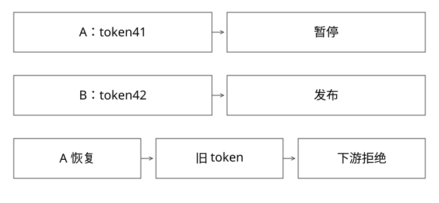

# ZooKeeper前驱锁与fencing

会话锁已经换了持有者，旧执行为什么仍可能写坏下游？

源码基线：apache/zookeeper · release-3.9.2。[固定源文件](https://github.com/apache/zookeeper/blob/e454e8c7283100c7caec6dcae2bc82aaecb63023/zookeeper-recipes/zookeeper-recipes-lock/src/main/java/org/apache/zookeeper/recipes/lock/WriteLock.java)。



## 顺序节点解决竞争排序

WriteLock的配方使用临时顺序节点，读取子节点并排序，最小者获得锁，其余关注相应前驱。前驱锁避免所有等待者都只监听同一个最小节点，在释放时同时惊醒。

临时节点与会话关联，不是与某个Java函数栈直接关联。网络断开、会话过期和客户端得知过期的时刻不同，不能把“本地还没收到错误”当成仍持有锁。

## 前驱消失的竞态

```text
B列出节点，发现前驱A
A恰好释放并删除节点
B对A执行exists并安装watch
若返回已不存在：必须重新判断，而不是永久等通知
```

watch事件是提醒重新读取状态，不是无须复核的锁授予证书。重连、会话变化与配方重试还需遵守客户端协议。

## 完整推导：旧执行A恢复

1. A取得token=41，开始构建，随后长时间暂停。
2. 会话失效，临时节点消失。
3. B取得更新的token=42，构建并发布。
4. A恢复，仍按旧内存继续执行发布请求。

如果下游只看“A说自己有锁”，A可能覆盖B的新版本。协调服务不直接拦截A对数据库或对象存储的写，这正是锁与fencing的边界。

## fencing必须由下游执行

```text
发布(token,expectedCurrent,newManifest):
  在同一条件写/事务范围内
  检查token是否仍被允许
  检查current是否等于expectedCurrent
  满足才更新current与已见token
```

token可以来自可靠单调序列，但整个生命周期要明确，不能在删除重建某个命名空间后把旧序列当永不回退。使用ZK顺序节点号码也不自动赋予所有下游支持该比较。

下游“只保存已见最大token”与“每次核对当前租约epoch”是两种协议：前者在新token尚未触达下游时的行为不同。不能用一个简化比较式许诺任意租约即时失效。

## 锁保护范围为什么要小

将几个小时的构建全过程都等同于必须持有全局锁，容易扩大故障影响。可按尝试隔离产物，把短的发布指针切换作为强校验点；并发构建允许存在，但只有符合条件的结果能发布。

续租、任务取消、产物复用和条件提交分别处理不同问题。旧worker可能无法马上杀死，但其写入必须被安全拒绝。

## 验证与自测

本库Publisher的epoch模型模拟“新租约已被发布端确认后拒绝旧token”，不是完整ZK客户端实现。故障实验应暂停持有者、使会话失效、让新执行提交，再恢复旧执行，检查旧提交确实被拒。

本轮未启动ZK。

## 自测

应用在写前先查一次“我是否持锁”，随后再写，能否消除检查与写之间窗口？不能；需要下游原子校验或等效协议。

## 补一层实现边界

会话重建后，旧异步回调仍可能晚到。管理层应将回调绑定attempt和epoch，拒绝把旧回调记到新任务上；否则下游虽挡住了旧发布，控制台仍可能把新执行错误标为成功或失败。fencing需要贯穿写入与状态归属，不只是生成一枚数字。

[查看可编辑 SVG](assets/deep-points/24.svg) · [查看 PNG](assets/deep-points/24.png) · [返回知识点目录](实现详解_00_知识点目录.md)

