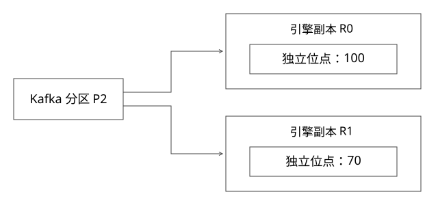

# Kafka手动assign与副本独立消费

如何指定分区，并让同一引擎分片的每份副本都收到该分区数据？

源码基线：apache/kafka · 3.7.0。[固定源文件](https://github.com/apache/kafka/blob/2ae524ed625438c5fee89e78648bd73e64a3ada0/clients/src/main/java/org/apache/kafka/clients/consumer/internals/LegacyKafkaConsumer.java)。



## assign与subscribe是不同分配模式

KafkaConsumer在3.7.0委托到具体consumer实现。LegacyKafkaConsumer.assign衔接SubscriptionState.assignFromUser；ConsumerCoordinator.poll针对自动分配进行组管理。手动assign由应用决定分区集合，不参加subscribe那套自动分配。

多个manual consumer可以读取同一分区，不会仅因group.id相同就自动让其中一个停止读取。但如果它们提交同一group、topic、partition的offset，就在共享一份恢复身份。

## 完整推导：分片S3有两个副本

```text
映射：引擎分片S3 -> Kafka分区{2,5}
副本R0：assign{2,5}，检查点身份S3/R0
副本R1：assign{2,5}，检查点身份S3/R1
每个副本都读取2、5，并独立应用到自己的索引
```

若R0提交到100，R1才持久化到70，两者共享同一个group提交身份会使恢复选择含糊。让每个逻辑副本有独立group，或完全使用与本地索引绑定的外部持久化检查点，都是可讨论方案；不能混着用却不说明谁权威。

## 消费骨架

```java
var tp = new TopicPartition(topic, 2);
consumer.assign(List.of(tp));
consumer.seek(tp, checkpoint.nextOffset());
while (running) {
    var records = consumer.poll(timeout);
    // 先处理，并建立可恢复索引状态；再推进安全检查点
}
```

代码只表达顺序，不是完整生产消费者。seek到哪里取决于可恢复索引，而不是内存中上次poll的位置。关闭自动提交不能自动让外部索引写入与offset提交原子。

## 生命周期身份

随机Pod名每次变化若直接成为新group，旧进度如何继承、新group何时清理都要解决。稳定逻辑副本身份又要防止两个进程误以为自己同时是R0，覆盖检查点；可结合租约、epoch与持久化绑定。

引擎分片数与Kafka分区数可能不同。扩分区后映射变化必须有版本，不能仍以partitionId==shardId推导全部路由。

## 1000个group应看哪些代价

组元数据按groupId映射到__consumer_offsets相关分区；GroupMetadataManager.partitionFor是研究入口。groupMaxSize限制的组内成员，不能读成集群group总数。

手动assign减少自动分配与rebalance相关工作，但仍有位点提交、协调发现、连接和重复fetch成本。即使只关心group数量，也必须知道它们是否活跃、提交频率和分布，单个数字不能推出固定压力。

## 线程与异常边界

普通KafkaConsumer不是供多个业务线程任意并发调用的容器；常见模式由单线程拥有poll/seek/commit，处理并行结果经安全通道返回。wakeup等特定能力另按API约束使用。

本轮未接broker，已有Java完整骨架见基础篇。

## 手动分配以后，哪些事要自己接手

假设R0只允许读取{2,5}。broker上分区2的leader变化，客户端元数据刷新可切到新leader，这不需要应用手动重新发明Kafka日志副本协议；但引擎副本R0崩溃后由谁在另一台机器接任，则是应用自己的逻辑副本调度问题。manual assign不替平台做这件事。

接任者先取得R0身份及新epoch，加载与R0检查点匹配的索引，再seek独立分区位置。不能只复用旧group ID并让旧进程继续运行；两个manual consumer不会自动被组分配协议互斥掉，外部检查点写入也可能互相覆盖。

如果使用外部检查点，应明确关闭自动提交，并明确启动时以哪份状态为准；Kafka提交可以是观测或恢复提示，但不能在它领先本地耐久索引时直接跳过数据。若完全不使用Kafka存储位点，可按客户端API约定避免依赖group提交；不要把“独立group”当成唯一架构。

## 独立副本追赶与在线服务资格

R0已到分区2的100、R1只到70，两者文件都可打开，不代表同样新鲜。若业务要求至少达到发布屏障Q=90，则R1暂不能进该版本的合格候选；如果允许陈旧读，要明确可接受滞后和观测。

Kafka日志副本数3、引擎副本数2、每个逻辑副本的进程数，分别属于三个层次。新增引擎副本会再次fetch并写索引，不会因为Kafka只保存一份逻辑分区就免掉网络和索引构建成本。容量评估要区分group协调开销与副本实际读写放大。

## 自测

R0/R1都manual assign同一分区，是否自动均分消息？不是；独立读全量正是这里需要的语义。

[查看可编辑 SVG](assets/deep-points/25.svg) · [查看 PNG](assets/deep-points/25.png) · [返回知识点目录](实现详解_00_知识点目录.md)

