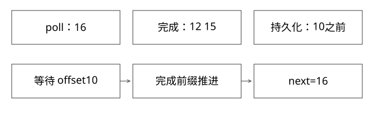

# Kafka位点与外部索引恢复

poll位置、提交位置和索引恢复位置不同，重启究竟应该从哪里继续？

源码基线：apache/kafka · 3.7.0。[固定源文件](https://github.com/apache/kafka/blob/2ae524ed625438c5fee89e78648bd73e64a3ada0/clients/src/main/java/org/apache/kafka/clients/consumer/internals/ConsumerCoordinator.java)。



## 四个位置分别是什么

poll推进消费者内存位置；处理完成位置表示应用动作完成；持久化位置表示崩溃后索引确实可恢复到哪里；Kafka committed offset是组恢复记录。它们可能不同，不能把poll返回就当作业务已提交。

提交offset通常表示下一条读取位置。最后完成offset10，对应下一位置11，但还要考虑前面有没有未完成的消息。

## 完整推导：两个提交顺序都存在窗口

| 顺序 | 崩溃点 | 后果 |
|---|---|---|
| 写索引，再提交11 | 索引成功，位点未提交 | offset10可能重放 |
| 先提交11，再写索引 | 位点成功，索引未写 | offset10可能被跳过 |
| 可查询但未持久化，再提交11 | 崩溃丢失内存/NRT状态 | 消费进度领先可恢复索引 |

安全方案需要将可恢复索引与位置绑定，或接受重放并在目标端幂等。仅“手动commit”不能消除第三行。

## 连续完成前缀，不是最大完成值

处理offset10、11、12，若10和12完成、11未完成，不能提交13。应只推进到第一个未完成位置。多个分区分别维护进度，不能把一个全局最大offset用于全部分区。

还有更细的边界：真实Kafka可见offset可能有数字空洞，例如事务控制记录、过滤或压缩后的日志。按整数10、11、12逐个等待只适用于连续教学输入。生产跟踪应根据实际交付的记录顺序与可跨越的扫描位置，维护“已交付且在范围内的在途记录”，而不是永远等待某个从未交付的整数offset。

## 一个有空洞的例子

```text
poll交付offset10、12、15，记录扫描后的安全候选next=16
完成12、15，但10未完成 -> 不越过10
完成10 -> 本批全部完成，可推进到16
```

这里的16必须由消费/批次协议提供可靠边界，不能仅从任意未来记录猜测。若有多个批次并行，要保留每批交付与在途信息，避免后批完成提前越过前批。

## 实体版本与顺序

相同实体的新值v8先写成功，旧值v7后到，应拒绝旧值；相同版本不同内容应当冲突而不是悄悄覆盖。删除保留版本tombstone，防止旧更新复活。

检查版本与写内容应在目标端原子完成。先读版本，再普通写入，两个线程仍可能让旧值最后覆盖新值。

## 验证与自测

本地模型分别验证连续输入与有空洞的交付清单：expert_models.py检查连续前缀、旧更新、重复、删除及同版本冲突，deep_models.py检查实际交付记录有空洞时的完成前缀；kafka_ingestion_demo.py模拟写入/提交之间的崩溃窗口。三者不代替broker/索引集成。ConsumerCoordinator.commitOffsetsSync的成功只证明该提交协议成功，不证明任意外部副作用。


## 把位点和索引绑定成一个可恢复单位

一种参考方案是把每分区nextOffset写入索引提交元数据，与该次可恢复索引提交共同发布；启动时读取同一个commit的内容与位置。另一种是外部checkpoint引用明确的索引快照ID，只有该快照已耐久并可恢复，才允许推进引用。具体引擎是否支持，必须查接口与持久化语义，不能把refresh当commit。

假设内存已经处理到16，但最近耐久提交只覆盖到13。即使Kafka组提交已到16，恢复索引后也不能跳到16，否则13之后的数据可能永久缺失；正确起点取决于绑定的恢复单位。接受重放时，实体版本、删除tombstone与相同版本内容校验负责避免错误覆盖。

## 有空洞时的最小确认账本

将poll交付列表[10,12,15]按实际顺序登记，每条有完成/未完成状态，另保存该次扫描可安全跨越的边界16。12先完成不移动最早未完成位置；15再完成也一样；10完成后才允许把这批推进到16。不是计算max(completed)+1，也不是按整数等一个永远不会交付的11。

多批并行时，后批[18,20]即便先完成，仍不能越过前批的10。暂停某分区fetch有助于限制未完成数量，但不能释放已在处理的任务或撤销副作用。消费者拥有线程串行登记/提交，worker只回报完成，简化了账本的一致性。

账本推进仍只是内存判断；持久化失败后，不能对外宣称checkpoint成功。取消、异常、目标分片改版和旧epoch回调都必须绑定原身份，否则旧任务的“完成”会错误推进新索引位置。

## 自测

将max(completed)+1作为提交值何时会漏？当更早的已交付记录尚未完成。重复消费能否一概靠Redis短TTL去重？不能，重放窗口与目标事实未必被短TTL覆盖。

## 补一层实现边界

异步commit回调失败后不能无条件重发更旧进度；若后续新进度已成功，旧回调重试可能干扰恢复记录。单线程拥有提交序列、单调进度检查与错误分类都需明确。客户端中的重试处理不能代替应用对外部持久化边界的判断。

[查看可编辑 SVG](assets/deep-points/26.svg) · [查看 PNG](assets/deep-points/26.png) · [返回知识点目录](实现详解_00_知识点目录.md)

