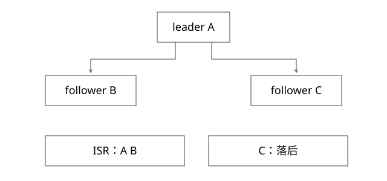

# Kafka副本ISR与确认边界

有三份副本是否就能承诺消息不丢，acks=all实际等待什么？

源码基线：apache/kafka · 3.7.0。[固定源文件](https://github.com/apache/kafka/blob/2ae524ed625438c5fee89e78648bd73e64a3ada0/core/src/main/scala/kafka/cluster/Partition.scala)。



## 分区副本和消费副本不是一回事

Kafka leader/follower复制日志，引擎的多个索引副本则各自应用业务更新。前者保存消息，不代表后者已经加载或追到相同位点；两套高可用需要分别观察。

Partition.appendRecordsToLeader负责leader追加相关路径，ReplicaFetcherThread处理副本拉取与落地，high watermark的推进参与已复制边界。不要把消费group成员画成Kafka日志follower。

## LEO、HW和ISR

LEO是日志末尾的下一位置，HW限制相应已复制可见边界。ISR是被认为跟上的副本集合，随复制状态变化。HW不是简单固定取“配置中所有副本LEO最小值”，实际实现还处理ISR变化、追赶和状态协调。

read_committed还要考虑事务稳定边界，不能把“到HW”当作所有事务模式下一样可读。

## 完整推导：3副本，min ISR=2

初始leader A与follower B/C都在ISR。acks=all按当前协议等待相应ISR复制与提交边界，不是只等任意一个副本。

若C落后并被移出ISR，A/B仍可在满足min ISR条件时接收相关写；若只剩A且min ISR=2，acks=all的写应失败，而不是为了可用性自动降为单副本确认。

这个取舍把部分故障转为写不可用，以保护所需复制条件。配置副本因子3本身不提供同样保证。

## 错误不等于没有写入

Partition中可见追加前的ISR不足检查，也有等待确认阶段的相关检查。若追加后条件变化或响应丢失，生产者收到错误/超时，日志可能已存在该批数据。

所以应用不能遇到异常就断言“这次绝没有成功”；幂等生产者利用producer身份、epoch与分区序列协助处理协议内重试。但两个独立业务send仍可能是两条消息，它不认识你的订单操作ID。

## 选举与截断

新leader应按故障协议从合适副本接任；日志epoch帮助识别分叉与截断。若允许不满足同步条件的副本接任，就要接受更高数据丢失风险。关闭某类不安全选举也不是任何多机/磁盘灾难下绝不丢失证明。

磁盘持久性、机架放置、同时故障、配置和版本都影响实际承诺。acks不是对操作系统和所有硬件故障的无限保证。

## 端到端路径

```text
业务事件产生
 -> producer确认
 -> Kafka日志复制
 -> consumer取到
 -> 索引应用并持久化
 -> 实例通过查询验证
```

每个箭头都有独立状态。Kafka确认成功既不等于索引写入完成，也不等于商家页面已经看到结果。

本轮未运行故障注入。

## 用数值区分“写到leader”和“可确认”

假设要写的批次结束后nextOffset为101，A的LEO变101，B仍100。仅A追加不能证明acks=all的这批已达确认边界。B追到所需位置后，还要按本轮ISR、HW和延迟确认协议判断，不是应用看到某个副本目录里有文件就算成功。

若ISR原来为A/B/C，C迟迟不追赶，它未正式离开ISR前与离开后，确认条件可能不同；不能把min.insync.replicas=2背成“总是随便挑两份就立即确认”。min ISR是相应写入的门槛，而acks=all还要满足有效复制状态。

## 生产者幂等的身份边界

协议内重试可复用producer身份、epoch与分区序列，使broker识别同一批次的重传；应用重启后重新发一个业务事件，或上游因响应丢失又生成一个新send，不保证是同一批次。业务event_id和目标端幂等仍有必要。

Kafka事务能协调其支持的Kafka记录与位点，不会自动把一个任意HTTP发券接口或外部索引文件纳入同一原子提交。要讨论端到端语义，应画清“事务实际覆盖哪些存储”，不只说开启了一个参数。

可靠性也不是每条acks=all都意味着所有副本完成设备级fsync。应分别检查日志复制、刷盘策略、机架故障、选举与恢复；副本复制把某些单机失败风险转成可恢复，不是对全部共同故障的数学免疫。

## 自测

acks=all与min ISR=1是否等于始终有两份数据？不等于；当ISR仅leader时条件可能仍满足。生产端幂等是否自动实现外部数据库exactly-once？不实现。

## 补一层实现边界

跨机架副本可降低某类相关故障，但副本数够不代表故障域独立；所有副本共享电源、存储或区域风险时，独立失效假设并不成立。可靠性方案应同时记录副本放置、允许选举集合、恢复时间与可接受数据窗口。

[查看可编辑 SVG](assets/deep-points/27.svg) · [查看 PNG](assets/deep-points/27.png) · [返回知识点目录](实现详解_00_知识点目录.md)

