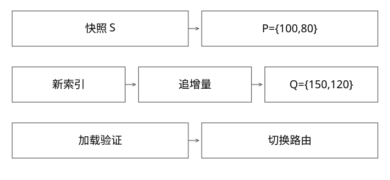

# 全量快照与增量切换

全量构建几个小时期间数据不断变化，怎样保证切换不漏更新？

实现基线：本库协议模型，非内部系统源码。



## 快照和位点必须描述同一边界

全量快照S覆盖哪些更新，必须能映射到增量流的位置向量P。P按分区记录“从哪里继续”，不只是一个墙钟时间。数据库提交顺序、CDC读取和Kafka写入之间可能有延迟，因此随手记录构建开始时的Kafka最新位置，不能证明它恰好对应快照。

本篇是协议设计，不声称内部引擎已经采用某一种实现。

## 完整推导：两个分区的边界

```text
S覆盖：P0 offset<100，P1 offset<80
新索引Build(S)
增量追赶起点：{P0:100, P1:80}
追到目标Q：{P0:150, P1:120}
加载验证后，才允许按约定切换
```

如果快照漏了P0的90，而追增量从100开始，这条更新永久不在新索引；若快照已经覆盖110，却又从100重放，需要目标端幂等/版本语义正确处理重复。不能只比较总行数判断不存在这两类错误。

## 切换条件需要哪个水位

“追到最新”会随生产不断移动，不能是无法判定的口号。可记录一个确定目标水位Q，等各分区达到；也可设计双写/连续追赶和原子路由切换协议，但要说明切换时读者的可见承诺。

跨分区不存在天然全局offset。达到每分区Q不自动保证一个跨分区业务事务的原子可见性，若业务需要，应另外设计事务标记或一致切面。

## 保留期和吞吐预算

假设构建8小时、重试2小时，若增量只保留6小时，最初边界可能已不可读取。auto.offset.reset跳到earliest或latest并不能补回缺失数据，应失败报警并重建快照或可靠补数。

设恒定增量生产速率w、追赶处理速率c。c=w时积压不缩小，c<w时还会增长；c>w时，理想化追赶时间约 backlog/(c-w)。这还未计源限制、索引merge和其他流量，因此要保留余量，不只看消费瞬时QPS。

## 产物分发不是服务切换

实例收到文件后应核对manifest、schema、分片与版本；加载成功后做必要数据与查询检查；达到允许服务状态才进入候选集合。上传HTTP200不等于引擎已经打开了正确版本。

切换路由也有缓存传播。若要求所有请求立即只到新版本，就不能仅依赖异步发现；需要匹配可接受的一致性或短暂双版本语义。

## 回滚与增量还在继续

回滚到旧全量时，旧实例可能已停止追增量。仅保留旧文件不足以保证回滚后数据新鲜；应明确旧版追赶、恢复位点、数据兼容和回滚窗口。新版本做过不可逆数据转换时更需单独设计。

## 验证与自测

构造可标识事件序列，明确快照包含集合，重放边界后的事件，对照最终实体版本与tombstone；再分别在Build、追赶、加载、路由切换注入故障。现有本地模型只验证事件集合覆盖，不包含上述完整故障注入，也未测试追赶算式。“保留期和吞吐预算”中的公式是恒定速率下的手算模型，不是实际吞吐测量，更不代表验证了真实CDC一致快照协议。


## 算一次追赶时间与保留期

全量构建8小时，期间每秒产生1万条增量，则积压约2.88亿条。假设追赶真实处理能力为3万条/秒，继续生产1万条/秒，净追赶为2万条/秒，理想追赶约14400秒，即4小时。不能用2.88亿除以3万得到2小时40分就结束，因为这段时间还在生产新数据。

因此从初始边界到追赶结束已约12小时；若又有2小时失败重试，至少还要覆盖这段额外时间及余量。日志保留还可能受大小上限而非只受时间控制，应检查实际最早可读位置，而不是只读一项“保留24小时”配置。

追赶期间处理能力可能因merge、源限额或前台查询竞争下降。用短时峰值3万估算全天恢复，会低估RTO；应该测持续净追赶速度，并检查每片尾部，而非只看总体平均。

## 一致快照边界的责任不能空着

源表快照到增量位置的对应关系，通常要由源系统/CDC/引擎协议提供，平台记录和校验它；DUMP从ODPS读完不自动产生Kafka一致边界。如果拿不到可靠对应，可采用更保守的重叠重放与实体版本协议，但必须证明不会漏掉快照缺失事件，不能任意猜一个较早offset就称已证明。

重叠区里“同实体旧更新覆盖新全量值”是另一个风险。全量记录与增量都应有可比较版本，或者由严格定义的切换协议决定覆盖；删除也需要覆盖。平台负责调度并不等于可以绕过引擎对格式和应用顺序的约束。

## 自测

快照时刻10:00、Kafka位点记录时刻也是10:00，能否证明一致？不能，墙钟相同不代表数据提交与流位置一致。

## 补一层实现边界

切换验收不能只抽一个业务ID：需覆盖每片manifest与水位，再选新增、更新、删除和边界时间查询验证。抽样可发现错误，不能逻辑上证明全部记录无误；应以输入边界、完整清单和确定性校验建立基础，再用业务查询补充语义证据。

[查看可编辑 SVG](assets/deep-points/28.svg) · [查看 PNG](assets/deep-points/28.png) · [返回知识点目录](实现详解_00_知识点目录.md)

