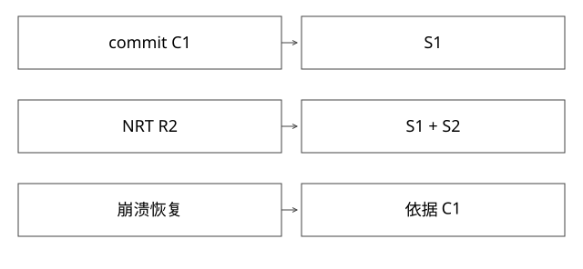

# Lucene的Segment与提交点

索引已经能搜到，为什么进程崩溃后仍可能回不到这个状态？

源码基线：apache/lucene · releases/lucene/9.9.2。[固定源文件](https://github.com/apache/lucene/blob/a2939784c4ca60bc28bf488b5479c02fc2e5e22c/lucene/core/src/java/org/apache/lucene/index/SegmentInfos.java)。数值模型与二进制兼容验证分别说明。



## 段、reader与提交文件

Segment是一组索引结构的组织单位，reader持有某个可读视图，commit记录一组可恢复段引用。docID在段内定位，不是稳定业务主键；merge可能改变它。

IndexWriter接收文档，DocumentsWriterPerThread处理线程局部写入与flush；不同字段生成倒排、stored fields、DocValues、point/vector等结构。不是一份“正排文件”包含全部类型。

## 四个动作逐个拆

flush将内存中的相关索引状态形成段产物；NRT refresh建立可观察写入器新状态的reader；commit建立持久化提交点；merge组织段合并和删除回收等。它们的触发、完成条件与成本不同。

StandardDirectoryReader的提交打开路径与写入器NRT路径不同。旧reader不会收到一个新文档就自动变新。

## 完整推导：最后一次commit之后的更新

```text
C1：提交引用 S1
写入更多文档 -> flush得到 S2
NRT reader R2可观察 S1+S2
尚未commit时崩溃
按最后持久化提交恢复 -> 依据C1，不可仅凭R2曾搜到就承诺S2可恢复
```

有时S2文件已存在，但孤立文件不等于合法提交集合。恢复依据不是“扫描目录，把看见的所有文件都算索引”。

## prepareCommit与finishCommit

SegmentInfos.prepareCommit衔接pending segments写入等准备；finishCommit通过相应rename与元数据同步形成正式提交。文件内容、目录项与存储Directory的同步语义共同影响崩溃承诺。

```text
准备所引用文件
 -> 写pending提交元数据并同步
 -> 完成提交名切换
 -> 同步相应目录元数据
```

这是机制化简，不代替全部异常清理分支。自定义Directory或远程存储若不提供对应保证，不能沿用本地文件系统的所有假设。

## 更新与删除

按稳定业务项updateDocument通常体现删除旧匹配和新增文档，不是对不可变段的倒排正文原地改一行。删除状态与段合并有自己的生命周期，已删除docID和maxDoc等计数也不等同有效文档数。

merge可减少段数和回收某些删除代价，却会占CPU/I/O；不是“merge完才搜索”，更不应在每次发布前无条件强制合并到单段。

## 与Kafka恢复位置绑定

若offset提交领先最后可恢复提交，NRT里已见到的更新在崩溃后丢失，消费者又跳过，便可能漏数据。应以可恢复索引点记录相应每分区位置，或设计可安全重放的协议。


## docID与业务ID：用一次merge说明不能混用

S1内docID0=A、1=B，A被删除；S2内docID0=C。查询侧通常用段身份加段内docID，或reader视图中的docBase组合定位，不能直接把两个0去重。merge可把有效B、C组织到新段，产生新的docID映射；业务主键B/C仍不变。

旧reader持有自己的段与删除视图，不会因为新段生成就把内部映射原地换掉。缓存若以docID作为跨reader的永久key，merge或reopen后可能把A的字段解释成B。需要绑定reader/segment生命周期，或使用真正稳定业务ID及版本。

## 提交与检查点的一个可恢复例子

假设C1中业务数据只覆盖分区P0到next=100，NRT已应用到120。把Kafka提交120后崩溃，重新打开C1只能恢复到100；若直接seek120，就漏掉[100,120)的必要更新。

参考方案是在一次索引commit的元数据中保存与提交内容一致的位置向量，例如C2绑定P0=120、P1=80；只有C2提交可靠完成才将它作为恢复根。若使用外部checkpoint，则它必须引用一个可恢复的C2，而不是只记一句“当前索引已刷新”。

Lucene可以提供相关提交元数据接口，但同步语义、失败处理及跨系统发布仍需调用方设计。一次refresh快、一次commit慢，不能简单删掉commit来追求吞吐，再沿用相同崩溃恢复承诺。

## 自测

新reader搜到一个业务ID，能否证明它已经持久化commit？不能。文件存在是否等于在当前commit中？也不能。验证时应分别记录可见时间、提交点和重启恢复结果。

本轮锁定源文件并手推状态，没有构建完整Lucene或运行磁盘故障实验。

[查看可编辑 SVG](assets/deep-points/29.svg) · [查看 PNG](assets/deep-points/29.png) · [返回知识点目录](实现详解_00_知识点目录.md)

