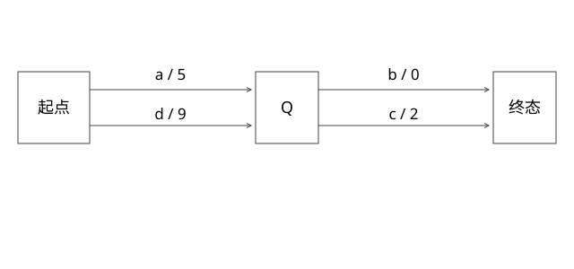

# FST输出共享与BlockTree查词

FST怎样比Trie更紧凑，又怎样与词典块一起找到词项？

源码基线：apache/lucene · releases/lucene/9.9.2。[固定源文件](https://github.com/apache/lucene/blob/a2939784c4ca60bc28bf488b5479c02fc2e5e22c/lucene/core/src/java/org/apache/lucene/util/fst/FST.java)。数值模型与二进制兼容验证分别说明。



## FST不只是压缩版字符串集合

Trie共享前缀；有限状态转换器还携带输出，并可合并满足等价条件的后续状态。等价不是“边标签看起来一样”就够，还涉及终态与后续输出关系。

findTargetArc按输入label查转移；路径输出按所用Outputs语义组合。不同输出类型可能用不同运算，不能一律解释为字符串拼接或整数相加。

## 完整推导：不同前缀共享同一段后缀

构造整数输出字典：
```text
ab -> 5
ac -> 7
db -> 9
dc -> 11
```

可将根上a边输出5、d边输出9，二者指向同一个后续状态Q；Q上b输出0、c输出2，再到终态。这样a+b得到5，a+c得到7，d+b得到9，d+c得到11。

这个例子使用整数相加输出，展示把公共输出提前后形成等价后缀。不是说任意输出字典都能按这组简单数字合并，也不是声称Lucene所有词项都用此一形式建图。

## 路径为何必须保留输出

若只记终态是否存在而丢掉边输出，就只能识别字符串，无法还原5/7/9/11。若输出提前后没有调整后续残量，又会重复累计。正确构建要保持每条输入的总输出不变。

FST的节点序列化还可使用不同出边组织；查找一条边不是总扫描所有状态。压缩、缓存局部性、随机访问和构建成本需要一起衡量。

## BlockTree没有把完整倒排塞进FST

SegmentTermsEnum的seekExact/seekCeil利用词项索引和已有前缀状态导航块，再读取块内后缀、floor block与元数据。FST在这里帮助定位前缀/块，不是每个完整词都直接携带全部docID。

```text
输入 term
 -> FST前缀导航
 -> 词典块定位 / floor选择
 -> 块内后缀匹配
 -> 解码词项状态
 -> postings枚举
```

前缀是词典索引中的组织单位，目标词还可能需要在块里判断。把“FST前缀没走完”与“词不存在”的推理脱离实际BlockTree布局，会解释错seek分支。

## seekExact与seekCeil

exact只问目标词是否存在；ceil可到达大于等于目标的词，适合范围与枚举等操作。连续查询相近前缀时，实现可复用部分seek状态；不能把每次查询都想成从磁盘头顺序扫完整字典。

词典压缩影响索引内存与定位，postings压缩影响倒排体；二者不是同一种压缩率，也不能相加后直接换算QPS。

## 验证与自测

新增模型检查四条路径的输出和共享状态等价；本库原FST图解提供更小结构。它不是Lucene二进制兼容编码器。真实验证应固定词分布、公共前后缀、查询顺序，分别测构建与seek。


## findTargetArc不是始终线性扫边

固定文件按节点出边表示分支。二分布局保存固定宽度弧，按label比较定位；直接寻址布局先把目标label减firstLabel，检查范围与存在位，再定位实际弧；连续布局针对无空洞的连续label，可直接按下标定位。小的变长弧布局则有相应逐弧扫描路径。

这几条分支解释空间与访问时间的交换。若label范围巨大但实际出边很少，为所有空洞留固定槽会浪费；存在位可以表达稀疏范围，二分又以比较换空间。不能只说“FST查找O(词长)”就忽略每个状态找目标边的代价。

例如一个状态出边为a、c、z，查c：二分查有序label；直接寻址先算c−a，再核对该位确实存在。查b不能因为b处于a..z之间就判存在。弧上还需要目标、输出、终态等信息，某些编码用标志省略可推导数据；逻辑图共享与字节布局压缩是两个层次。

本篇ab/ac/db/dc图是字母与整数输出模型；Lucene词典涉及字节序、对应输入类型和BlockTree组织。读源代码时必须从构建器与读取器配对理解，不能把图中的某个节点画法直接当磁盘结构。

## 自测

两个后继状态的标签相同但终态输出不同，能否直接合并？不能，必须保持每条输入输出语义。FST是否等于完整倒排？不是。

## 补一层实现边界

输出共享示例的前提是按构建器要求处理输入，并保持同一Outputs代数。最小化合并的是等价后续行为，不是把任意相同字节片段共用。若终态携带非零输出，也必须计入等价判定；漏掉终态输出，可能出现查词存在但返回地址错误的问题。

[查看可编辑 SVG](assets/deep-points/30.svg) · [查看 PNG](assets/deep-points/30.png) · [返回知识点目录](实现详解_00_知识点目录.md)

