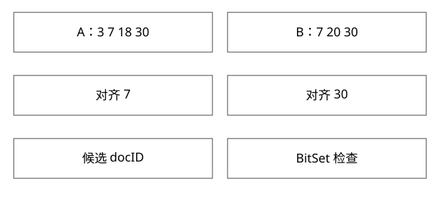

# 倒排求交advance与BitSet

多个条件怎样逐步对齐候选，为什么不用把所有结果先读成大集合？

源码基线：apache/lucene · releases/lucene/9.9.2。[固定源文件](https://github.com/apache/lucene/blob/a2939784c4ca60bc28bf488b5479c02fc2e5e22c/lucene/core/src/java/org/apache/lucene/search/ConjunctionDISI.java)。数值模型与二进制兼容验证分别说明。



## 候选迭代器的契约

nextDoc推进到下一个文档，advance(target)推进到不小于target的后续位置，调用者必须遵守单调推进契约，不能随意往回seek。cost是用于选择路径的估计，不等于已经精确测量CPU耗时。

Lucene99PostingsReader结合块缓冲和skip等机制实现遍历；ConjunctionDISI组织多个迭代器对齐，低成本迭代器可优先驱动，但具体布局还涉及BitSet等优化。

## 完整推导：A与B求交

```text
A={3,7,18,30}，B={7,20,30}
B先到7，A.advance(7) -> 7，命中
B.next -> 20，A.advance(20) -> 30
A已经超过20，B.advance(30) -> 30，命中
下一步任一耗尽，交集结束
```

中间没有生成A的每个候选与B的每个候选的笛卡尔比较。对齐失败时推进落后的迭代器；不能永远推进已经在前面的那个，否则会跳过合法交集。

## skip并不是跳过必要答案

倒排块通常包含可用于跳转的信息。若某块最大文档位置仍小于target，可跳过相应区域；目标附近仍需要解码和定位。advance提高跳跃能力，不承诺任何目标都只做一次内存访问。

压缩块大小、稀疏程度、访问顺序和目标跨度影响代价。目标很近时逐步推进可能与大跳不同，不能用一条统一复杂度概括所有实现。

## BitSet为何适合某些过滤

若另一个条件可表示为位集合，候选docID可用bit测试快速判断；也可以对整字进行AND等操作。空间约为maxDoc/8字节再加结构费用，稀疏集合不一定适合总是分配致密位图。

过滤选择性、复用率和段大小影响是否值得先物化。存在删除文档时还需liveDocs等有效性条件，不能把某个字段过滤bit位为1直接当最终可见结果。

## 两阶段匹配

有些查询先给较宽的近似候选，再用较贵matches判断真匹配。应尽量让便宜条件减少昂贵验证次数，但必须保持正确性。仅拿近似迭代器数量当最终命中数，会高估结果。

排序评分又是候选之上的操作；过滤不需要评分的部分可以改变执行方式，而不是所有查询都先算完整BM25再丢弃。

## 可运行模型与边界

新增deep_models.py使用单调索引和bisect实现教学advance，记录每次位置变化，断言结果为7、30；这是契约模型，不具备Lucene真实skip文件、压缩缓冲或评分器成本。

实际benchmark要固定词频分布、相关性、过滤选择性和缓存状态，比较解码块数与尾延迟，而不是仅看结果条数。


## 第二阶段为什么不是多余过滤

短语查询“new york”的两份倒排可先按docID求交。文档D同时含new和york，但位置分别为5和9，属于候选却不满足紧邻短语；若为5和6才可能满足相应位置约束。还需考虑分析器、同义词与slop等具体语义，不能仅靠共同docID决定。

第一阶段迭代器负责便宜近似，第二阶段matches负责较贵验证。若候选很多，位置列表解码可能主导成本；将低选择性的条件全物化为致密位图也未必最优。选择驱动器依据cost等估计与查询类型，不是只看单个词字符长度。

## 位图的数量级与共享范围

maxDoc=1亿时，仅每文档1bit的致密位图约12.5MB，即约11.9MiB，还未计对象开销。若为1000个互不共享的租户过滤分别物化，最坏量级就约12.5GB；稀疏或可复用结构、缓存预算和失效规则都会影响选择。

位图只对它构造时对应的段/reader有意义。merge后docID重映射，不能把旧位图原封不动用于新段；删除可见性与权限变化也需要正确失效。单次bit test很便宜，不能因此忽略构建、保留和重建成本。

## 自测

A到30、B到20时，下一步应该把谁推进到30？B。若直接把A推进到31，可能丢失共同的30。BitSet检查快是否意味着建BitSet永远划算？不意味着。

[查看可编辑 SVG](assets/deep-points/31.svg) · [查看 PNG](assets/deep-points/31.png) · [返回知识点目录](实现详解_00_知识点目录.md)

