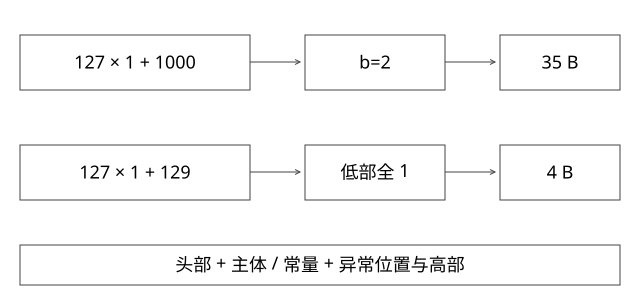

# 倒排差分与PFor异常压缩

一块整数怎样在保留随机跳块能力的同时减少字节数？

源码基线：apache/lucene · releases/lucene/9.9.2。[固定源文件](https://github.com/apache/lucene/blob/a2939784c4ca60bc28bf488b5479c02fc2e5e22c/lucene/core/src/java/org/apache/lucene/codecs/lucene99/PForUtil.java)。数值模型与二进制兼容验证分别说明。



## 先区分差分与位打包

docID有序时，可保存相邻差值；小差值适合更少bit。差分改变数值分布，位打包改变二进制存储，两者可以组合，但不是同一步。

还原docID需要前缀和及相应块基准。只解出小整数而忘了恢复基准，会得到差分而非真实文档位置。

## PFor本版的块与头部

Lucene99相关块为128个整数。PForUtil用较小基准位宽存大部分值，少量异常保存位置与高位。token低5位表达基准位宽，高位表达异常数；异常高部用字节，因此选宽时不能把最大值超出的bit数无限增大。

encode根据若干最大值与范围约束选位宽，不是穷举所有bit宽度寻找整个系统最优压缩率。

## 完整推导：127个1与一个1000

长度128的块中，第42位为1000，其他均为1。最大值需10bit；按本版补丁范围约束，基准位宽可为2，异常数为1：

```text
token = (1 << 5) | 2 = 34
主体：128 * 2 bit = 32 byte
异常位置：42，1 byte
异常高位：1000 >> 2 = 250，1 byte
主体该位置低位：1000 & 3 = 0
还原：0 | (250 << 2) = 1000
总计：1 + 32 + 2 = 35 byte
```

若全块统一10bit，仅主体就160byte。这里35byte是指定分支的编码预算，不含外围文件、指针、校验和与跳表信息，不是整份索引压缩率。

## 为什么还有相等值特例

本版对某些全相等低值块可使用位宽0与一个VLong基值，再叠加异常恢复等语义。decoder看到bitsPerValue=0时先填充基值，不能误读成所有整数都是0。

skip也按token选择跳过VLong或固定宽主体，再跳异常对；所以编码头既影响压缩，也影响不用全解码时如何跳过一块。

## 解码与查询性能的取舍

较小文件减少存储与带宽，但解码、前缀和、分支和缓存访问仍消耗CPU。位打包成批解码有利于连续处理；随机查询只需少数候选时，块跳过与缓存更关键。

因此“压缩5倍，QPS提升5倍”没有依据。需分别测冷/热缓存、顺序/随机advance、不同差值分布与硬件。

## 实验与自测

新增模型按上述2bit主体与异常补丁还原128值，检查1000和所有1；它不实现ForUtil的实际长字布局，也不是可互换的Lucene编码器。该区分必须保留：数学语义正确，不代表字节格式兼容。


## 再走一个特殊分支：127个1和一个129

最大值129需要8bit，其余为1。按本版选择规则，基准位宽可为1；129的低1bit仍为1，去掉异常高部后整个主体全相等，且maxBitsRequired<=8，因此可进入相等值特例，而不是固定写128bit主体。

教学解码账如下：

```text
token = (1<<5) | 0 = 32
VLong基值 = 1，占1B
异常位置 = 42，占1B
异常补丁 = 128，占1B
decode先把128个位置填1，再在42处执行1 | 128 = 129
合计4B，不含外层文件与校验
```

这个分支中存储补丁已按编码规则调整；不能把普通分支的“读高部后左移基准宽度”原封不动搬来。解码使用token的bitsPerValue=0，补丁已保存到正确位上。

再换成1000，低2bit变0，而其他仍为1，主体不再全相等，回到前面35B示例。对比这两个输入，可以看出压缩费用由整个分布与分支共同决定，不是只看最大值大小。实际ForUtil布局仍需上游编码器验证，教学字节账不等于已生成兼容文件。

补充算例验证：[depth_review_models.py](examples/source-level/depth_review_models.py) 中的 test_pfor_special_and_normal_accounting 核对指定普通/常量低部分支的记账与数值还原，不输出Lucene兼容文件。

## 自测

把1000当异常存全值是否同样是这个格式？不是，本版保存的是高部与位置。只算32byte而忽略token和异常对是否正确？不正确。没有差分基准能否直接还原绝对docID？不能。

## 补一层实现边界

差值为零、块尾不足128、超过补丁可表达范围等情形不能硬塞本例分支；真实codec有自己的块与尾部处理。模型应在超范围时拒绝，而不是截断高位。round-trip测试应覆盖边界，且须区分自建编码与上游格式。

[查看可编辑 SVG](assets/deep-points/32.svg) · [查看 PNG](assets/deep-points/32.png) · [返回知识点目录](实现详解_00_知识点目录.md)

