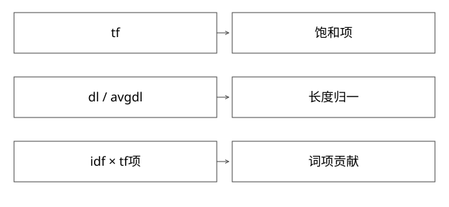

# BM25的饱和归一与实现公式

词频越高为何收益越来越小，为什么不能直接拿教科书分数对齐Lucene数值？

源码基线：apache/lucene · releases/lucene/9.9.2。[固定源文件](https://github.com/apache/lucene/blob/a2939784c4ca60bc28bf488b5479c02fc2e5e22c/lucene/core/src/java/org/apache/lucene/search/similarities/BM25Similarity.java)。数值模型与二进制兼容验证分别说明。



## 三个输入维度

词频tf描述词在当前文档的出现量，文档频率n描述多少文档包含词，文档长度dl及平均长度avgdl参与长度归一。它们是索引分析后的统计，不能把原文字符数当作同一个dl。

k1控制词频饱和形态，b控制长度归一强度；boost还可整体缩放贡献。多词和多字段组合由上层查询组织，不等同只算一次单词公式。

## 本版的等价解释形式

idf使用 ln(1+(N-n+0.5)/(n+0.5))。忽略norm量化误差与boost取1时，可将本实现tf部分解释为：
```text
K = k1 * (1-b+b*dl/avgdl)
贡献 = idf * tf/(tf+K)
```

实际score用缓存normInverse和减法形式等安排来支持相应浮点性质。教科书常见额外(k1+1)因子没有按同一方式保留；对固定参数可能只差常数，但数值与跨实现融合不能直接混用。

## 完整推导：相同词频、不同长度

取N=1000，n=10，idf约4.557；k1=1.2，b=0.75，avgdl=100，tf=3：
```text
dl=100：K=1.2，tf部分=3/4.2≈0.7143，贡献≈3.255
dl=200：K=2.1，tf部分=3/5.1≈0.5882，贡献≈2.681
```

长度更大但词频相同，匹配密度较低，归一后贡献下降。若长文词频也增加，两个效应要一起计算，不能只凭长短断言得分。

## 词频为什么饱和

固定K=1.2时，tf从1到2，比例从1/2.2≈0.455升至2/3.2=0.625；从10到11，只从约0.893升至0.902。每次额外出现仍有收益，却逐渐趋近1。

b=0移除这一长度比项，不等于关闭所有统计影响；k1变化会改变饱和，不能把它当“召回条数”。参数优劣要依据实际相关性标注，而不是默认越大越准。

## norm量化与字段统计

长度norm采用压缩表示时，实际还原长度可能是近似值。overlap token处理与索引选项也影响长度统计。上述连续公式是机制手算，逐bit复现分数还需按实际编码norm与输入统计运行实现。

分片/段/字段的统计来源也影响跨系统得分比较。仅把两个不同检索源的原始BM25和向量相似度线性相加，可能只是量纲碰巧，不是校准。

## 验证与自测

新增模型验证上述数值、tf饱和和长度方向，不声称复现norm编码。真实调参需固定分析器、文档、查询与相关性集合，测排序质量和性能，避免训练/验证泄漏。


## 自测

长文就一定排后面吗？不一定，还涉及tf、idf、字段与查询结构。把常数因子忽略是否完全无影响？固定单一评分下某些相对顺序可不变，但阈值与异源融合数值会变。

## 补一层实现边界

idf中的N与n来自相应字段统计，不是必然等于数据库总行数。缺失字段、删除与统计聚合策略可使其不同于业务文档计数。解释线上分数时，先取得实际使用的统计与norm，再代公式；仅拿原文和总行数无法精确复算。

[查看可编辑 SVG](assets/deep-points/33.svg) · [查看 PNG](assets/deep-points/33.png) · [返回知识点目录](实现详解_00_知识点目录.md)

