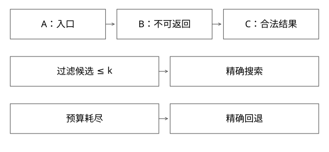

# HNSW候选搜索与过滤回退

被过滤节点为何仍可能被访问，k又为什么不是访问节点数量？

源码基线：apache/lucene · releases/lucene/9.9.2。[固定源文件](https://github.com/apache/lucene/blob/a2939784c4ca60bc28bf488b5479c02fc2e5e22c/lucene/core/src/java/org/apache/lucene/util/hnsw/HnswGraphSearcher.java)。数值模型与二进制兼容验证分别说明。



## 搜索维护的不止一份集合

图中邻接边用于导航；visited避免重复展开；候选队列保存值得继续探索的节点；结果收集器保存当前较好合法结果。它们的容量、比较方向与含义不同，不能画成一张固定大小的TopK列表。

高层导航与底层搜索也有不同工作。构建图参数影响连接与可搜索性，查询k只是结果目标，不能代表构建参数或访问预算。

## 完整推导：非法节点也可充当桥

构造A—B—C，查询目标接近C，B因业务过滤不允许返回。如果搜索时完全禁止访问B或沿B的边继续，就可能无法到C。图导航与结果收集应分别判断。

```text
到A -> 发现B -> 计算/安排B
B不满足acceptOrds：不放入最终合法结果
B仍可按搜索规则参与邻居导航 -> 发现C
C满足过滤 -> 进入结果候选
```

具体是否展开某节点仍受候选边界和预算控制，不是所有被拒绝节点必然展开。核心区别是“不可返回”不等于“绝不参与导航”。

## Lucene上层如何选择精确搜索

AbstractKnnVectorQuery先构造过滤并考虑liveDocs；若过滤后候选数cost<=k，本版直接exactSearch。若候选较多，进入带预算的approximateSearch；若结果标记因访问过多而非完整结束，会回退exactSearch。

因此一次KNN查询不保证永远只走HNSW。过滤越严格，有时精确枚举反而便宜，也避免图搜索为凑合法结果探索太多节点。

## k、访问预算与召回率

k=10不表示只计算10次距离。为了找到好的10个可能比较大量节点；预算小可能更快但召回下降，过滤和数据分布会改变曲线。

衡量ANN Recall@K应以同一向量集、过滤条件和相似度的精确TopK为参照。若精确基准没过滤、ANN有过滤，分母就错了。

## 相似度与量化边界

点积与余弦只有在相应归一条件下建立特定关系。向量维度、范数、相似度方向和编码必须匹配。量化可降低存储/计算成本，但引入误差；它不是HNSW图结构本身的同义词。

IVF、PQ、HNSW属于不同机制，不能因知道其中一个，就宣称源文件同时实现全部结构。本篇只解释固定Lucene路径。

## 验证与自测

最小图模型可验证“过滤桥节点仍可导航”的必要性，但不证明近似搜索召回保证。真实benchmark应分别测候选数、距离计算/访问数、过滤选择性、Recall与尾延迟，并按热冷缓存分组。

本轮未跑Lucene ANN。

## 用距离队列推演“为什么会提前停止”

为便于手算，以下用距离越小越好表示，源码使用相似度时比较方向相反。设k=2，入口A距离9；展开A发现B距离6、C距离2，候选队列优先弹C，结果暂保留C2/B6。C再发现D距离1，结果变D1/C2，当前最差合法结果距离2。

此时候选B的距离6比结果边界2差，近似搜索可以按对应停止规则结束。即使B背后还连接着距离0.5的E，也不一定继续探索到它；图连接质量与搜索宽度决定近似误差。停止不是对全部未访问节点的精确下界证明。

visited集合防止A↔B回路反复计算，候选队列决定下一步探索，结果队列决定当前返回边界。被过滤的桥节点可能留在探索过程，却不进入合法结果；这仍受搜索边界与访问预算约束。

因此评估要以完全相同过滤后的精确TopK为基准，画访问数/延迟与Recall曲线。若上层因预算耗尽转精确枚举，尾延迟可能跳变；只报平均ANN耗时会掩盖回退成本。

补充算例验证：[depth_review_models.py](examples/source-level/depth_review_models.py) 中的 test_graph_queue_pruning_can_hide_better_neighbor 演示两队列边界为何可能漏掉E，不是完整Lucene HNSW实现。

## 自测

结果没满k是否一定数据不足？可能过滤、预算或其他约束影响；应检查上层回退与候选事实。approximate正常返回是否证明全局精确TopK？不能。

## 补一层实现边界

段内局部docID还需与docBase衔接，再作段间结果合并。把不同段的同号docID直接去重会误删不同文档。返回业务ID还需字段映射，图内部序号、段内docID与业务主键是三套身份，不应混用。

[查看可编辑 SVG](assets/deep-points/34.svg) · [查看 PNG](assets/deep-points/34.png) · [返回知识点目录](实现详解_00_知识点目录.md)

