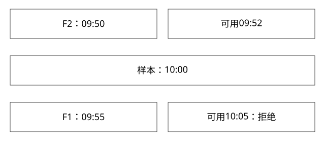

# 特征双时间连接与穿越

事件发生在样本之前，为什么仍可能是线上当时看不到的未来信息？

实现基线：本库可运行参考模型与工程协议，不冒充私有引擎源码。



## 事件时间和可用时间回答不同问题

event_time描述业务何时发生，available_time描述这份特征何时进入服务可使用状态。样本时间为t，合法历史特征通常至少需要两者都不晚于t，并按约定考虑实体、版本、有效区间与过期。

这不是把“延迟到达的数据全部丢掉”，而是训练样本重建必须模拟决策当时能看到什么。

## 完整推导：晚到的新事件与已到的旧事件

```text
样本 t=10:00
F1：event=09:55，available=10:05，值=9
F2：event=09:50，available=09:52，值=5
只按event<=t选最新 -> F1，线上当时不可见
同时按available<=t -> F2，符合当时信息边界
```

若10:10服务读取当前特征，F1可能已经合法；同一条数据对不同历史时点的资格不同。不能只给一份“最新特征表”就宣称能重建所有历史样本。

## 参考函数的逐步语义

expert_models.point_in_time先筛双时间条件，再按(event,available)选择最大候选。这个排序是教学约定；若同一业务事件有修订序列，应显式加入revision或可靠版本，不能让两条冲突数据因存储顺序随机胜出。

```sql
-- 示意条件，真实SQL还需按样本和实体分组取版本
WHERE feature.entity_id = sample.entity_id
  AND feature.event_time <= sample.time
  AND feature.available_time <= sample.time
```

WHERE正确不等于整个join正确；一对多重复、同名特征版本、空值、时区与精度差异都可能污染结果。

## 滚动窗口也会穿越

“过去7天点击数”必须按样本时点截断，并考虑当时已到达的事件。离线任务在第二天重算，可能纳入当时未到的历史点击；event落在窗口内，不代表可用性也符合。

标签有自己的成熟窗口。购买发生在曝光后可以构造监督标签，但不能同时作为曝光时就可见的输入特征。区分标签截止时间与特征截止时间。

## 线上线下一致性不仅是数据相同

相同原始值经不同缺省填充、归一化、字典映射或模型版本，会得到不同输入。应把特征定义、数据版本、处理函数与模型归属一起记录。

采样线上请求的实际输入，与历史重建结果比较，有助于区分数据晚到、缓存陈旧和处理逻辑偏差。全量记录敏感明文不是必要前提，应按权限与脱敏要求设计证据。

## 验证与自测

现有本地模型验证F1被拒、F2被选；它只按(event,available)筛选和取最大值，没有实现修订号或过期区间。无可见候选可由函数返回None；同事件修订与过期边界需要先扩展契约再补测试，不能声称当前代码已覆盖。时间值示例955/1005只是便于推演的有序标记，不应直接当可做分钟运算的时钟编码。


## 自测

按event_time做ASOF JOIN能否必然无穿越？不能，还缺available_time等条件。离线分数变高是否说明模型更好？也可能是泄漏或采样/标注变化，需要回到输入事实。

[查看可编辑 SVG](assets/deep-points/35.svg) · [查看 PNG](assets/deep-points/35.png) · [返回知识点目录](实现详解_00_知识点目录.md)

