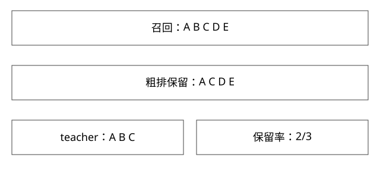

# 召回粗排与精排的候选损失

粗排为什么要对齐精排，又为什么复现精排仍不等于业务最优？

实现基线：本库可运行参考模型与工程协议，不冒充私有引擎源码。



## 分层不是简单把同一模型调用三遍

召回从大集合取候选，粗排用较轻计算进一步筛选，精排在较小集合上用更丰富信号。各阶段预算、特征成本与训练分布不同。下游通常无法恢复已被上游删除的候选，因此必须看损失发生在哪一层。

扩大召回集合可能提高覆盖，也可能增加噪声、特征读取、模型误差与超时，不是候选越多必然效果越好。

## 完整推导：粗排保留率的分母

同一候选集合中，精排Top3是{A,B,C}。粗排预算只保留{A,C,D,E}，对teacher Top3的保留率为2/3。若精排Top3本身算自另一份候选集合，这个对比就混入召回差异，不能只归因粗排。

```text
teacher_top = 精排在固定候选上的TopK
kept = 粗排送下游的集合
retention = |teacher_top ∩ kept| / |teacher_top|
```

统计应按请求或样本做明确聚合；大流量请求与小流量请求是否等权，会改变总体值。teacher_top为空时也需定义未定义或特殊处理。

## 双塔得分与向量范数

用户向量u=(1,0)，物品A=(2,0)、B=(1,1)。点积A=2、B=1；余弦A=1、B≈0.707。这个例子排序相同，但只看点积还同时受到物品范数影响。

再取C=(100,100)，点积100，余弦仍≈0.707；若业务只想角度相似，未归一化点积可能把大范数推得很高。是否归一化必须与训练目标、索引相似度和在线配置一致。

## TopK选择与打分成本

对M候选计算轻分，再用大小K的堆，选择常见为O(M log K)、空间O(K)；但总时间还包括M次打分与特征获取。若走ANN，计算路径不是全量枚举，参考HNSW篇。

粗排降低精排输入量，不代表把精排耗时直接按候选数线性缩小。批处理、模型并行、特征缓存与尾部请求会改变实际曲线。

## 为什么teacher不是ground truth

精排可能受曝光选择偏差、历史训练数据和模型误差影响。把teacher模仿得更像，可能只是复现其偏差。teacher保留率用于阶段兼容诊断，业务价值还要看标注、用户指标与实验。

损失分解可以按“目标未被召回、召回后被粗排丢弃、精排评分不佳、后置规则覆盖、展示失败”定位。只看CTR总下降，很难找到具体责任阶段。

## 验证与自测

固定同一候选和teacher打分，再改粗排预算，记录保留率—延迟曲线；同时检查不同人群、长尾请求和超时。不能只选一个改善明显的case代表整体收益。

新增模型验证2/3保留与范数反例，不包含真实训练。

## 把损失沿漏斗逐级算清楚

固定一条查询有10个约定相关目标G。召回候选含其中8个，粗排送下游时剩5个，最后展示Top3含2个，则相对G的覆盖依次为80%、50%、20%。粗排的条件保留率是5/8=62.5%，不是5/10；末段是2/5=40%。在这个固定集合示例中，0.8×0.625×0.4=0.2。

若把不同查询的平均率直接相乘，通常不能得到整体覆盖，因为各层分母、权重和相关性可能不同。逐请求保留候选ID、被丢阶段和版本，才能定位真正损失点。

teacher TopK保留率是另一种诊断：它问便宜模型有没有保住昂贵模型偏好的候选，并不等于上述人工相关目标G的Recall。老师模型偏好与真实用户价值有差异，两个分母不能混写在一个“召回率”指标里。

还应记录超时与降级：离线10毫秒内能保住的候选，在线因特征RPC超时走默认值可能被丢。把性能护栏与候选轨迹放一起，才分得清模型表达不足和工程链路失真。

## 自测

粗排保留率100%是否证明线上效果最好？不能。精排TopK保留率的teacher候选集合为什么必须固定？否则分子分母变化混杂多个阶段。

## 补一层实现边界

离线teacher应在当时可用特征和约定模型下生成。若teacher使用事后修正数据，而粗排线上只能读旧特征，可能产生分布差。把差异全部归因学生容量不足，会掩盖数据时间边界；应先对齐数据，再解释模型与预算取舍。

[查看可编辑 SVG](assets/deep-points/36.svg) · [查看 PNG](assets/deep-points/36.png) · [返回知识点目录](实现详解_00_知识点目录.md)

