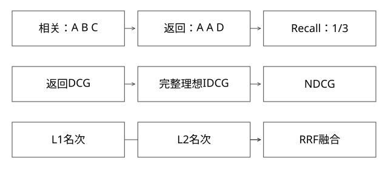

# Recall与NDCG及RRF的计算契约

检索质量指标和融合分数怎样逐项算，哪些分母最容易算错？

实现基线：本库可运行参考模型与工程协议，不冒充私有引擎源码。



## 三种量不评价同一件事

Recall评价相关目标覆盖，NDCG评价带等级相关性的排列质量，RRF按多个检索器的名次融合。RRF分数不是标注质量指标，不能用“融合分升高”直接宣称用户效果变好。

实现基线为expert_models.py与本轮deep_models.py，函数契约必须和报告一起说明。

## 完整推导：Recall与重复项

相关集合R={A,B,C}，返回Top3=[A,A,D]。唯一命中只有A，所以Recall=1/3；不能把重复A算两次。若precision按3个返回槽计算，则为1/3，重复也占掉一个位置。

当R为空，Recall分母为0，本库返回未定义，不伪装成0或1。聚合时需报告有效样本数，避免不同版本因为跳过样本比例变化出现虚假改善。

## NDCG的理想排序必须来自同一评价宇宙

采用gain=2^rel-1、折扣log2(rank+1)。理想候选有标签[3,2,0]，理想DCG=7+3/log2(3)≈8.893。返回顺序标签[2,0,3]，DCG=3+0+7/2=6.5，NDCG约0.731。

若系统漏召回标签3，只返回标签2、0，不能仅将自己的返回标签排序当IDCG并得到1。IDCG应由约定评价候选/相关集合产生，缺失目标也必须反映到分数。

原参考函数默认只评价传入标签的排列；本轮增加ideal_labels参数，允许显式传完整基准，文档不能把默认函数说成自动知道未返回目标。

## RRF怎样融合不同量纲

两个名次表L1=[A,B]、L2=[B,C]，常数c=60、排名从1开始：
```text
A = 1/61
B = 1/62 + 1/61
C = 1/62
```

B排首。它不需要将BM25和余弦原始分强行相加，但仍需去重、权限、版本和结果数量契约。本库先对每一路重复ID去重再重新编号，这是明确的规范化选择，不是所有系统唯一做法。

## 截断与并列边界

K=0、负K、结果不足K、全零相关标签、重复、并列分数和缺失标注都需定义。不同IDCG集合、gain函数与未标注处理，不应放在同一报告中直接比较。

稳定tie-break只解决可重复，不说明并列处有真实相关性差异。离线只标注召回过的文档，还可能引入评估选择偏差。

## 验证与自测

本轮模型检查漏召回时NDCG不会因缩小分母虚高，并校验RRF与重复约定。业务评测还应按查询、用户或任务聚合，避免长输出样本自然贡献更多权重。


## 自测

两个检索器都把同一错误文档排第一，RRF会自动纠错吗？不会。Recall提高但NDCG下降是否矛盾？不矛盾，覆盖和排序是不同维度。

## 补一层实现边界

宏平均按查询先算再平均，微平均先汇总分子分母，权重不同。一个查询有1个相关目标，另一个有100个，在宏平均中等权，在微平均中后一项权重大。报告需保存聚合协议，避免相同“Recall”标签掩盖不同统计目标。

[查看可编辑 SVG](assets/deep-points/37.svg) · [查看 PNG](assets/deep-points/37.png) · [返回知识点目录](实现详解_00_知识点目录.md)

