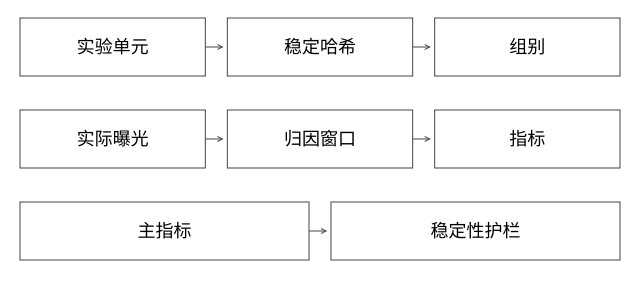

# 稳定分桶与AB实验归因

用户被稳定分到新版本后，还缺什么才能证明效果来自改动？

实现基线：本库可运行参考模型与工程协议，不冒充私有引擎源码。

## 分流是实验执行，不是全部实验设计

稳定分桶可用可靠哈希将实验单元映射到区间，再将区间分配为对照/实验。实验单元可以是用户、商家或其他对象，选择取决于干预传播与业务目标；不能默认每个请求都是独立样本。

请求每次随机分组会让同一用户反复跨版本，改变体验与归因。稳定也不是随意用语言默认hash：重启、版本或进程盐变化可能影响可重复，需要固定协议。

## 完整推导：用户有不同请求量

用户A发100次请求，B发1次。若干预按用户分配，却把101个请求当101个独立样本估算不确定性，可能低估同一用户内相关性。

按用户统计的转化与按请求统计的点击回答不同问题。目标是商家营销总效果时，同商家用户间还可能共享预算、库存与活动干预，实验单元选择会更复杂。

## 分层互斥与版本上下文

同一层实验互斥可以减少干预相撞；不同层并行实验又要考虑交互。用户命中策略应在请求上下文传播，避免召回用实验版、精排用对照版，最后只记录一个总标签。

服务版本路由约束目标实例集合，不自动生成可信的曝光日志。分配日志与实际曝光日志应分别保存，并预先说明分析口径。

按随机分配总体分析（ITT）时，未曝光者也保留在原分组中，不能为“只看有效用户”而事后随意剔除。若采用触发型分析，需要在两组对等识别“实际受到或本应受到改动影响”的用户，不能只在实验组保留曝光用户、对照组却使用全体；否则可能破坏可比性。可对照[Microsoft的触发分析与反事实日志说明](https://www.microsoft.com/en-us/research/articles/patterns-of-trustworthy-experimentation-post-experiment-stage/)。两种分析回答的总体问题不同，不应混用。

## 指标分母和成熟时间

点击率可按点击/曝光，转化率还需定义用户、会话、订单归因和观察窗口。购买有延迟，实验末尾刚曝光的用户没有足够成熟时间，不能直接与更早样本比同一个转化率。

退款、取消与重复上报还会改变最终结果。指标口径、数据延迟、异常去重和归因规则应固定版本。

## 样本比例与护栏

先查实际分组是否符合预期，是否有人群缺失、路由失败、日志采样差异。样本比例异常往往提示执行或记录有问题；不能看到实验组效果高就忽略基础检查。

护栏可包含错误率、延迟、成本、投诉等。主指标改善但稳定性明显退化，不一定可推全。阈值与止损应事先定义，不能看完结果再挑有利指标。

## 统计推断的边界

随机分配、干预独立性、实验时长和指标分布影响统计方法。频繁查看后只在显著时停止，会改变误报率；多指标、多分组也需要处理多重比较。

不应把某个通用p值公式当作适合所有电商指标的源码事实。本篇是实验协议推导，不提供未经业务假设验证的统计结论。

## 验证与自测

先做A/A检查分流与日志，再上线受控干预，保存分桶协议、曝光、指标定义和版本。对路由和效果之间各阶段逐步核对，避免将数据故障误判模型提升。

## 先检查SRM，再解释提升

计划以用户50/50分配2000个合格用户，实际入组900/1100。按最简单的固定独立分配模型，期望1000/1000，卡方统计量为100²/1000+100²/1000=20。这个手算提醒“差了100人”需调查；是否适用该检验、阈值与多次查看策略，仍要结合真实实验设计。

先区分分配总体与曝光总体。两组各1000人分配正确，但实验功能失败导致实验组只有800人曝光；如果只把800名成功用户作为实验组、对照仍用1000人，比较已被执行结果筛选，可能高估效果。错误用户不应仅因没曝光就从ITT分母消失。

SRM本身不告诉你根因。可能是资格判定不对称、分桶身份不稳定、路由缺版本、日志丢失或采样差异。按“资格→分配→实际路由→曝光→结果”逐层对齐人数，才能确定在哪一步出现不平衡。

这些是合成数据的计算与故障排查顺序，不构成某次线上实验的显著性结论。即使SRM正常，跨商家预算干扰、指标成熟期和并发实验交互仍需检查。

补充算例验证：[depth_review_models.py](examples/source-level/depth_review_models.py) 中的 test_srm_and_lfu_arithmetic 只复算本篇SRM的卡方统计量20，不计算p值或实验功效。

## 自测

50%请求命中新版是否足够证明AB有效？不够，还缺实验单元、曝光事实、口径和推断前提。稳定分桶能否消除同商家用户间干扰？不能自动消除。

## 补一层实现边界

若按商家随机，商家规模差异会造成方差与权重问题；若按用户随机，同一活动预算可能又让两组相互影响。应先画清干预资源共享关系，再选实验单位。请求数很多不代表独立样本很多，亿级流量下也一样。应预先确定最小可检测变化、观察期与异常处理，避免临时挑选有利时间窗。

[查看可编辑 SVG](assets/deep-points/38.svg) · [查看 PNG](assets/deep-points/38.png) · [返回知识点目录](实现详解_00_知识点目录.md)

