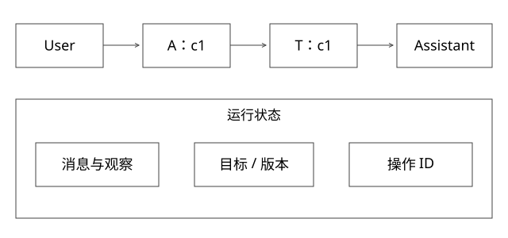

# ReAct消息循环与工具分支

Agent循环每一步保存什么，为什么END只是执行路径结束？

源码基线：cloudwego/eino · v0.7.0。[固定源文件](https://github.com/cloudwego/eino/blob/18427c201b3315586802260f8b20a97f6b008e8b/flow/agent/react/react.go)。上层业务协议与该库机制分别说明。



## 用消息对象代替神秘的“思考循环”

Eino此入口组织模型节点、工具节点和状态。模型输出可以包含tool calls；工具结果按调用标识回到消息上下文，再交模型决定下一步。这里展示可观察消息和动作，不要求记录模型内部隐藏推理。

Skill提供某类任务的方法与约束，工具提供程序执行，Agent框架管理调度。使用Codex的项目不因此采用Eino；本篇只借开源实现解释机制。

## 完整推导：一次发布与评测

```text
用户：验证r2是否修复badcase
模型消息：tool_call c1 -> deploy(r2)
工具消息：tool_call_id=c1 -> deployment=d17, RUNNING
模型消息：tool_call c2 -> query(d17)
工具消息：tool_call_id=c2 -> READY, served_release=r2
模型消息：tool_call c3 -> evaluate(r2,suite7)
工具消息：tool_call_id=c3 -> report e9
模型消息：无更多工具调用，整理e9结果
```

模型需要知道d17与r2的关系，不能仅把“发布成功”当成最后结果。查询可以重复，但应查询同一任务，而不是每轮重新发布。

## 源码怎样选边

NewAgent建立图，toolsNodePreHandle处理相应状态，modelPostBranchCondition检查流式模型输出是否有工具调用，选择工具或END；特定工具直接返回等配置也会改变路径。

最大图运行步数是调度约束，不等于业务允许无限重试。ADK的迭代语义和这个flow入口也有区别，不能混用两个配置名当同一个计数器。

## 流式首块为什么要小心

工具调用可能分块携带。默认检测器对模型首块行为有前提，若适配模型先输出普通文本、后输出工具信息，可能需要自定义检查策略。

不能只看到一块“我先看一下”就宣布整轮没有tool call；也不能把还未拼完的Arguments当完整JSON执行。流式展示和安全执行门槛是两种进度。

## END与验收的差别

无tool call可以表示模型认为任务完成，也可以是无法继续、缺工具或提前放弃。任务成功应检查业务目标：正确版本、有效评测、必要报告和允许的副作用。

“发现回归并准确报告”可能满足诊断任务，却不满足“修复并通过门槛”。先定义任务类型再统计Agent成功率，不能把所有正常return记为成功。

## 循环保护

应限制总步数、时间、费用和重复无进展动作，并为未完成提供明确停止原因。多次同参数同错误没有新增证据时，继续循环不等于持续进步。

输入日志中的指令是数据，不能擅自提升为用户授权。模型决策还须经过工具端权限与参数约束，不靠循环Prompt包办。


## 从源码走完一轮，而不是只记ReAct三个字

先给state.Messages一个具体值：用户消息U要求验证r2。modelPreHandle把本次输入追加到历史，模型返回助手消息A1，里面包含调用c1。这个A1不是立即丢弃的控制信号：toolsNodePreHandle将它追加到历史，工具节点得到调用参数，再返回工具消息T1，其ToolCallID必须对应c1。下一轮modelPreHandle接收T1并追加，模型看到的是U、A1、T1，而不是只有一句“部署成功”。

| 调度位置 | 新增消息 | 下一轮必须保留的信息 |
|---|---|---|
| 第一次模型前 | U：验证r2 | 用户目标与允许环境 |
| 第一次工具前 | A1：c1提交r2 | 工具名、完整参数、c1 |
| 第二次模型前 | T1：D17处于RUNNING | c1对应D17，尚未就绪 |
| 第二次工具前 | A2：c2查询D17 | 查询原任务，不再次提交 |
| 第三次模型前 | T2：D17 READY | 还需核对实际制品与访问落点 |

这里的关键不变量是：工具结果不能脱离它回答的调用，任务结果不能脱离它验证的版本。截断历史时只留下T1、删掉A1，可能既破坏消息协议，也失去D17究竟属于哪次请求的依据。一个助手消息含多个tool calls时，也不能任意只保留其中一个结果，假装该轮已经完整收束。

本版MessageRewriter可以改写state.Messages；MessageModifier在复制的切片上组织模型输入。这说明“有改写入口”，不等于库已替业务实现可靠摘要、长期记忆或操作事实核对。应继续阅读具体回调，而不是见到字段名就认定这些能力存在。

## Harness与上下文：压缩的是材料，不是执行事实

在本文中，Harness指围绕模型循环提供的执行环境、状态、工具约束和验收机制，不限定某个产品的同名组件。一个长任务至少区分四类材料：

- 必须持久保存的事实：目标制品、operation_id、task_id、已完成副作用、报告引用与当前授权。
- 模型本轮需要的工作上下文：目标、目前失败阶段、关键证据和待选择动作。
- 可按需读取的大材料：完整构建日志、源码文件、历史评测报告。
- 不能升级成授权的数据：检索文本、日志里出现的命令或第三方建议。

假设完整日志占80,000 token，而模型本轮只需解释一个编译错误。工具先返回阶段、错误码、少量相邻行和原日志引用，模型需要时再取片段。摘要记录“D17仍RUNNING，未开始评测”，不能改写成“发布已完成”。压缩后恢复时，再查平台权威状态；摘要不是数据库，也不撤销已经发生的副作用。

工作上下文可以遗漏可再取的旧日志，却不能丢失“同一操作键继续查询”的约束。应构造一个测试：提交已成功、响应丢失、随后压缩历史，再恢复任务；若Agent重新创建新操作而不是核对旧操作，即使最终成功，也暴露了恢复契约缺口。

## 流式分支的精确反例

固定源码的firstChunkStreamToolCallChecker会跳过前导空内容；遇到含ToolCalls的块返回true，遇到非空普通Content则返回false，而不是保证读完整轮后再判断。若模型依次输出“我先检查”、随后才输出工具调用，默认检测器可能提前选择END。这是适配契约问题，应换合适检测策略并用实际模型流验证，不是加大MaxStep就能修复。

工具调用参数也可能分多块。先到 `{"release":`，后到 `"r2"}` 时，必须完成拼接和解析再校验执行；不能把第一块当默认参数调用。图运行步数、模型轮数、工具次数和业务重试次数分别计量，不能将一个MaxStep同时当成四种预算。

## 自测

工具全部HTTP200是否证明任务成功？不证明，可能发布错版本或评测无效。本轮读固定源码，没有运行Eino模型服务。

[查看可编辑 SVG](assets/deep-points/39.svg) · [查看 PNG](assets/deep-points/39.png) · [返回知识点目录](实现详解_00_知识点目录.md)

