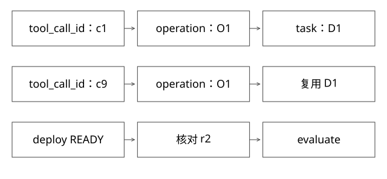

# 工具契约并行依赖与幂等ID

模型生成的工具调用怎样变成安全、可恢复的业务动作？

源码基线：cloudwego/eino · v0.7.0。[固定源文件](https://github.com/cloudwego/eino/blob/18427c201b3315586802260f8b20a97f6b008e8b/compose/tool_node.go)。上层业务协议与该库机制分别说明。



## JSON合法只是第一道门

ToolsNode根据工具名准备任务，将Arguments传入对应执行入口，并将结果关联到call ID。JSON能解析，不意味着资源存在、用户有权限、环境允许或业务前置条件满足。

服务端应独立验证身份、应用、环境、目标版本与允许动作。默认生产环境或猜测应用名，可能把一次语言歧义变成真实副作用。

## 输入输出要让程序能判断

```text
输入：app, environment, release, operation_id, payload_hash
输出：operation_id, task_id, state, actual_release, error_code
state：ACCEPTED / RUNNING / READY / FAILED / UNKNOWN
```

字段是参考契约，不是内部平台实际接口。返回“好了”不足以区分请求被接收、部署完成与业务验证通过；结构化状态仍应附必要可读证据。

## 完整推导：发布与评测不能盲目并行

模型同一轮给出deploy(r2)和evaluate(r2)。本版ToolsNode可顺序或并行执行，默认并行配置不代表两者业务独立。

顺序执行也不必然正确：deploy返回ACCEPTED后，紧接evaluate仍可能评到旧版。真正依赖是部署达到READY并验证actual_release=r2，再允许评测该入口。

两个只读查询可能并行；两个有副作用操作即使不同工具，也可能修改同一对象，需资源级并发约束。

## 三种ID分别约束什么

tool_call_id关联模型消息与工具响应；operation_id表示稳定业务意图；task_id表示平台执行任务。同一operation重试可得到同一task，不要求模型每次生成相同tool_call_id。

```text
第一次：call c1 -> op O1 -> task D1，响应丢失
恢复后：call c9 -> op O1 -> 返回已有D1
若重建成op O2，则可能真的创建D2
```

op ID应在第一次副作用前可靠保存；模型临时生成且未持久化的ID，崩溃后可能丢失，不能仅因有一个字段就宣称幂等。

## 参数变化为什么需要摘要检查

相同O1第一次发布r2，第二次却请求r3，服务端若只看到O1就返回D1，会掩盖错误；若按第二次覆盖，又破坏重试语义。应比较规范化业务内容摘要，同键异内容拒绝或显式冲突。

摘要不应随无关临时时间变化，也不能漏掉影响副作用的环境、版本、配置等字段。

## 失败语义

可重试、不可重试、结果未知要区分。UNKNOWN优先按operation查事实；权限拒绝不应自动提升权限；业务失败可能需要人修参数，不是立即重复执行。

Eino已有executedTools记录能复用某些执行结果，但它与外部服务提交不是同一事务。

## 沿ToolsNode逐层看：为什么执行成功不等于业务有保护

本版genToolCallTasks先检查消息角色和工具调用列表，再按名称找工具入口；已经存在于executedTools中的call ID可以复用结果。任务保存name、arg和callID，runToolCallTaskByInvoke设置调用上下文，调用endpoint，成功后才记录output和executed。

这能解释两个边界。第一，框架可检查“工具是否存在”，却不知道商家是否拥有指定活动；业务权限必须在服务端验证。第二，executedTools按工具调用身份复用，不等于平台按稳定业务身份去重。崩溃后call ID从c1变成c9，而平台操作仍是O1时，只有外部幂等协议才能保证不重复创建。

parallelRunToolCall为多个任务启动并发执行并等待完成；输出按调用位置组织，不能据返回数组有序就推断真实副作用有序。顺序执行分支同样不负责等待异步部署READY。执行顺序、依赖完成条件和结果排列是三件事。

## 把依赖关系写成可检验条件

假设四个动作：L读取构建日志，C读取配置，D提交部署，E运行评测。L和C只有在都读取同一目标身份且不修改资源时，才适合并行；E必须依赖D对应任务READY及目标核验V，而不是只依赖D函数返回。

可接受的关系是D → READY → V → E，L/C则按诊断需要插入。若D返回ACCEPTED，E不能启动；若V发现访问到了r1，E结果应标无效或停止，不可作为r2的通过证据。

框架执行并行请求之前应有资源与权限门禁。例如“更新配置”和“读取配置用于评测”看起来是不同工具，却共同影响同一应用。可以使用配置版本或快照绑定，避免读到半轮修改后的混合输入；不是给所有动作上一把全局锁。

## 写操作的最小服务端模型

设唯一约束为(租户,操作类型,operation_id)，记录request_hash、state、task_id和result。开始事务后插入操作记录、创建本地任务并关联，再提交；重复键冲突时读取已有记录并比较摘要。同键同内容返回同一任务，同键异内容返回冲突，不覆盖原参数。

这要求操作记录与本地任务在同一事务域。如果事务提交后还需通知另一个系统，可在同一事务写outbox，再由发送器重投；下游仍按event_id或业务键去重。不能把数据库事务保持打开，等待模型、用户审批和远端部署完成。

摘要中必须包含影响业务动作的字段：应用、环境、制品、配置及必要的确认版本。request_id用于单次尝试追踪，不放进业务摘要制造每次重试都不同；token等秘密也不能原样持久化到公开日志。

## 超时后的三个分支

1. 查到原任务RUNNING：继续原任务，限制查询频率和总等待。
2. 查到原任务SUCCEEDED：核验实际目标，复用结果。
3. 查询失败或返回暂不可见：仍是未知，不能把“没查到”直接当从未提交。若服务端支持可靠同键提交，可以重试原键；否则保留待核对状态。

对同一资源创建新的业务操作，是新的用户意图或明确恢复决策，不是网络重试的默认动作。具体协议可用本库发布评测实验重现“提交成功但返回丢失”，不能仅靠在工具描述中写“请勿重复”。

## 再向下实现：唯一键究竟约束哪一个提交点

先定义不变量，而不是先选Redis：同一租户、动作、operation_id和请求内容，只能映射到一个有效本地任务；同键不同内容必须冲突。它不声称远端工作只执行了一次，也不禁止一个任务进行多次物理尝试。

```text
BEGIN
  查/插入操作键(T, deploy, O1)，核对规范化请求摘要H1
  创建本地任务D1，并将O1关联到D1
  写待发送事件E1（若需通知外部执行器）
COMMIT                         ← 本地事实生效点
发送E1 → 外部按稳定身份接收      ← 不是同一个提交点
```

对并发插入的真实数据库实现，要用唯一约束和正确事务重试语义，不能在事务外“先查不存在，再插入”就宣称安全。读到冲突时先处理本次事务状态，再取原记录；不同数据库的异常/隔离行为不可一概套用。发送器崩溃可重投E1，但接收方还要去重，且创建外部对象成功但响应丢失仍需查询核对。[AWS幂等API设计](https://aws.amazon.com/builders-library/making-retries-safe-with-idempotent-APIs/)讨论了调用者意图、同键不同参数和迟到请求；这里的表结构是自主参考模型。

为什么记录请求摘要？同一个O1改成r3不再是r2的网络重试。摘要应来自规范化语义：应用、环境、制品、配置与审批内容，不能把无关trace_id或每次变化的时间戳放进去。摘要用于检出冲突，不代替保存可审计的必要输入，也不通过普通hash自动解决保密。

## 审批与幂等要分别检查

审批C1允许“应用A、预发、r2、配置K3”。用户随后改为生产或K4，即使操作ID相同，也不能沿用C1。执行前核对审批摘要、有效期与当前权限；去重结果返回也要防止跨租户读到别人的任务。是否允许已完成操作在权限撤销后继续查询，应按结果访问策略定义，不能靠旧请求中的身份授权。

同键记录只保留十分钟，却允许一天后重试，保证已经失效。要把操作保留、最大任务寿命和重试期限作为契约；高风险动作需要更长的可核对业务记录，不能为了节约缓存随意丢键。服务端没有去重能力时，Skill写“禁止重复”不是等价替代。

可运行的[事务模型](examples/source-level/expert_protocol_models.py)用两条SQLite连接并发提交同键，验证一个本地任务、异内容冲突、提交前回滚和提交后丢响应复用。它验证局部事务，不验证MySQL锁实现或外部平台恰好一次。

## 自测

框架记录未保存但平台已提交，怎样避免重复？仍需稳定业务ID与平台查询/去重协议。

[查看可编辑 SVG](assets/deep-points/40.svg) · [查看 PNG](assets/deep-points/40.png) · [返回知识点目录](实现详解_00_知识点目录.md)

