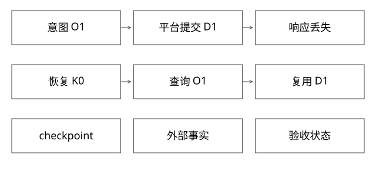

# Checkpoint与外部副作用恢复

检查点为什么不能单独保证恰好执行一次，恢复时究竟该相信谁？

源码基线：cloudwego/eino · v0.7.0。[固定源文件](https://github.com/cloudwego/eino/blob/18427c201b3315586802260f8b20a97f6b008e8b/adk/runner.go)。上层业务协议与该库机制分别说明。



## 三份状态可能不一致

编排状态记录执行到哪里；外部服务记录副作用是否发生；验收状态记录目标是否满足。checkpoint保存第一类的相应内容，不能自动与其他系统原子提交。

Eino Runner.handleIter在相应中断路径先尝试saveCheckPoint，保存失败会输出错误，但该分支未直接终止后续中断事件发送。因此收到中断不保证检查点持久化成功；更不是跨所有工具的分布式事务。下文给出具体源码纠正与失败时序。

## 完整推导：提交成功但返回丢失

```text
K0：记录意图O1
平台：O1已创建部署D1并提交
进程崩溃：工具响应和后续checkpoint未保存
恢复K0：不知道D1的返回
按O1查平台 -> 找到D1 -> 继续等待与验证
```

若恢复逻辑新建O2，可能多发一次。若只根据旧checkpoint认定没执行，也会误判。事实核对是恢复协议的一部分，不是异常后的可选优化。

## 服务端幂等事务

单数据库域可用唯一operation_id，并在同一事务记录请求摘要与任务创建；冲突时核对摘要，返回已存在任务。若任务创建还调用另一个外部系统，应继续设计outbox、状态查询或下游幂等，不能把本地事务扩成全世界原子。

现有SQLite实验把本地创建放进一个事务，再故意丢响应；重试同键只保留1个部署。这是本地协议验证，不是生产分布式exactly-once证明。

## 崩溃矩阵

| 位置 | 恢复动作 |
|---|---|
| 意图未可靠保存 | 不应已执行不可恢复副作用；否则需额外对账 |
| 意图已存，平台未提交 | 同键重试或查状态 |
| 平台已提交，工具结果未存 | 查O1，复用事实 |
| 工具结果已存，评测未完 | 恢复原版本评测 |
| 报告已存，最终回复未送达 | 可重发报告，不必重新发布 |

把动作设成幂等，只解决某类重复；并发恢复者仍可能同时驱动同一个工作流，所以还要任务租约、epoch或状态条件更新。

## 中断与审批绑定

人工批准应绑定操作目标、环境、版本和摘要。审批后参数改变，不能继续沿用旧批准。恢复payload应传入正确中断组件，而不是随意在聊天里补一句“同意”并让所有等待操作继续。

序列化格式、组件地址、工具版本和代码升级影响checkpoint兼容。恢复失败应可解释并安全停止，不靠猜测旧字段含义。

## 验证与自测

故障应注入在提交前后、返回前后、保存前后，而不是只在函数入口随机抛异常。记录operation/task/checkpoint/served_release，检查重放后副作用次数与结果一致性。

本轮未运行Eino跨进程恢复；本地SQLite案例与新增验收模型已提供。

## 源码纠正：保存尝试的顺序不等于保存成功的门禁

固定版本Runner.handleIter遇到中断时调用saveCheckPoint；失败分支会gen.Send一个Err事件，但没有在该处return或continue，后面仍可能执行gen.Send(event)。所以“先保存，再发中断”只能描述调用顺序，不能推导出“收到中断事件就一定已有可恢复检查点”。

一个具体反例：存储写失败 → 消费者收到错误 → 随后收到中断 → 消费者只处理最后的中断并展示“可恢复”。此时恢复可能读不到检查点。上层必须处理错误事件，并核验恢复所需状态；不能用本篇的原有概括为该保证背书。这里是源码行为核对，不表示已经运行此故障的Eino集成实验。

## 用两条时间轴推导恢复协议

编排器和平台分别持久化，不能共享一条虚构的提交线：

| 时刻 | 编排器事实 | 平台事实 | 崩溃恢复时能做什么 |
|---|---|---|---|
| t0 | 保存O1与请求摘要H1 | 无本地已知结果 | 查询/同键提交 |
| t1 | 发出O1，尚无响应 | 原子提交O1→D1 | 不能创建O2重试 |
| t2 | 仍是旧checkpoint | D1运行中 | 按O1找到D1 |
| t3 | 保存D1及版本r2 | D1 READY | 核验落点，再评测 |
| t4 | 保存报告E1 | 外部发布已完成 | 重发报告不重发部署 |

检查点更频繁，只会缩小编排状态落后的窗口；在平台提交与下一次保存之间，窗口仍存在。要么两个系统真的同属一个原子域，要么通过稳定意图、幂等动作和事实核对恢复。不能口头把它们称为一个“大事务”。

## 查询不到为什么也不能马上判失败

网络超时、读副本延迟、查询服务故障，都可能导致暂时拿不到原操作。只有协议明确保证了查询可见性与原操作状态，才能据不存在作决定。更稳妥的恢复入口是同一业务键重复提交：服务端要么返回已有结果，要么安全创建一次；若平台没有这个能力，应承认人工核对或更弱保证。

幂等记录保留期也影响保证。原动作可能迟到一天，服务端去重键只留十分钟，重试就可能再次生效。去重保留、任务寿命、重试窗口和产物保留要共同设计；“唯一索引存在”不是无限期保证。

## 两个恢复者与迟到的旧执行

W1持有epoch7，暂停后租约过期；W2取得epoch8开始恢复。即使任务表拒绝W1再写状态，W1已经发出的外部请求仍可能到达平台。服务端稳定operation_id限制重复生效，必要时fencing拒绝旧epoch；只在编排器本地检查租约不够。

对固定同一发布意图，重试身份应稳定；对用户明确改变的新版本，则必须形成新的意图并重新授权，不能用旧operation_id覆盖内容。恢复、重试和改目标不要混成一个按钮。

## 检查点升级的兼容测试

保存旧版组件地址、状态schema、工具版本和关键事实引用，用新代码恢复时先判断能否解释；不能解释则迁移或拒绝。测试不只是在保存函数抛异常，还要覆盖写入成功响应丢失、重复恢复、旧代码迟到、目标被取消和幂等记录过期。期望结果是业务状态可核对且没有被旧执行悄悄推进，而非所有任务都一定自动成功。

## epoch要带作用域：不是越大的数字就能挡住一切

至少区分三件事：工作流执行租约、某个业务对象的修改代次、用户意图是否已取消。任务A的epoch8和任务B的epoch3没有天然顺序，拿一个全局max随便拒绝B会误伤合法任务；同一对象的比较还要求代次来源可靠、重启不倒退。

```text
W1：任务T/epoch7，准备发布O1
W2：任务T/epoch8，接管同一个O1
下游：O1幂等 → 限制同一动作重复生效
下游：对象A的fence检查 → 拒绝同作用域的迟到旧代次
意图库：T已取消 → 是否还允许首次生效，需要额外协议
```

幂等解决重复，fencing解决过期执行者，取消解决不再希望发生的动作，三者不能互相代替。同一epoch8发两次仍可能重复；O1首次到达时即使未被重复执行，也可能已经不该执行。参数摘要不应把同一意图重试时变化的worker租约混进去；租约作为执行准入信息单独校验，否则每次接管都会被当成新业务内容。

取消记录写进编排库，不能立刻阻止一个尚未得知取消的外部系统。若要求“取消确认后不能再首次启动”，必须把取消和执行准入放到同一可仲裁边界，或由接收方核对有效意图/授权租约，并定义已准入在途动作的语义。跨系统分区时不能同时无条件承诺立即取消和继续执行。做不到强取消，就返回“取消请求已受理，正在核对”，不要返回“外部动作肯定未发生”。

本地拒绝旧状态提交只保护本地记录；要保护外部制品指针或预算，校验必须发生在真正的生效端。已提交的动作如何补偿，是新的、可审计、也需幂等的业务动作，不是把checkpoint倒回去。

[模型](examples/source-level/expert_protocol_models.py)中的作用域测试表明A/epoch8不能阻止B/epoch3，同代次也不能去重；路由测试还刻意允许“取消已本地提交，但远端尚未得知”的窗口。承认该窗口，比测试全部写成成功更重要。

## 自测

checkpoint越频繁，是否能彻底消除重复？不能，只缩小某些窗口，外部原子域仍然分离。

## 补一层实现边界

恢复读操作不一定产生同类业务重复，但结果随时间变化，不能把重查日志当作原时刻快照。保存证据版本或查询时间，有助于解释恢复后结论为何变化。幂等约束效果次数，不自动保证两次读取相同。

[查看可编辑 SVG](assets/deep-points/41.svg) · [查看 PNG](assets/deep-points/41.png) · [返回知识点目录](实现详解_00_知识点目录.md)

