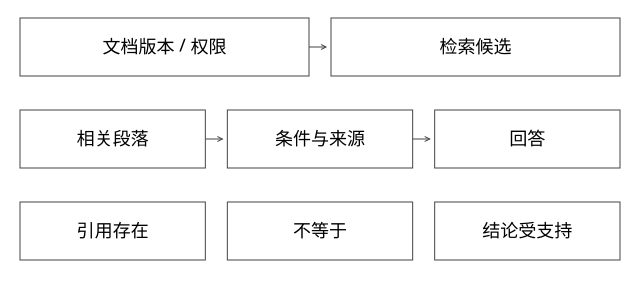

# RAG证据链与版本权限

向量命中了相关段落，为什么答案仍可能错误或越权？

源码基线：apache/lucene · releases/lucene/9.9.2。[固定源文件](https://github.com/apache/lucene/blob/a2939784c4ca60bc28bf488b5479c02fc2e5e22c/lucene/core/src/java/org/apache/lucene/search/AbstractKnnVectorQuery.java)。上层业务协议与该库机制分别说明。



## 离线和在线分别承担什么

离线解析文档、切分、生成embedding并建立索引；在线根据问题与权限检索，融合、重排、组织证据，再生成答案。读取实时日志API属于工具取事实，不能把所有上下文获取都叫文档RAG。

底层关键词与向量可参考Lucene，本篇上层证据协议是设计模型，不声称Lucene自动提供文档权限、引用支持或业务知识有效性。

## 一个chunk至少保留哪些归属

```text
doc_id / chunk_id / source_uri
document_version / effective_time / section_path
tenant / permission_scope
parser_version / embedding_model / index_version
content / content_hash
```

字段应按系统需要最小化，但不能只留向量和正文，之后完全找不回来源或有效版本。文档更新还需删除/替换旧chunk，不能只不断追加新版本而不约束查询。

## 完整推导：相关但错误的诊断证据

问题是SDK v2部署失败。检索返回v1文档：“参数名用timeout_ms”；v2实际使用另一个定义。如果只按相似度高低取第一段，回答可以很流畅却不适用。

应先限定合法权限与相关版本，或把版本冲突显式暴露，再按证据生成。找不到适用版本时，应报告缺口而非把旧资料包装成确定结论。

## 切分如何丢条件

一条规则是“仅测试环境可跳过校验”。若切分把“仅测试环境”放前块，“可跳过校验”放后块，召回后块可能产生危险建议。段落路径、父块扩展或重叠可缓解，但会增加token、重复和噪声。

chunk变大不必然更好；它可保留条件，也可能稀释局部相关性。评估应检查检索是否把决定性前提带进上下文，而不只看某个文档ID是否命中。

## 混合检索与权限时机

关键词擅长精确错误码、参数名，向量擅长语义相近；RRF或其他融合与重排可共同使用。权限过滤若只在生成后做，未授权内容可能已经进入模型上下文；如果先限制候选，则还要处理过滤后召回不足。

过滤后的候选与ANN图导航机制要分清，不能因底层访问节点就断言内容已经授权进入回答。证据通道的权限检查应有明确边界。

## 引用不等于蕴含

答案带一个URL，只证明存在引用，不证明那页支持这句结论。需要核验引用内容、版本和关键条件，区分检索错误、证据组织错误与生成越界。

文档中的命令或“忽略所有规则”是来源内容，不是用户指令。执行前仍走工具授权，不能因资料写了某条shell就自动运行。

## 验证与自测

评测至少分检索覆盖、证据有效性、答案支持与权限。构造旧版本高相关、相互冲突、无答案、跨租户、条件被切断等用例，比分别调topK更能发现真实失败。

本轮不假称已部署完整RAG服务。

## 手工走一条证据链，定位错在哪一层

用户在租户T1的测试环境排查SDK v2超时。知识库有四段：A为T1/v1旧参数；B为T1/v2测试环境参数；C为T2/v2内部说明；D为T1/v2且注明仅特定发布号适用。若向量排序是C、A、D、B，直接取第一段就已经越过了权限和版本条件。

先从可信认证上下文得到T1，再限制候选权限；版本和发布范围来自本次部署事实，不能让模型随便猜。B可能成为适用证据，D只有发布号满足时才可用。若B没有解释当前错误，则应继续取当前日志或报告知识缺口，不因为D“看起来更详细”就照搬。

| 失败位置 | 可观察证据 | 应改哪一层 |
|---|---|---|
| B根本未入库 | 解析/索引清单没有chunk | 摄取与更新 |
| B在库但候选没命中 | 候选列表缺B | 检索与过滤 |
| B已候选但被排到截断线外 | rerank前后排名与分数 | 重排或预算 |
| B进入上下文却遗漏适用条件 | 实际上下文片段 | 证据组织 |
| 条件完整但回答改成生产可用 | 逐句引用对应 | 生成与验收 |

这五种故障用不同修复。统一“增大topK”可能增加噪声和token，却不能修复漏入库或权限错误。诊断至少留查询身份、索引版本、候选ID、过滤原因、最终证据和回答支持关系；日志应受权限与脱敏约束，不保存全量敏感正文来换取可观测性。

## RRF算一次，避免把不同分数直接相加

关键词排名A第1、B第2；向量排名B第1、A第10。教学取常数k=60，不作为生产固定配置。A的融合分数为1/61+1/70≈0.03068；B为1/62+1/61≈0.03252，因此B排前。这里只利用名次，不能从这个分数读出“答案正确概率3.25%”。

两路都找不到的文档，融合不会凭空创造。某路只返回前K名，缺失项通常不贡献该路排名分；配置截断和去重规则也影响结果。融合后还可重排，但每加一步，都要检查决定性证据是否仍在最终上下文预算内。

## 缓存、删除与权限撤销必须贯穿全链路

缓存键只用query，可能把T1的检索答案复用给T2。键或隔离域至少反映授权范围、适用知识版本及影响结果的参数，并在权限变化时失效或重新检查。即使索引已删旧chunk，答案缓存、会话历史和报告引用也可能保留内容；数据治理不是一次delete API即可结束。

权限预过滤是把不允许的文档排除在返回候选之外；ANN内部为导航访问图节点，是另一层物理过程。它不自动等于明文已泄露给模型，但也不免除检索服务本身的安全边界。安全论证要说清谁能接触向量、正文和引用，不能靠“过滤在前”四个字包办。

## 从源码参照回到上层责任

Lucene的过滤向量查询可以帮助解释合法候选与近似/精确搜索分支，不负责上面的tenant身份、知识生效日期、回答引用或拒答策略。检索效果实验与安全测试分开：相关文档召回率提高，不能抵消一次跨租户泄露；答案有引用，也不能抵消适用条件被省略。

## 自测

引用正确文档但忽略“仅测试环境”是否通过？不通过，证据条件决定结论适用性。

[查看可编辑 SVG](assets/deep-points/42.svg) · [查看 PNG](assets/deep-points/42.png) · [返回知识点目录](实现详解_00_知识点目录.md)

