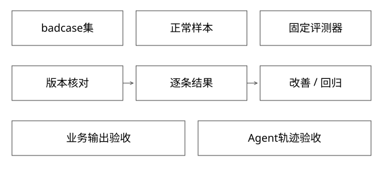

# badcase回归与Agent轨迹验收

修好了已知问题，怎样确认没有评错版本，也没有弄坏正常场景？

实现基线：本库可运行参考模型与工程协议，不冒充私有引擎源码。



## 两种被测对象要分开

业务评测检查候选版本的输出；工具链评测检查Agent是否正确选目标、发布、取证和报告。业务仍不通过但Agent准确发现并报告，可能是一次合格诊断；反之业务用例通过但实际评的是旧版，工具链不能算成功。

不能把业务badcase通过率直接作为Codex整体成功率。

## 固定一次评测的身份

```text
run_id
artifact / served_release
suite_version / case_id
environment / data_snapshot
evaluator_version
逐条输出、证据、PASS/FAIL/INVALID
```

INVALID表示这次测量无效，例如请求打错版本、依赖准备失败或评测器异常。它不能悄悄丢弃，也不能和业务FAIL完全混同。报告有效样本通过率时还需同时报有效覆盖。

## 完整推导：只修badcase却造成回归

基准r1：badcase0/2通过，正常3/3通过，总3/5。
r2：badcase2/2，正常3/3，总5/5。
r3：badcase2/2，正常2/3，总4/5。

只看badcase，r2和r3相同；逐条对比发现r3让正常N1退化。若按r1→r3，需同时报告B1/B2改善与N1退化，不能只写“提升了20个百分点”。

现有agent_delivery_eval_demo.py输出这三组结果，并将实际served_release不符的整次评测记为INVALID。

## 轨迹验收看必要约束，不锁死唯一序列

允许轮询或事件通知两种等待方式，但评测前必须核对目标可用，报告前必须有对应评测证据。可以将轨迹看成事件偏序，而不是唯一字符串序列。

```text
部署达到READY
  必须早于：核对served_release
核对成功
  必须早于：接受对应评测结论
```

一个Agent多查了一次日志未必失败；未经核对就宣称成功，即使最终碰巧版本正确，也违反过程约束。安全与质量可以分别打分。

## 生成型任务的裁判

字段和确定约束优先规则；开放质量可用人工、校准后的辅助模型与多维标准。裁判模型也会偏向格式、长度或某种措辞，应与人工样本对照，固定版本并记录分歧。

同一个模型既生成又凭一句自我评价打满分，不能算可靠验收。工具日志也只证明动作事实，不证明答案质量。

## 数据集扩展与污染

badcase来自已知失败分布，适合回归，但不能代表全部线上流量。加入代表性正常样本和不同难度分层；保留未用于反复调Prompt的验证集，避免把记住题目当成泛化。

敏感请求和日志需脱敏，且保留足以复现的版本与配置。去掉关键上下文后不能复现，应明确样本限制，而不是编造确定预期。

## 验证与自测

本地实验校验响应丢失重试、逐条改善/退化和错误版本INVALID。新增轨迹模型只检查事件约束，不是假称已评测真实Codex任务集。


## 评测器本身也要被评测：算一张混淆表

将“裁判允许通过”定义为正类。假设人工复核100条，其中80条业务合格、20条不合格；辅助裁判给出的结果如下，数字只用于推演：

| | 人工合格80 | 人工不合格20 |
|---|---|---|
| 裁判通过78 | 72 | 6 |
| 裁判拒绝22 | 8 | 14 |

总体一致率为(72+14)/100=86%，但漏放不合格结果的比例是6/20=30%；被裁判放行的结果中，正确比例为72/78≈92.3%。这三个分母不同，不能用86%一致率遮住30%漏放。高风险操作的误放与低风险文案的误拒，代价也不同。

人工标注不是天然真理。先给清楚的rubric，用重叠样本检查标注者分歧；规则不明确时先澄清，不让模型裁判替产品定义目标。校准集确定阈值，保留集检验新样本；不能一边看测试答案调裁判，一边继续把同一集合称为独立验收。

## 把硬约束与开放质量分开判

营销文案可以有不同措辞，但商家身份、预算上限、禁售资格与是否已得到确认是硬约束。它们由规则/权威接口判定，不与“表达好看”求平均。一个答案文案9分、越权发券0分，不能平均成4.5分后勉强上线。

开放质量可拆为任务满足、事实支持、可读性等维度，给正反例和可复核理由。若用成对偏好比较，将A/B顺序调换再测，检查位置偏差；对异常长文与复制标准措辞的结果，检查裁判是否只偏爱形式。记录裁判模型、提示版本、规则与输入，升级裁判时重评基线。

不要求模型输出内部隐藏推理；保留简短可核验依据、引用片段或规则失败字段即可。重复运行同一模型可以暴露波动，却不自动消除共同偏差。

## 统计口径：同一批用例怎么比较

设100条里80条有效、72条通过。总样本通过占比为72/100=72%，有效样本通过率为72/80=90%，有效覆盖为80%。三者一起报告。若20条无效是环境故障，应修复后补测；若目标服务不满足规定超时，则应按可靠性FAIL，而不是归为无效并剔除。

版本比较优先保留同一case的配对结果：改善、退化、不变和不可比较。baseline不可执行、candidate可执行，不等于业务质量改善；评测器版本或依赖fixture变化时，也不能直接把两次汇总率相减。

badcase集合刻意包含失败，只能说明这些已知条件的回归。正常集、边界集、权限安全集与性能护栏分别检查；来自同一原始任务的改写应按组划分，避免在不同集合中泄漏。线上整体增益仍需要合适采样与业务实验，不从5条合成用例推断。

补充算例验证：[depth_review_models.py](examples/source-level/depth_review_models.py) 中的 test_rrf_judge_and_denominators 复算裁判四格表、误放行率及有效任务分母，不证明模型裁判可靠。

## 完整推导：从70%到80%，怎样判断不是汇总数字在骗人

对同一批100个独立任务，固定版本、用例和判定规则，记录配对结果：

| 基线/候选 | 候选通过 | 候选失败 |
|---|---|---|
| 基线通过 | 65 | 5（退化） |
| 基线失败 | 15（改善） | 15 |

基线70/100，候选80/100，净提升10个百分点，但关键差异来自15条改善与5条退化。若这些任务确实独立、判定为二元且只进行预先约定的一次比较，可在20条不一致任务上，用“改善/退化等可能”的二项模型做精确配对检验：双侧尾概率为2×Σ(k=0..5) C(20,k)/2^20≈0.04139。这是McNemar检验的精确二项形式，不是把两组当独立样本计算；精确与卡方近似的区别可对照[statsmodels官方说明](https://www.statsmodels.org/stable/generated/statsmodels.stats.contingency_tables.mcnemar.html)。

这个数不表示“候选有95.86%的概率更好”，也不保证10个百分点的增益可迁移线上。任务来自同一用户的大量改写、裁判相关错误、反复调参后挑最好一次，都会破坏这里的解释。预先固定主指标、样本单位、比较次数与停止规则；需要多轮观察时采用适当序贯/多重比较方法，而不是每轮p小于0.05就停。检验只是一项证据，5条退化若触犯安全硬约束，仍应拒绝上线。

## 300条没有越权，为什么仍不能说越权概率为0

假设每个独立、同分布任务的失败概率为p，300次都未失败的概率为(1−p)^300。令它等于0.05，得到单侧95%精确上界p=1−0.05^(1/300)≈0.9936%。这是二项模型下的置信上界，不是安全保证；把10条样本各重复30次，不能自动当成300个独立任务。

二项置信区间原理可对照[NIST说明](https://www.itl.nist.gov/div898/handbook/prc/section2/prc241.htm)。本篇的配对表和单侧零失败推导是自建算例，由[expert_protocol_models.py](examples/source-level/expert_protocol_models.py)复算，不是实际Agent评测成绩。

工程上仍要实施服务端授权和禁止动作拦截；统计抽样用于发现与估计风险，不替代权限边界。安全用例、正常回归、代表性质量与时延成本分别门禁，不与总通过率加权平均抵消。

## 自测

有效样本5/5但100条中只有5条有效，能否只写100%通过？不能，应同时报告5/100有效覆盖与失败原因。

[查看可编辑 SVG](assets/deep-points/43.svg) · [查看 PNG](assets/deep-points/43.png) · [返回知识点目录](实现详解_00_知识点目录.md)

