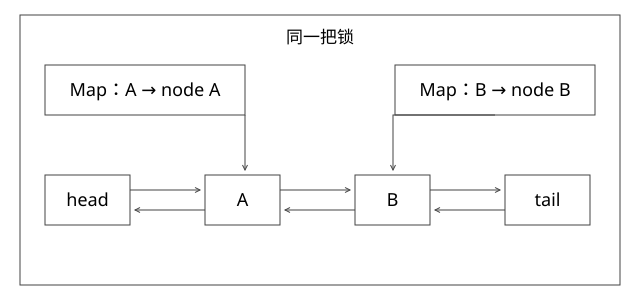

# 手写线程安全LRU与指针不变量

固定实现入口：[HashMap.java · jdk-17.0.14+7](https://github.com/openjdk/jdk17u/blob/c5c90ffa45d0c14bcb013164f0992938eb4740ab/src/java.base/share/classes/java/util/HashMap.java)。



## 结论与实现契约

严格LRU可以用HashMap定位节点、双向链表维护顺序、一把锁保护两者的整体变化。get命中也是写链表，不能当纯读；更新已有key也必须提升顺序。完整实现见[HandwrittenLru.java](examples/source-level/HandwrittenLru.java)，没有使用LinkedHashMap。

本实现拒绝null键和值，get未命中返回null，容量0接受put但不保留，负容量构造失败。值对象自身可变性的线程安全不属于缓存容器自动保证的范围。

## 先确定指针不变量

链表头部为最近使用，尾部为最久未使用。head/tail是永不放入Map的哨兵：

```text
head <-> A <-> B <-> tail
index[A] = 节点A
index[B] = 节点B
每个有效节点恰好出现一次；Map与链表集合相同
```

unlink先让node.prev.next指向node.next，再让node.next.prev指回node.prev。addFirst先保存旧首节点关系，再接回head。不能一边改next一边丢失旧节点；哨兵使删除唯一元素和删除头尾走同一逻辑。

## 关键代码的保护范围

```text
get(k)，持同一把锁：
  查Map，未命中直接返回
  命中则unlink + addFirst，返回value

put(k,v)，持同一把锁：
  已有节点：改value + 移到首部
  新节点：加入Map与链表
  超容量：取tail.prev，链表与Map都删除
```

HashMap不必另外换成ConcurrentHashMap，因为全部容器访问都在同一锁下。仅把Map操作变成原子、链表操作另加锁，不能保证跨结构不变量。

## 完整推导：更新与淘汰交错

容量2，初始A,B，其中B较新。get(A)后变A,B；put(C)后变C,A，B从Map和链表同时消失；put(A,v2)后变A,C。若最后一次只更新value而不提升，则后续淘汰错误。

并发T1 get(A)、T2 put(C)时，共同临界区只允许两种合法串行化。T1先则A被提升后淘汰B；T2先且A本来最旧，则A可能已被淘汰，T1必须未命中。不存在“Map查到A，A被淘汰后又重新挂成幽灵节点”的中间可见操作。

## 线性化点和复杂度

一次操作的Map与指针更新对其他操作不可见地在锁内完成，可选择临界区中满足顺序语义的时刻作为线性化点。互斥与顺序实现共同建立论证，不能靠压力测试无报错直接宣布线性化。

平均get/put为O(1)，依赖HashMap的哈希分布与key成本；最坏情况不能无条件当常数。调试快照和checkInvariants为O(n)，不应纳入每次生产操作的性能承诺。

## 扩展时最容易破坏什么

不要在全局锁中执行远程loader，慢I/O会阻塞所有key。按key合并加载任务，需要占位Future、失败清理和超时契约，是另一个机制。分段、异步访问记录能降低竞争，但改变严格全局LRU语义，应说明可以接受的近似淘汰。

容量按条数限制，也不等于按字节限制；一个值几MB时仍可压垮内存。TTL与LRU是两种维度，过期失效和容量淘汰需要共同定义。

## 自测与验证

[CoverageMechanics.java](examples/source-level/CoverageMechanics.java)执行10万步独立顺序模型对照、容量边界和8线程指针/集合不变量检查。并发测试不是全历史线性化验证器，正确性仍依赖锁范围与上述串行化推理。

如果put超容量只摘链尾、不删除Map，下一次get会发生什么？可能取回不在链表的旧节点并破坏摘挂；必须同时维护两种索引。

[SVG](assets/deep-points/44.svg) · [PNG](assets/deep-points/44.png) · [返回知识点目录](实现详解_00_知识点目录.md)

