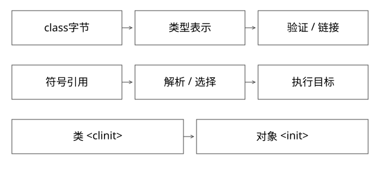

# JVM加载验证准备与符号解析

固定实现入口：[classFileParser.cpp · jdk-17.0.14+7](https://github.com/openjdk/jdk17u/blob/c5c90ffa45d0c14bcb013164f0992938eb4740ab/src/hotspot/share/classfile/classFileParser.cpp)，[verifier.cpp · jdk-17.0.14+7](https://github.com/openjdk/jdk17u/blob/c5c90ffa45d0c14bcb013164f0992938eb4740ab/src/hotspot/share/classfile/verifier.cpp)，[linkResolver.cpp · jdk-17.0.14+7](https://github.com/openjdk/jdk17u/blob/c5c90ffa45d0c14bcb013164f0992938eb4740ab/src/hotspot/share/interpreter/linkResolver.cpp)。



## 结论：四类动作不能混成“实例化”

加载从class字节建立类型表示；链接包含验证、准备与解析；类初始化执行适用的`<clinit>`；创建对象还涉及分配、默认值与实例构造器`<init>`。得到Class对象不必执行静态块，类初始化也不是给每个实例调用构造器。[JVMS 17 第5章](https://docs.oracle.com/javase/specs/jvms/se17/html/jvms-5.html)定义这些边界。

下面以固定HotSpot源码解释实现，阶段是逻辑职责，不承诺一次把所有常量池项立即解析完。

## 字节进入VM后先检查什么

ClassFileParser::parse_stream处理版本、常量池、父类型、字段、方法和属性等表示。坏格式可能在建立可用类型前就失败；不是任意byte[]都能define为一个类。

加载还要建立定义加载器关系和Class镜像等运行时状态。class文件常量池中的方法引用保存类名、方法名、描述符等符号，不是编译时已经知道的最终机器地址。

## 验证与准备分别维护什么

InstanceKlass::link_class_impl在相应协调下进入verify_code，调用Verifier::verify，并衔接字节码重写、link_methods、vtable/itable初始化及加载约束检查。

验证关注字节码与类型约束，不执行用户的正常业务初始化逻辑；准备建立静态存储和相关默认状态。实现中字段布局、镜像创建与规范阶段存在配合，不能机械地把每项内存分配都定位到同一行。

## 完整推导：两个静态字段与一个对象

```java
class Example {
    static int n = compute();       // 不是编译期常量
    static final int LIMIT = 7;     // 常量值有专门规则
    int value = 3;
    Example() { value = 4; }
}
```

对非编译期常量n，默认状态不是compute()的结果；主动初始化才执行其初始化逻辑。LIMIT的常量值处理不能概括成“所有static final都提前求值”，例如static final Object=new Object()仍需要相应初始化。

new Example并不只是初始化类：若类型尚需初始化先协调类初始化，随后实例内存初始化、执行父/本类构造链。把`<clinit>`与`<init>`说反，会导致无法解释静态块一次、构造器多次的现象。

## 符号解析为什么不是“替换一个绝对地址”

LinkResolver::resolve_method、resolve_field按符号、类型层级、访问与指令约束找到运行时目标信息。invokevirtual还涉及接收者类型上的方法选择；JIT编译和内联缓存又可改变机器执行形式。

因此“链接就是把方法地址写回对象，随后实例化”不准确。解析可延迟到首次需要某项时，NoSuchMethodError也可能在某条路径第一次真正调用时才暴露。

## 失败怎样定位到阶段

| 现象 | 首先核对 |
|---|---|
| ClassFormatError/版本不支持 | 产物格式与编译目标 |
| VerifyError | 字节码约束、增强/转换链 |
| NoSuchMethodError | 编译时签名与运行时实际定义 |
| ExceptionInInitializerError | 最早静态初始化原因 |
| 同名类不能互转 | 定义加载器与公共契约归属 |

这是一条诊断入口，不是仅凭异常名即可断定唯一原因。代理增强、模块访问和间接依赖都可能参与。

## 自测与验证

已有DeepStateTransitions验证load不等于initialize、递归可见默认值与失败状态；BinaryCompatibilityLab验证符号签名不匹配。两者结合比背阶段名更能检查模型。

JDK8的扩展加载器与JDK17的平台加载器名称/实现不同，不应混用“ext目录加载所有平台类”的旧描述。哪些阶段先于初始化、哪些符号可延迟，要回答规范边界，而不是编一个固定时间表。

[SVG](assets/deep-points/45.svg) · [PNG](assets/deep-points/45.png) · [返回知识点目录](实现详解_00_知识点目录.md)

