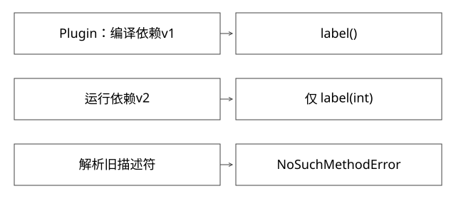

# 依赖版本与Java二进制兼容

固定实现入口：[linkResolver.cpp · jdk-17.0.14+7](https://github.com/openjdk/jdk17u/blob/c5c90ffa45d0c14bcb013164f0992938eb4740ab/src/hotspot/share/interpreter/linkResolver.cpp)。



## 结论：隔离身份与二进制兼容是两回事

每版本一个ClassLoader可以隔离私有实现，但不能让调用者编译时期待的方法凭空出现在公共依赖中。共享API、跨加载器参数、运行时依赖来源与方法描述符必须有兼容契约。

Maven的scope和依赖仲裁主要决定相应构建阶段的依赖集合；provided不等于运行环境必然提供兼容版本。[依赖机制文档](https://maven.apache.org/guides/introduction/introduction-to-dependency-mechanism.html)可用于核对scope、传递与仲裁规则，运行期事实还须另查。

## 完整推导：编译成功，运行才报错

```text
Api v1：String label()
Plugin编译成对 Api.label:()Ljava/lang/String; 的调用
运行容器只提供Api v2：String label(int mode)
加载Plugin成功，不代表调用已成功
执行该调用时，运行期找不到原描述符 -> NoSuchMethodError
```

方法描述符包含参数与返回类型等信息。只看到两边都叫label，或两个jar都叫api.jar，不足以证明二进制兼容。新增重载保留旧签名与删除旧签名，是不同升级。

## 私有依赖与公共契约怎样划界

父层定义共享Contract及跨边界DTO，子层可定义自己的内部库。若DTO也各自加载，宿主可能无法接收看似同名的对象。若库参与SPI、序列化、反射、线程上下文加载，又不能仅按包名前缀武断隔离。

```text
父层：Contract / 公共DTO / 明确共享依赖
L1：Plugin1 + 私有lib版本1
L2：Plugin2 + 私有lib版本2
```

共享减少重复元数据，但扩大升级影响面；全私有降低部分依赖冲突，却增加内存和跨边界约束。不存在一个“全部下沉”或“全部child-first”通吃的策略。

## 准入应检查什么

保存源码commit、编译器目标、依赖锁/解析清单、制品摘要、平台API版本及入口签名。编译后可检查重复公共类、禁止的覆盖包、依赖收敛和最低运行版本，再在匹配运行基线的环境加载并执行兼容用例。

只做编译检查看不到所有反射路径；只做入口new实例也可能没有触发后来才解析的方法。需要覆盖关键运行路径，并把未覆盖风险纳入灰度。

## 异常与证据分开处理

ClassNotFoundException通常是显式加载未找到；NoClassDefFoundError可能是依赖缺失或此前初始化失败；ClassCastException关注类型身份；IllegalAccessError关注运行时访问/兼容。先取最早cause，打印实际类的定义加载器与CodeSource，再比制品清单。

不要在生产不断改父优先规则试运气：这可能让不同路径取到不同版本，原错误消失却引入另一种链接约束问题。

## 升级和回滚的闭环

公共API可采用兼容窗口，先加后用再删；跨版本DTO需容忍字段演进或用明确序列化协议；重大破坏性变更可使用新的运行基线，而非强行让所有旧模块混跑。回滚应绑定代码、配置与状态，不只换jar。

[BinaryCompatibilityLab.java](examples/source-level/BinaryCompatibilityLab.java)在临时目录编译v1接口与Plugin，再让Plugin面对破坏性v2，验证真实NoSuchMethodError；保留旧方法的兼容版本则成功。它验证Java链接行为，不宣称测试了内部平台全部依赖。

## 常量内联：没有链接异常也可能语义不一致

公共API v1包含编译期常量static final int LIMIT=7，旧客户端编译时可能把7直接放进自己的字节码。运行时只更换API，把LIMIT改成9，不会保证旧客户端自动读到9；这与找不到方法描述符的NoSuchMethodError是不同问题。

因此兼容不只是“类能加载、方法还在”。还包括常量、枚举、异常行为、默认值与序列化语义。若值本来就需要随平台配置改变，应使用明确的查询/配置契约，而不是把可变业务参数作为编译期常量发布。

验收可以对旧客户端class运行javap，检查它是常量加载还是getstatic，再与重新编译客户端对照；这一步是建议实验，当前BinaryCompatibilityLab只验证方法描述符变化，不把它写成已覆盖常量内联测试。

## 自测

“同名类由不同loader定义”为什么不能用来证明公共库升级一定没问题？因为调用引用最终仍受共享契约与运行期签名约束。provided减少包体，不负责替你验证部署环境。

[SVG](assets/deep-points/46.svg) · [PNG](assets/deep-points/46.png) · [返回知识点目录](实现详解_00_知识点目录.md)

