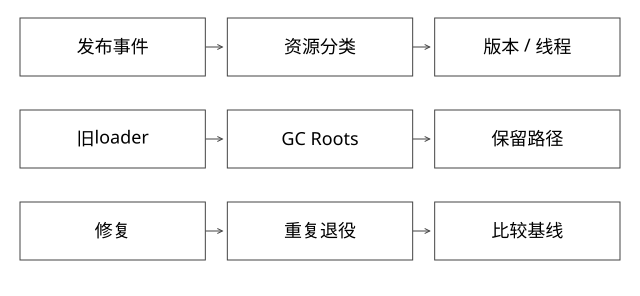

# JVM泄漏与资源故障取证

固定实现入口：[classLoaderDataGraph.cpp · jdk-17.0.14+7](https://github.com/openjdk/jdk17u/blob/c5c90ffa45d0c14bcb013164f0992938eb4740ab/src/hotspot/share/classfile/classLoaderDataGraph.cpp)，[metaspaceArena.cpp · jdk-17.0.14+7](https://github.com/openjdk/jdk17u/blob/c5c90ffa45d0c14bcb013164f0992938eb4740ab/src/hotspot/share/memory/metaspace/metaspaceArena.cpp)。



## 结论：先确定增长在哪个内存域

堆对象、Metaspace、直接内存、线程栈、代码缓存、文件映射和容器统计不能混为“内存高”。CPU高也不能直接断定死循环，先区分忙计算、GC、锁竞争、I/O等待与配额throttle。

诊断目标是建立“哪个版本、何时变化、哪条资源/引用链持续保留”的证据，而不是只找最大的类或重启后看暂时恢复。

## 完整推导：卸载后RSS不降

```text
发布V2 -> V1摘流 -> 在途已结束
ClassLoader V1仍活着 -> 查GC Roots
宿主定时任务捕获V1对象 -> 取消并断开引用
合适回收后旧类卸载、Metaspace used回落
RSS仍较高 -> 继续查committed、分配器和其他native域
```

若used本已回落，就不能仅用RSS证明卸载仍失败。反过来，清掉一个大缓存也不能证明所有旧加载器已释放；需要观察版本退役后的数量基线。

## 先轻后重地取证

以下是对已获授权目标、匹配JDK的命令示意，本轮没有对真实服务执行：

```text
jcmd <pid> help
jcmd <pid> VM.classloader_stats
jcmd <pid> VM.native_memory summary
jcmd <pid> Thread.print
```

NMT需要相应启动配置，例如NativeMemoryTracking；未启用就不能补出过去的分类数据。baseline与summary.diff可比较native变化，但并不覆盖所有外部库或每类OS费用。

GC.class_histogram、heap dump、JFR采集与详细日志各有暂停、I/O、CPU或数据暴露成本；先看help与现场预算，不在拥塞时反复全量dump。堆文件可能包含凭据与用户数据，应限制存储、传输和保留。

## 类加载泄漏看什么引用

重点找退役loader到GC Roots的路径：长期线程TCCL、ThreadLocal value、父层静态缓存、回调、定时任务、未完成Future。某个业务对象小，也可能让整批版本类和资源不能退役。

“类直方图中业务对象不大”不排除loader泄漏；“调用URLClassLoader.close”也不证明类卸载。普通GC可达性与元数据arena提交粒度要分别解释。

## CPU与容器资源怎样关联

Linux可按线程采样CPU，再和Java线程dump中的线程标识核对；保留多次时间样本，避免把某一瞬间正在运行的线程误判为长期热点。高GC时间、对象分配激增和业务热点方法需要不同处置。

容器还要看cpu.stat、内存限制、OOM事件、节点压力。宿主CPU低而容器频繁throttle时，扩大线程池可能更糟。不要把JVM最大堆等同容器全部内存预算。

## 从止血走到验证

高风险版本可先停止新流量、必要时回退；重启属于恢复手段，应保留最小证据并检查是否会触发缓存冷启动或下游风暴。根因修复后重复发布/退役循环，比较回收后基线、旧loader数量、类卸载和关键接口尾延迟。

设告警时既看绝对水位，也看增长斜率与部署事件；只用“达到80%就重启”可能掩盖持续泄漏，也可能误杀本来合理的缓存增长。

## 自测

一个旧loader能否通过很小的ThreadLocal值被保留？能。重启后恢复能否证明泄漏已解决？不能。验证应从保留路径和多轮稳态趋势闭环，不把一次系统快照当因果证明。

[SVG](assets/deep-points/47.svg) · [PNG](assets/deep-points/47.png) · [返回知识点目录](实现详解_00_知识点目录.md)

