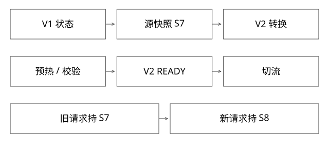

# 热更新状态迁移与版本预热

本文为本库可执行参考协议，不冒充内部平台源码。



## 结论：新代码可运行，不代表旧状态已经可用

版本中的静态List、字典、缓存、模型与连接都有自己的生命周期。两个加载器定义的同名State不是同一种Java类型；新增字段后直接把旧对象强转或浅复制，不会自动完成语义迁移。

更稳妥的协议是区分不可变共享数据、版本私有状态与外部权威状态，再定义快照、迁移、预热和回滚。把状态下沉父层只改变归属，不自动解决兼容。

## 完整推导：两万条字典新增字段

```text
V1：Entry{id,name}
V2：Entry{id,name,category}
源快照 S7：记录与schema确定
准备V2：由S7重新解码/转换，补category规则
校验V2：条数、版本、关键内容、查询用例
V2 READY后切路由；V1保持服务直到排空
```

若category依赖实时外部数据，不能靠Java字段默认null宣布迁移完成。迁移规则、缺省与失败处理必须对应业务语义。两万条很小还是很大，应看字节、计算与外部调用，而不是只看数量。

## 三种状态处理方式

| 状态 | 可选策略 | 代价与边界 |
|---|---|---|
| 不可变、跨版本兼容字典 | 父层共享快照句柄 | 更新与引用生命周期仍要管 |
| 版本私有且可重建 | 新版本重新加载/预热 | 启动时间与源压力增加 |
| 持续变动、有副作用状态 | 外置权威存储或显式迁移 | 需要并发更新与一致性协议 |

共享DictionaryService暴露稳定DTO或只读查询，比让所有模块拿到可变全局List更易约束。若返回值依旧由不同loader定义，接口稳定也未必保证类型可交互。

## 预热不是多打一条健康检查

至少验证依赖可连、必要配置/模型/字典已就绪、关键路径可执行及实际制品版本正确。liveness只说明进程活着，readiness也应按服务能力定义，而非“端口已开”。

预热流量不能产生真实业务副作用。缓存批量重建应限速并随机化，避免几十个新Pod同时把源存储打满。

## 持续增量怎样接上

若字典在构建期间更新，需固定快照边界和增量位置，按实体版本应用，再验证目标水位；否则新版本刚切上可能比旧版更旧。不可变快照可用原子引用切换，已有请求继续持原快照，避免一次请求前半用S7后半用S8。

这与全量索引切换的原理相同，但字典字段兼容、索引schema与模型版本还应分别记录。

## 回滚为什么可能失效

V2若已把外部数据改为V1不认识的新格式，切回旧代码可能读失败。应采用兼容窗口、双读/双写或可逆转换等策略，并明确最终清理时点。不能把“旧jar还在”作为完整回滚能力。

本篇是平台协议参考，不声称原系统实现了自动对象迁移。新增模型核对快照/schema绑定与兼容门槛；真实字典加载时间与内存峰值需部署实验。

## 双版本预热时，峰值为什么比常驻开销更大

假设旧版字典对象驻留200MiB，新版最终也是200MiB，但转换过程还需150MiB解码与临时结构。两版共存时，仅这些对象就可能达到550MiB；旧版排空后才可能逐步下降。这里是指定输入的预算手算，不代表JVM RSS等于对象大小之和。

若十个版本同时预热，源读取和临时内存还会叠加。可限制并行预热、复用真正不可变且兼容的数据、按阶段释放临时对象，并为回滚保留独立余量。以“新版稳态只有200MiB”设置容器上限，可能在上线前就OOM。

验收需分别观察构建/解码峰值、READY后稳态、双版并存和旧版退役后基线。共享缓存若在父层保留所有版本，又可能让峰值变成长期占用；优化共享与卸载契约必须一起看。

## 自测

预热查询命中缓存是否证明真实依赖可用？未必。探针应覆盖关键路径与允许的依赖访问方式，并记录使用的快照、schema和配置摘要，避免热缓存掩盖新版本实际无法访问源数据的问题。

旧List引用交给新loader，是否可以靠反射把新字段变出来？不能据此建立正确的类型/数据迁移。新旧两套状态同时预热时，资源估算还必须包含暂时的双份驻留。

[SVG](assets/deep-points/48.svg) · [PNG](assets/deep-points/48.png) · [返回知识点目录](实现详解_00_知识点目录.md)

